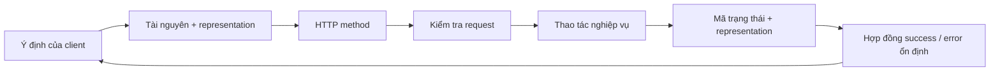
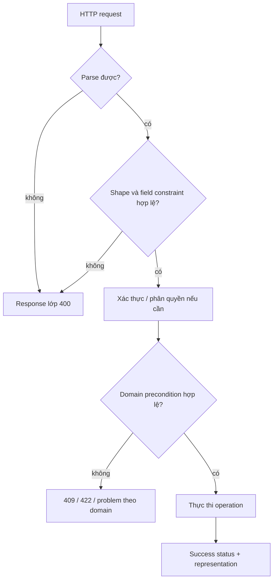
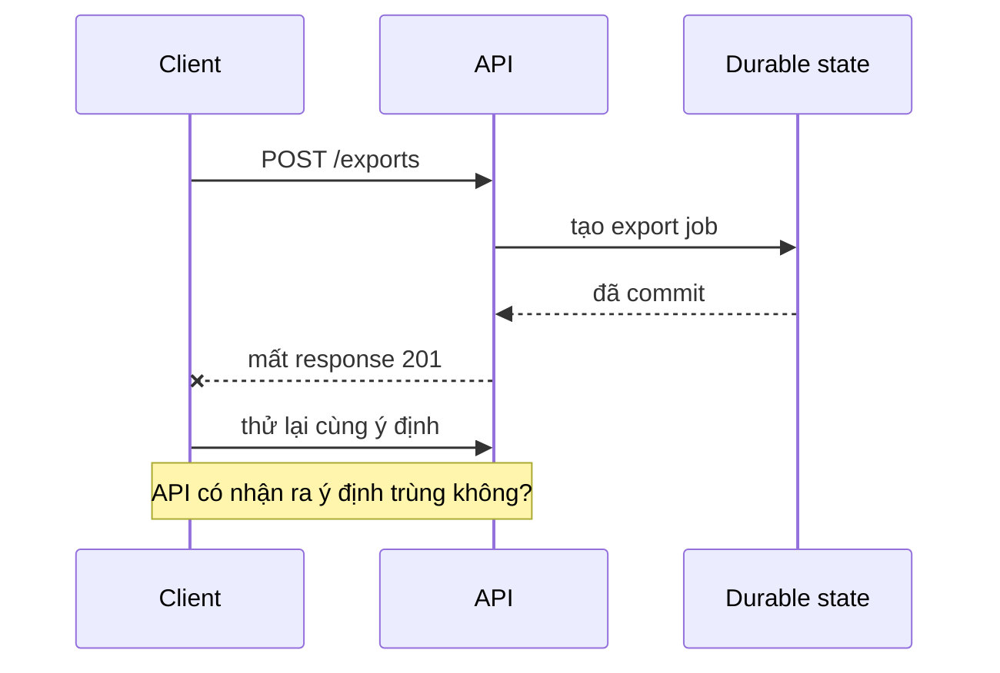

## Tóm tắt nhanh và tình huống minh họa

**Tình huống giả định (không phải sự cố đã được xác minh):** Backend đổi `tracking_url` thành `tracking.url` và đổi trường `status` từ chuỗi thành đối tượng. Phiên bản ứng dụng di động cũ dùng bộ giải mã dữ liệu nghiêm ngặt có thể không đọc được phản hồi mới cho đến khi được cập nhật. Server vẫn có thể hoạt động bình thường, nhưng người dùng phiên bản cũ gặp lỗi ở màn hình chi tiết đơn hàng. Ví dụ này không khẳng định số người dùng bị ảnh hưởng, thời gian gián đoạn hay tỷ lệ uptime thực tế. Khả năng cập nhật ứng dụng phụ thuộc vào nền tảng và cách phát hành.

HTTP API tạo ra **hợp đồng kỹ thuật** giữa các hệ thống được triển khai độc lập; bản thân API không mặc nhiên là hợp đồng có hiệu lực pháp lý. Client dựa vào biểu diễn tài nguyên, ngữ nghĩa HTTP, cách kiểm tra dữ liệu, mã lỗi, phân trang, quy tắc thử lại và chính sách tương thích. RFC 9457 đưa ra một định dạng tùy chọn cho lỗi HTTP mang tên Problem Details và **thay thế RFC 7807**. API vẫn có thể dùng định dạng lỗi ổn định khác nếu được công bố rõ ràng.



> 💡 **Quy tắc bỏ túi:** Hợp đồng API tồn tại lâu hơn một lần triển khai server. Ưu tiên thay đổi tương thích, mô hình lỗi rõ ràng và phân trang nhất quán; nếu cần thay đổi phá vỡ tương thích, hãy có ranh giới phiên bản, kế hoạch chuyển đổi và giai đoạn cùng tồn tại.

### Những quyết định quan trọng trong hợp đồng
- **Hợp đồng quan trọng hơn triển khai:** Ưu tiên tài nguyên ổn định (`/orders/{id}`) thay vì vô tình đưa tên hàm nội bộ ra ngoài (`/doCreateOrder`). Giữ đúng ngữ nghĩa an toàn (safe) và tính lặp lại không đổi tác động dự kiến (idempotent) của các HTTP method.
- **Mô hình lỗi nhất quán:** Ưu tiên Problem Details theo RFC 9457 hoặc một định dạng lỗi ổn định được công bố rõ ràng, thay vì thông báo tùy tiện. RFC 9457 thay thế RFC 7807; các trường `type`, `title`, `status`, `detail`, `instance` không bắt buộc có đủ, và `type` mặc định là `about:blank` nếu bị bỏ qua. Client nên dựa vào mã định danh ổn định thay vì câu chữ lỗi.
- **Phân trang có giới hạn:** API danh sách cần thứ tự rõ ràng và giới hạn kích thước trang phù hợp. Cursor/keyset pagination có thể giảm chi phí của offset lớn, nhưng tự nó không bảo đảm tránh trùng hoặc thiếu bản ghi khi có ghi đồng thời. Bảo đảm thực tế phụ thuộc vào thứ tự ổn định và chính sách nhất quán/snapshot.
- **Tương thích ngược:** Client có tốc độ cập nhật khác nhau. Đổi tên trường, đổi kiểu dữ liệu hoặc bắt buộc thêm input thường làm hỏng caller cũ; hãy mở rộng tương thích hoặc đưa thay đổi vào phiên bản mới có kế hoạch chuyển đổi và kiểm tra giai đoạn cùng tồn tại.
- **Rủi ro lớn:** Đổi schema phản hồi hoặc thắt chặt validation có thể làm phiên bản client cũ lỗi. Mức độ ảnh hưởng phụ thuộc vào từng phiên bản và cách giải mã dữ liệu; cần kiểm thử tương thích và theo dõi khi triển khai.

<TermBox term="Hợp đồng API">
**Hợp đồng API** là tập quy tắc bên sử dụng có thể dựa vào: mã định danh, trường yêu cầu và phản hồi, ngữ nghĩa phương thức HTTP, mã trạng thái, mô hình lỗi, thứ tự kết quả, phân trang và quy tắc tương thích.

**Tại sao quan trọng:** refactor phía server chỉ thực sự nội bộ khi nó giữ nguyên hợp đồng mà client đang quan sát.
</TermBox>

## 1. Bắt đầu từ tài nguyên và ý định của client

RFC 9110 mô tả HTTP là giao diện thống nhất để tương tác với tài nguyên thông qua cách biểu diễn của chúng. Không phải API nào cũng phải theo khuôn mẫu REST cứng nhắc; điều quan trọng là tài nguyên đích và ý nghĩa thao tác phải rõ ràng.

Ưu tiên tên tài nguyên là khái niệm nghiệp vụ ổn định:

```text
/orders/{order_id}
/customers/{customer_id}/addresses
/exports/{export_id}
```

Thận trọng với route chỉ phản chiếu tên hàm triển khai:

```text
/doCreateOrder
/runCustomerAddressUpdate
/getExportStatusNow
```

Endpoint mang tính hành động vẫn có thể hợp lý khi thao tác là một domain command độc lập, ví dụ:

```text
POST /orders/{order_id}/cancel
POST /accounts/{account_id}/rotate-key
```

Câu hỏi quan trọng không phải “URL có động từ không?” mà là: **client có dự đoán được ý nghĩa, state transition, ranh giới phân quyền và hậu quả khi thử lại hay không?**

## 2. Dùng HTTP method đúng ngữ nghĩa

RFC 9110 định nghĩa ngữ nghĩa cho các method chuẩn. Đừng coi method chỉ là vỏ vận chuyển cho cùng một kiểu handler.

| Method | Ý nghĩa API thường gặp | Thuộc tính quan trọng |
| --- | --- | --- |
| `GET` | Đọc representation hiện tại | Safe và idempotent |
| `POST` | Yêu cầu target xử lý content gửi lên | Không idempotent theo method semantics |
| `PUT` | Thay thế trạng thái/representation tại target đã biết | Idempotent |
| `PATCH` | Áp thay đổi một phần theo patch semantics mà API phải định nghĩa | Không tự động coi là retry-safe |
| `DELETE` | Loại bỏ association/trạng thái hiện tại của target | Idempotent theo method semantics |

Một phương thức HTTP có tính **lũy đẳng (idempotent)** không đòi hỏi các phản hồi giống hệt từng byte. Nhiều yêu cầu giống nhau phải có cùng tác động dự kiến như một yêu cầu.

Vì vậy, `DELETE` có thể trả `204` ở lần đầu và `404` ở lần sau mà vẫn lũy đẳng. Nhật ký, số liệu giám sát, bản ghi kiểm toán hoặc dấu thời gian cũng có thể khác. Tương tự, `GET` **an toàn (safe)** không yêu cầu thay đổi trạng thái nghiệp vụ, dù máy chủ vẫn có thể ghi log hoặc đo lường.

<TermBox term="Method idempotent">
Một **phương thức lũy đẳng** có cùng tác động dự kiến ở phía máy chủ khi thực hiện nhiều lần một yêu cầu như khi thực hiện một lần.

**Vì sao quan trọng:** bên sử dụng và hệ thống trung gian dễ suy luận về việc thử lại hơn khi ngữ nghĩa HTTP phù hợp với thao tác.
</TermBox>

### PUT và PATCH

Dùng `PUT` khi client gửi trạng thái thay thế mong muốn cho một target đã biết. Dùng `PATCH` khi API có mô hình partial update rõ ràng.

Tránh kiểu `PUT` nhập nhằng như “field bị thiếu hôm nay nghĩa là giữ nguyên, ngày mai lại nghĩa là xóa”. Hợp đồng như vậy không thể dự đoán ổn định.

**PATCH không mặc nhiên có tính lũy đẳng (RFC 5789).** Bản vá tăng bộ đếm có thể tăng thêm lần nữa khi thử lại; bản vá đặt một trường thành giá trị cố định có thể được thiết kế để lũy đẳng. Với thay đổi dựa trên phiên bản đã đọc, hãy dùng yêu cầu có điều kiện như `If-Match` kèm ETag mạnh và xử lý `412 Precondition Failed`, thay vì âm thầm ghi đè thay đổi đồng thời. Định dạng bản vá và cách xử lý xung đột phải được ghi rõ trong hợp đồng.

## 3. Mã trạng thái phải mô tả điều đã xảy ra

Mã trạng thái là một phần của response semantics. RFC 9110 định nghĩa các lớp và ý nghĩa để client quyết định bước tiếp theo.

Một số lựa chọn thường gặp:

- `200 OK` — request thành công và có representation/kết quả trả về;
- `201 Created` — tài nguyên mới đã được tạo; chỉ rõ tài nguyên đó, thường có thể dùng `Location`;
- `202 Accepted` — công việc đã được nhận nhưng chưa hoàn tất;
- `204 No Content` — request thành công và cố ý không có response content;
- `400 Bad Request` — request sai cú pháp hoặc không hợp lệ ở ranh giới input;
- `401 Unauthorized` — yêu cầu chưa có thông tin xác thực hợp lệ cho tài nguyên đích; theo RFC 9110, máy chủ **MUST** gửi header `WWW-Authenticate` chứa ít nhất một challenge phù hợp;
- `403 Forbidden` — server hiểu request nhưng từ chối hành động;
- `404 Not Found` — không tìm thấy tài nguyên đích; máy chủ cũng có thể cố ý dùng mã này thay cho `403` để không tiết lộ sự tồn tại của tài nguyên;
- `409 Conflict` — request xung đột với trạng thái hiện tại của tài nguyên;
- `422 Unprocessable Content` — hiểu được cú pháp content nhưng không thể xử lý instruction.

Đừng trả `200` cho mọi kết quả rồi giấu lỗi bên trong `{ "ok": false }`. Cách đó buộc bên sử dụng, proxy, hệ thống giám sát và SDK phải tự suy đoán kết quả thay vì dựa vào ngữ nghĩa HTTP.

Cũng đừng chọn status code chỉ vì framework helper thuận tiện. Hãy chọn mã mô tả kết quả quan sát được.

## 4. Kiểm tra đầu vào và quy tắc nghiệp vụ tại đúng ranh giới

Validation có ít nhất hai lớp:

1. **Kiểm tra hợp đồng:** yêu cầu có phân tích được cú pháp không, và dữ liệu có đúng cấu trúc cùng ràng buộc cơ bản đã công bố không?
2. **Kiểm tra nghiệp vụ:** thao tác có hợp lệ với trạng thái nghiệp vụ hiện tại không?



Ví dụ:

```text
Kiểm tra hợp đồng:
- thiếu field bắt buộc
- UUID sai cú pháp
- string vượt độ dài đã công bố
- enum value không hỗ trợ

Kiểm tra nghiệp vụ:
- order đã ship nên không thể cancel
- username đã được giữ
- trạng thái account không cho phép transition này
```

Đừng để database constraint error vô tình trở thành từ vựng lỗi công khai. Unique-key exception là bằng chứng triển khai; API vẫn cần ý nghĩa ổn định cho client.

## 5. Thiết kế một mô hình lỗi ổn định

Bên sử dụng không nên phải viết bộ phân tích lỗi riêng cho từng trường hợp thất bại.

RFC 9457 (**thay thế RFC 7807**) định nghĩa **Problem Details for HTTP APIs**, một cách tùy chọn để mô tả lỗi HTTP bằng cấu trúc máy có thể đọc. Ví dụ dưới đây gồm các trường tùy chọn:

```json
{
  "type": "https://example.com/problems/order-state-conflict",
  "title": "Order cannot be cancelled",
  "status": 409,
  "detail": "The order has already shipped.",
  "instance": "/orders/ord_123/requests/req_456"
}
```

Định dạng JSON sử dụng `Content-Type: application/problem+json`. Trường `status` chỉ có tính tham khảo, không thay cho mã trạng thái HTTP thực tế; `type` nhận diện loại lỗi (mặc định `about:blank`), còn `title` và `detail` dành cho người đọc. Client không nên phân tích `detail` để quyết định luồng xử lý. API có thể thêm trường mở rộng như lỗi kiểm tra dữ liệu hoặc mã lỗi nghiệp vụ.

<TermBox term="Chi tiết lỗi có cấu trúc">
**Problem details** là representation lỗi HTTP có cấu trúc theo RFC 9457, giúp client đọc failure bằng máy mà không cần mỗi endpoint tự tạo một error envelope khác nhau.

**Tại sao quan trọng:** mô hình lỗi ổn định làm client behavior, observability, documentation và evolution nhất quán hơn.
</TermBox>

Response lỗi cần đủ thông tin để client hành động, nhưng không nên lộ stack trace, SQL text, secret, internal hostname hay chi tiết triển khai nhạy cảm.

### Tách thông báo cho người đọc khỏi mã quyết định của client

Đừng để client branch theo chuỗi `message` tiếng Anh.

Ưu tiên machine field ổn định như `type` hoặc extension code đã document; `title` và `detail` có thể cải thiện câu chữ theo thời gian.

## 6. Phân trang là một phần của hợp đồng

API trả về danh sách mà không quy định cách xử lý khi dữ liệu tăng trưởng có thể sớm gặp vấn đề về độ tin cậy.

### Phân trang theo offset

```text
GET /orders?limit=50&offset=100
```

Ưu điểm:
- dễ hiểu;
- có thể nhảy tới trang tùy ý.

Đánh đổi:
- offset lớn có thể đắt tùy datastore;
- insert/delete đồng thời có thể làm kết quả dịch chuyển, tạo duplicate hoặc gap.

### Phân trang theo cursor

```text
GET /orders?limit=50&cursor=eyJ...
```

Ưu điểm:
- có thể bám stable indexed ordering;
- thường tránh được chi phí quét offset lớn nếu khóa sắp xếp có index; điều đó chưa bảo đảm có một snapshot cố định.

Đánh đổi:
- client thường không nhảy tới trang tùy ý;
- cursor trở thành một phần compatibility surface.

Hãy coi cursor là **opaque token** đối với client. Đừng bắt client decode payload base64 rồi tự dựng cursor kế tiếp. Server cần được phép đổi internal representation của cursor trong khi giữ behavior đã công bố.

Luôn xác định thứ tự ổn định và khóa phân biệt khi bằng nhau (ví dụ `created_at, id`), cùng với ý nghĩa của cursor. Ngay cả khi dùng keyset pagination, bản ghi bị sửa khóa sắp xếp giữa các request có thể chuyển vị trí hoặc xuất hiện nhiều lần. Nếu cần duyệt dữ liệu nhất quán, phải quy định snapshot hoặc cơ chế nhất quán tương đương. Chỉ nói “trả 50 dòng tiếp theo” là chưa đủ.

## 7. Thiết kế phải tính đến tương thích ngược

Khi các ứng dụng được triển khai độc lập, thay đổi API trở thành bài toán phối hợp triển khai giữa nhiều hệ thống.

Những thay đổi thường phá vỡ tương thích gồm:

- xóa hoặc đổi tên response field mà client đang dùng;
- đổi kiểu hoặc ý nghĩa của field;
- biến request field tùy chọn thành bắt buộc;
- đổi semantics của identifier;
- đổi ordering hoặc cách hiểu cursor;
- đổi từ xử lý đồng bộ sang bất đồng bộ mà không đổi contract;
- đổi visibility/authorization theo cách phá assumption đã document.

Additive change thường an toàn hơn nhưng không tuyệt đối. Thêm enum value mới vẫn có thể làm client cũ lỗi nếu nó giả định tập enum là exhaustive. Thêm nested field rất lớn có thể ảnh hưởng bandwidth hoặc parser limit.

Khi review compatibility, hỏi:

```text
Caller cũ có thể gửi gì?
Caller cũ mong nhận gì?
Generated SDK hoặc strict decoder đang giả định điều gì?
Client cũ và mới có cùng tồn tại trong rollout được không?
Có đo được usage của behavior cũ trước khi xóa không?
```

### Chỉ tạo phiên bản mới khi thực sự cần ranh giới tương thích

Versioning hữu ích khi có breaking contract có chủ đích, nhưng `/v2` không làm migration miễn phí. Vẫn cần coexistence, documentation, telemetry, deprecation policy và kế hoạch tắt version cũ.

Ưu tiên evolve một contract theo hướng tương thích khi khả thi. Tạo version boundary khi semantics thực sự không thể giữ tương thích ngược.

## 8. Hành vi thử lại thuộc về thiết kế API

Client có thể mất response sau khi server đã commit operation. Từ góc nhìn client, câu hỏi “đã xảy ra chưa?” trở nên nhập nhằng.



Method semantics giúp suy luận nhưng chưa đủ:

- thử lại method idempotent dễ reasoning hơn;
- `POST` có side effect có thể cần idempotency key ở application layer hoặc một natural deduplication identity nếu duplicate không chấp nhận được;
- retry policy vẫn cần timeout, backoff và quy tắc error nào được thử lại;
- idempotency key cần scope, persistence và so sánh với intended operation, không phải magic header.

Lesson này **không claim** canonical concept `idempotency`. Operating rule ở đây hẹp hơn: mọi API contract cần làm rõ hậu quả khi client thử lại.

## 9. Giữ xác thực, phân quyền, rate limit và caching ở đúng boundary

Thiết kế API tốt kết hợp với các concern lân cận nhưng không trộn semantics của chúng.

Với mỗi endpoint, cần document hoặc làm discoverable:

```text
yêu cầu xác thực
phạm vi phân quyền/tài nguyên
rate-limit behavior khi có
cacheability và validator khi có
idempotency / retry behavior
```

Nhưng mỗi concern vẫn có meaning riêng. `403` không phải rate-limit response. Cached representation không phải authorization decision. Idempotency key không phải authentication.

## 10. Tình huống giả định: thay đổi phản hồi làm ứng dụng di động cũ gặp lỗi

**Ví dụ minh họa, không phải báo cáo sự cố thực tế:** Một ứng dụng di động phiên bản cũ đang đọc:

```json
{
  "id": "ord_123",
  "status": "shipped",
  "tracking_url": "https://carrier.example/track/123"
}
```

Đội server refactor API và deploy:

```json
{
  "id": "ord_123",
  "status": { "code": "shipped", "label": "Shipped" },
  "tracking": { "url": "https://carrier.example/track/123" }
}
```

Web client mới vẫn chạy vì deploy cùng server. Các phiên bản di động cũ **có bộ giải mã nghiêm ngặt** có thể lỗi vì `status` đổi kiểu và `tracking_url` bị xóa; bộ giải mã linh hoạt hơn có thể xử lý khác.

**Hậu quả:** màn hình chi tiết đơn hàng có thể bị lỗi hoặc hiển thị thông báo lỗi cho người dùng chưa cập nhật ứng dụng, dù máy chủ vẫn hoạt động bình thường.

**Nguyên nhân cốt lõi:** nhóm phát triển coi việc đổi cấu trúc phản hồi của máy chủ là thay đổi nội bộ. Thực tế, tên trường, kiểu dữ liệu và cấu trúc phản hồi đã là hợp đồng mà ứng dụng cũ đang phụ thuộc.

**Cách khắc phục chuẩn:** giữ field cũ trong giai đoạn thêm field mới theo hướng tương thích, hoặc tạo version/migration boundary rõ ràng cho breaking representation. Đo usage của client cũ, document deprecation và chỉ xóa behavior cũ sau khi compatibility window được đóng có chủ đích.

Bài học không phải “không bao giờ đổi JSON”. Quy tắc là: **xác định hành vi quan sát được từ bên ngoài, rồi thay đổi nó với kế hoạch duy trì phiên bản cũ và mới rõ ràng.**

## 11. Rà soát điểm truy cập như một hợp đồng

Trước khi phát hành điểm truy cập mới hoặc thay đổi có nguy cơ phá tương thích, hãy lần lượt kiểm tra:

```text
1. Target là tài nguyên hoặc domain intent nào?
2. Vì sao HTTP method này đúng về semantics?
3. Request shape nào được chấp nhận và validation ở đâu?
4. Có những success status/representation nào?
5. Có những error model ổn định nào?
6. Ranh giới authorization và visibility là gì?
7. Pagination/order hoạt động thế nào?
8. Điều gì xảy ra nếu client retry sau ambiguous timeout?
9. Thay đổi nào bắt buộc giữ backward compatibility?
10. Ta quan sát migration/deprecation thế nào trước khi remove behavior cũ?
```

<details>
<summary>Tự kiểm tra: thiết kế endpoint export bất đồng bộ</summary>

Giả sử tạo CSV mất hai phút. So sánh:

```text
A) POST /exports -> chờ tối đa hai phút, rồi 200 kèm bytes
B) POST /exports -> 202 kèm một export/status resource để client poll
```

Một câu trả lời tốt cần bàn về timeout budget, ambiguous retry, job identity, authorization của status resource, representation cho progress/error và cách client biết công việc đã hoàn tất. Nếu duplicate export job gây tốn kém, contract cũng cần chiến lược lặp lại an toàn thay vì giả định client sẽ không bao giờ thử lại.

</details>

## Checklist vận hành

- [ ] Endpoint biểu diễn tài nguyên hoặc domain intent ổn định thay vì phản chiếu controller function tình cờ.
- [ ] GET, POST, PUT, PATCH và DELETE được dùng với semantics đã document, không dùng thay thế lẫn nhau tùy tiện.
- [ ] Mã trạng thái success/failure mô tả outcome thực tế.
- [ ] Kiểm tra request shape được tách khỏi kiểm tra domain state.
- [ ] Error response dùng một mô hình máy đọc được ổn định; client không branch theo prose string.
- [ ] Collection endpoint định nghĩa limit, ordering và phân trang.
- [ ] Cursor là opaque token trừ khi cấu trúc của nó được cố ý công khai thành contract.
- [ ] Tương thích ngược được review cho field name, type, semantics, enum và required input.
- [ ] Hành vi thử lại rõ ràng, đặc biệt với POST có side effect.
- [ ] Authentication, authorization, rate limit, caching và idempotency giữ đúng boundary riêng.
- [ ] Quyết định deprecate/remove có usage evidence và coexistence plan.

## Quy tắc cho agent

Khi thay đổi API, đừng chỉ hướng tới mã nguồn máy chủ gọn hơn. Hãy xác định hợp đồng quan sát được, liệt kê giả định của các ứng dụng hiện hữu, ưu tiên giữ hành vi tương thích và đưa thay đổi không tương thích ra quyết định công khai thay vì giấu trong một lần sửa đổi nội bộ.

## Nguồn chính

- [RFC 9110 — HTTP Semantics](https://www.rfc-editor.org/rfc/rfc9110.html)
- [RFC 5789 — Phương thức PATCH cho HTTP](https://www.rfc-editor.org/rfc/rfc5789.html)
- [RFC 9457 — Problem Details for HTTP APIs](https://www.rfc-editor.org/rfc/rfc9457.html)
