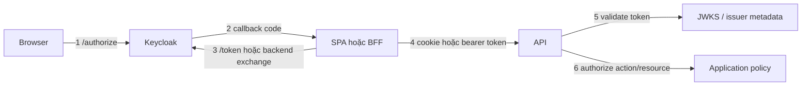
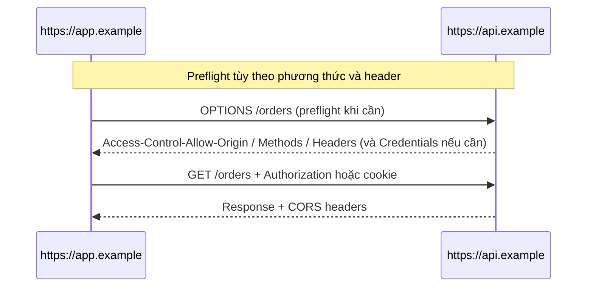
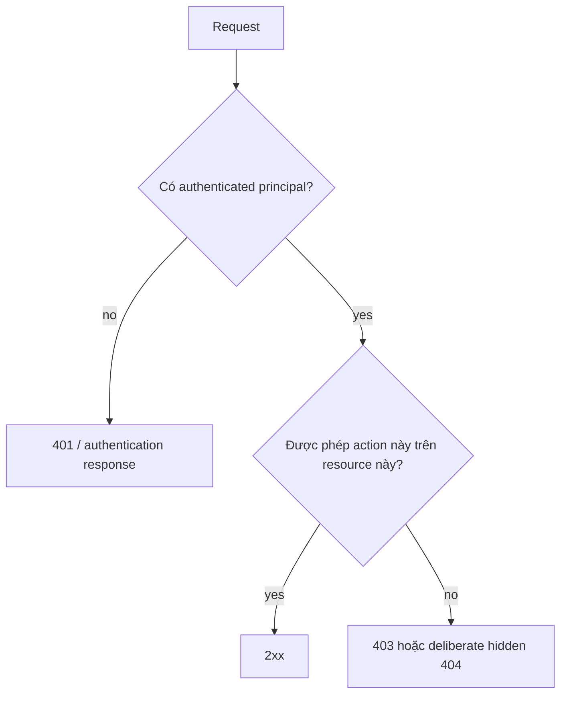

# Cẩm nang Debug Auth: 401, 403, CORS, Redirect, Issuer, Audience & Claim

## Tóm tắt nhanh

Việc gỡ lỗi xác thực trở nên khó khăn khi mọi triệu chứng đều bị quy thành “lỗi Keycloak”. Một luồng đăng nhập OAuth/OIDC trên trình duyệt có thể đi qua nhiều ranh giới độc lập: cấu hình chuyển hướng, phiên tại nhà cung cấp danh tính (IdP), đổi mã ủy quyền lấy token, phát hành token, truyền yêu cầu từ trình duyệt, xác minh token và phân quyền tại ứng dụng. Các bước thực tế phụ thuộc kiến trúc SPA trực tiếp hay BFF.

> 💡 **Quy tắc bỏ túi:** Trước khi sửa Keycloak, CORS, vai trò hay mã giao diện, hãy tìm **ranh giới đầu tiên xảy ra lỗi** và thu thập bằng chứng tại đó.

- **Lỗi chuyển hướng:** thường xuất phát từ đăng ký ứng dụng hoặc trạng thái của lần gọi trở về (callback).
- **Lỗi CORS:** liên quan đến quyền đọc phản hồi khác nguồn của trình duyệt; không chứng minh API từ chối xác thực.
- **401:** thiếu thông tin xác thực, thông tin không hợp lệ, đã hết hạn hoặc không được chấp nhận cho tài nguyên được bảo vệ.
- **403:** máy chủ hiểu yêu cầu nhưng từ chối thao tác; thông tin xác thực hợp lệ vẫn có thể không đủ quyền.
- **Sai lầm có rủi ro cao:** cùng lúc sửa vai trò, CORS, URI chuyển hướng, bộ ánh xạ token và proxy mà không xác định ranh giới gây lỗi.

## Bắt đầu bằng sơ đồ các ranh giới



Đây là sơ đồ minh họa để lần theo lỗi, không phải thứ tự bắt buộc của mọi hệ thống. BFF có thể đổi mã ủy quyền lấy token trên máy chủ; API cũng có thể dùng khóa ký đã lưu thay vì truy vấn JWKS ở mỗi yêu cầu. Đừng kiểm tra phân quyền khi bước callback còn chưa hoàn tất.

<TermBox term="Authentication failure">
**Lỗi xác thực** nghĩa là máy chủ không xác lập được danh tính được chấp nhận cho yêu cầu: thông tin xác thực có thể bị thiếu, sai định dạng, hết hạn, được ký bằng khóa không đáng tin cậy, đến từ nhà phát hành sai hoặc dành cho tài nguyên khác.

**Vì sao quan trọng:** sửa vai trò không có tác dụng nếu API từ chối token trước khi xác lập danh tính.
</TermBox>

<TermBox term="Authorization failure">
**Lỗi phân quyền** nghĩa là hệ thống có đủ thông tin danh tính và ngữ cảnh để hiểu yêu cầu nhưng chính sách không cho phép thao tác trên tài nguyên đích.

**Vì sao quan trọng:** làm mới token liên tục không thay đổi một quy tắc phân quyền cấp tài nguyên đang chủ động từ chối truy cập.
</TermBox>

## 1. Chuyển hướng lỗi trước khi đăng nhập hoặc nhận callback

Triệu chứng thường gặp:

- invalid_redirect_uri;
- chuyển hướng lặp vô hạn;
- callback được gửi đến sai môi trường;
- đăng nhập Keycloak thành công nhưng ứng dụng từ chối tham số `state`;
- giao diện quay về đường dẫn không xử lý xong bước đăng nhập.

Kiểm:

```text
request client_id
        ↓
registered Keycloak client
        ↓
exact redirect_uri / allowed pattern
        ↓
scheme + host + port + path
        ↓
callback transaction state
```

Keycloak khuyến nghị cấu hình `Valid Redirect URIs` càng cụ thể càng tốt. Địa chỉ callback trên máy phát triển, môi trường xem trước, tên miền thật, đường dẫn qua proxy và phần cuối đường dẫn có thể khác nhau; chỉ các mẫu được đăng ký rõ ràng mới được chấp nhận.

Đừng xử lý URI chuyển hướng không khớp bằng ký tự đại diện quá rộng khi chưa biết phản hồi ủy quyền có thể bị gửi đến những địa chỉ nào.

## 2. Đăng nhập thành công nhưng ứng dụng chưa có phiên sử dụng được

Tách bốn câu hỏi:

1. Keycloak đã xác thực người dùng chưa?
2. Ứng dụng đã nhận và xác minh callback chưa?
3. Việc đổi mã ủy quyền lấy token đã thành công chưa?
4. Ứng dụng đã tạo phiên cục bộ hoặc lưu trạng thái token chưa?

Trang Keycloak báo đăng nhập thành công chỉ chứng minh bước 1.

Trong kiến trúc BFF, yêu cầu lấy token có thể diễn ra giữa hai máy chủ nên không xuất hiện trong công cụ mạng của trình duyệt. Hãy xem log BFF và cookie phiên được tạo sau đó.

Với SPA trực tiếp, hãy kiểm tra việc đổi mã lấy token và trạng thái do thư viện quản lý.

## 3. Lỗi CORS nằm ở ranh giới trình duyệt

<TermBox term="CORS">
**Chia sẻ tài nguyên khác nguồn (CORS)** là cơ chế HTTP bổ sung cho chính sách cùng nguồn của trình duyệt; máy chủ có thể cho phép các nguồn được chỉ định đọc phản hồi khác nguồn.

**Vì sao quan trọng:** lỗi CORS trong bảng điều khiển phản ánh việc JavaScript có được đọc phản hồi hay không, chứ không tự chứng minh Keycloak hoặc API đã từ chối xác thực.
</TermBox>

Tiêu chuẩn Fetch yêu cầu máy chủ cho phép rõ ràng việc chia sẻ phản hồi khác nguồn. Với yêu cầu có chế độ thông tin xác thực `include`, máy chủ phải trả về đúng nguồn cụ thể (không dùng `*`) và `Access-Control-Allow-Credentials: true`. Preflight chỉ xuất hiện khi phương thức hoặc header yêu cầu cần kiểm tra trước; không phải mọi lệnh GET khác nguồn đều có preflight. Ví dụ, header `Authorization` thường khiến trình duyệt gửi preflight.



Kiểm tra bảng **Network**, không chỉ thông báo lỗi trong console:

- Trường hợp này có yêu cầu preflight `OPTIONS` không?
- Preflight trả mã trạng thái nào? Nếu preflight thất bại, trình duyệt có thể không gửi yêu cầu thực tế.
- `Access-Control-Allow-Origin` có trùng nguồn của giao diện không?
- Nếu chế độ gửi thông tin xác thực là `include`, máy chủ có trả `Access-Control-Allow-Credentials: true` và nguồn cụ thể không?
- Header `Authorization` và phương thức yêu cầu có được cho phép không?
- Yêu cầu thực tế có được gửi sau preflight không?

Máy chủ có thể trả 401 hoặc 500, nhưng nếu thiếu header CORS phù hợp, JavaScript trong trình duyệt có thể chỉ nhận được thông báo lỗi CORS chung.

## 4. 401 Unauthorized: kiểm tra thông tin xác thực

RFC 9110 quy định 401 khi thông tin xác thực cho tài nguyên được bảo vệ bị thiếu, sai hoặc không đầy đủ/không được chấp nhận. **Phản hồi 401 bắt buộc có header `WWW-Authenticate` với ít nhất một challenge phù hợp**. Ứng dụng dùng phiên cookie có thể chọn kiểu phản hồi khác, nhưng không được coi phản hồi 401 là ngoại lệ của yêu cầu HTTP này.

Với Bearer access token, kiểm:

```text
Có Authorization header?
        ↓
Bearer syntax đúng?
        ↓
token expired / not-yet-valid?
        ↓
signature key trusted?
        ↓
issuer exact?
        ↓
audience/resource intended cho API này?
        ↓
token type/profile được chấp nhận?
```

### Issuer mismatch

Token phát hành bởi realm Keycloak này không tự động dùng được cho realm, môi trường, địa chỉ sau proxy hoặc cấu hình localhost khác, dù đều do cùng một hệ thống Keycloak quản lý.

API phải xác minh chính xác nhà phát hành đã được cấu hình tin cậy.

### Key / kid mismatch

Keycloak công bố khóa công khai của realm qua điểm truy cập OIDC JWKS. Khi đổi khóa ký, bộ xác minh cần chính sách làm mới và lưu tạm khóa. Với bộ xác minh lấy khóa động từ nhà phát hành đáng tin cậy, `kid` chưa biết có thể dẫn đến một lần làm mới JWKS có giới hạn; nếu vẫn không tìm thấy khóa phù hợp thì phải từ chối token. Không tắt xác minh chữ ký hay tin một URL khóa tùy ý do token cung cấp.

### Audience mismatch

Chữ ký hợp lệ giúp xác minh chủ thể phát hành token, nhưng không chứng minh API hiện tại là đối tượng sử dụng được chỉ định.

Nếu Orders API chỉ chấp nhận access token dành cho Orders, token có đối tượng nhận khác phải bị từ chối dù nhà phát hành, người dùng và vai trò trông quen thuộc.

## 5. 403 Forbidden: kiểm tra chính sách phân quyền của ứng dụng

Theo RFC 9110, 403 có nghĩa máy chủ hiểu yêu cầu nhưng từ chối thực hiện; thông tin xác thực có thể hợp lệ nhưng không đủ quyền.

Kiểm thường gặp:

- thiếu required scope;
- thiếu required role;
- role có nhưng nằm ở namespace/client khác;
- tenant/resource ownership không khớp;
- user được read nhưng không được mutate;
- permission đã đổi sau khi token issue;
- endpoint policy và frontend assumption không khớp.



Đừng xử lý mọi lỗi 403 bằng cách bắt người dùng đăng nhập lại. Nếu danh tính hợp lệ nhưng chính sách từ chối thao tác, đăng nhập lại có thể không thay đổi gì.

## 6. “Token có vai trò nhưng API vẫn từ chối”

Lần ngược từ điều kiện mà chính sách API thực sự kiểm tra.

```json
{
  "realm_access": {
    "roles": ["employee"]
  },
  "resource_access": {
    "orders-api": {
      "roles": ["refund"]
    }
  }
}
```

Hỏi:

1. API kiểm realm role hay client role?
2. Nó đọc role dưới client ID nào?
3. Client scope/protocol mapper có đưa intended claim vào **access token** không?
4. API có nhầm dùng ID Token claim không?
5. Policy còn yêu cầu tenant/ownership/context ngoài role không?
6. Token có stale sau khi role assignment đổi không?

Giao diện và API có thể dùng cùng tên vai trò để dễ hiểu, nhưng quyết định cho phép thao tác phải được thực thi tại API.

## 7. “Postman/curl chạy được, trình duyệt lại lỗi”

Đây là dấu hiệu đáng kiểm tra các cơ chế bảo mật riêng của trình duyệt.

Postman/curl không thực thi chính sách CORS của trình duyệt. Chúng cũng không tự tái hiện cách cookie áp dụng `SameSite`, trạng thái chuyển hướng, nguồn của giao diện hay vòng đời token trong JavaScript.

So sánh URL/Host, Origin, cookie presence và attributes, Authorization header, preflight, TLS/proxy path, redirect URI, token audience/issuer và browser có đang silently gửi state cũ không.

Đừng kết luận máy chủ không có lỗi chỉ vì curl thành công. Ta chỉ biết **một đường gửi yêu cầu ngoài trình duyệt đã thành công**.

## 8. Lỗi phiên cookie: kiểm tra thuộc tính và phạm vi

Với kiến trúc BFF hoặc phiên cookie, hãy xem thông tin cookie trong công cụ của trình duyệt.

Hỏi:

- Có nhận Set-Cookie không?
- Browser có store không?
- Cookie có Secure nhưng bạn vô tình chạy HTTP không?
- SameSite policy có cho phép navigation/request pattern hiện tại không?
- Domain quá rộng hay sai?
- Path có exclude endpoint không?
- Cookie expired chưa?
- Request có thực sự gửi cookie không?
- Với cross-origin credentialed fetch, credentials behavior và CORS có được cấu hình chủ đích không?

Cookie có thuộc tính `HttpOnly` cố ý không xuất hiện trong `document.cookie`; điều đó không chứng minh cookie bị mất.

## 9. Lỗi làm mới token và hết hạn

Symptom thường gặp:

- API bắt đầu 401 sau N phút;
- tab chạy cho tới khi reload;
- refresh loop;
- nhiều request đồng thời gây nhiều refresh;
- refresh thành công nhưng old access token vẫn được gửi.

Trace timestamp và ownership:

```text
access token exp
     ↓
ai nhận biết expiry?
     ↓
ai sở hữu refresh token?
     ↓
một refresh hay nhiều concurrent refresh?
     ↓
new access token có được ghi vào authoritative place?
     ↓
API request sau có dùng token mới?
```

Với direct SPA, kiểm library/adapter refresh behavior và race handling. Với BFF, kiểm server session/token cache và refresh logs.

## 10. Đăng xuất có vẻ không hoạt động

Hỏi chính xác logout nào bạn mong đợi:

- frontend state cleared?
- local application/BFF session invalidated?
- refresh token/session revoked theo design?
- Keycloak SSO session ended?
- app SSO khác có bị force logout?

Nếu người dùng đăng xuất khỏi ứng dụng A rồi mở lại mà được đăng nhập ngay không cần nhập mật khẩu, phiên tại IdP có thể vẫn còn hoạt động dù phiên cục bộ của ứng dụng đã bị xóa đúng cách. Đăng xuất liên ứng dụng và thu hồi refresh token là các cơ chế riêng, không phải một giao dịch nguyên tử đồng thời trên mọi ứng dụng.

## Tình huống giả định trong vận hành: lỗi 403 dẫn tới sửa CORS không cần thiết

**Tình huống minh họa, không phải báo cáo sự cố thực tế:** SPA quản lý đơn hàng nhận 403 khi gọi `POST /orders/42/refund`. Console cũng hiển thị phản hồi API thất bại. Nhóm phát triển mở rộng nguồn CORS, thêm ký tự đại diện vào URI chuyển hướng, cấp lại bí mật ứng dụng và sửa bộ ánh xạ Keycloak. Yêu cầu vẫn bị từ chối.

Access token vốn hợp lệ từ đầu. Chính sách API yêu cầu vai trò của client `orders-api:refund`, trong khi token chỉ có vai trò cấp realm tên `refund`.

- **Hậu quả:** Sai lệch nhỏ trong phân quyền dẫn tới những thay đổi cấu hình danh tính và CORS không cần thiết, tiềm ẩn rủi ro bảo mật và kéo dài quá trình gỡ lỗi. Không có số liệu thời gian gián đoạn thực tế được khẳng định.
- **Nguyên nhân cốt lõi:** Nhóm không phân biệt bằng chứng từ trình duyệt, xác thực và phân quyền trước khi sửa cấu hình.
- **Cách khắc phục chuẩn:** Lần theo yêu cầu qua từng ranh giới, xác nhận token đã được kiểm tra thành công, xem đúng dữ liệu mà chính sách API yêu cầu rồi chỉ sửa ánh xạ vai trò/phạm vi hoặc chính sách thực sự sai.

## Tự kiểm tra mô hình tư duy

> **Tình huống:** Browser console báo "blocked by CORS policy". DevTools Network cho thấy API trả 401, nhưng response thiếu Access-Control-Allow-Origin. CORS có nhất thiết là root authentication problem không?

<details>
<summary>Xem giải thích chi tiết</summary>

Không.

CORS ngăn JavaScript trong trình duyệt đọc phản hồi khác nguồn nếu máy chủ không cho phép nguồn đó. API bên dưới còn trả 401, nên có thể tồn tại một vấn đề xác thực riêng. Sửa cấu hình CORS giúp quan sát phản hồi xác thực thực tế, chứ không tự giải quyết thông tin xác thực bị từ chối.

</details>

## Danh sách kiểm tra khi gỡ lỗi

- [ ] **Reproduce:** Capture một failing request và timestamp.
- [ ] **Architecture:** Đây là direct SPA, BFF hay token-mediating backend?
- [ ] **First failure:** Redirect, callback, token exchange, browser transport, token validation hay authorization?
- [ ] **Redirect:** So exact client_id và redirect_uri với Keycloak config.
- [ ] **Trình duyệt:** Xác định có cần preflight không; kiểm tra `Origin`, cookie, `Authorization` và mã phản hồi thực tế. Khi chế độ thông tin xác thực là `include`, không chấp nhận `Access-Control-Allow-Origin: *`.
- [ ] **Token:** Xác định ID token hay access token trước khi đọc claim.
- [ ] **Validation:** Kiểm signature/JWKS, issuer, audience/resource, expiry/not-before và token profile.
- [ ] **401:** Xác định vì sao chưa xác lập được danh tính hợp lệ và kiểm tra challenge `WWW-Authenticate` bắt buộc.
- [ ] **403:** Xác định scope/role/resource/context policy nào deny action.
- [ ] **Roles:** Tách realm role, client role, scope, claim và business permission.
- [ ] **Refresh:** Xác nhận một owner refresh và request sau dùng refreshed token.
- [ ] **Session:** Inspect cookie attributes và local vs IdP session lifecycle.
- [ ] **Logout:** Nói rõ session nào phải kết thúc.
- [ ] **Change isolation:** Chỉ sửa một boundary mỗi lần và giữ before/after evidence.

## Các bài Atlas liên quan

- [Kiến trúc Xác thực Frontend](/vi/docs/engineering-judgment/architecture-walkthroughs/frontend-authentication-architecture) so sánh trust boundary của direct SPA và BFF.
- [OAuth 2.0 & OpenID Connect](/vi/docs/backend-engineering/oauth-and-oidc) giải thích Authorization Code + PKCE, token, discovery và validation.
- [Keycloak Thực chiến](/vi/docs/backend-engineering/keycloak-in-practice) ánh xạ realm/client/role/client-scope/mapper.
- [Xác thực & Phân quyền](/vi/docs/backend-engineering/authentication-and-authorization) tách identity establishment khỏi policy decision.
- [Same-Origin Policy và CORS](/vi/docs/web-platform/same-origin-and-cors) giải thích browser cross-origin boundary.

## Nguồn tham khảo

- [RFC 9110 — HTTP Semantics](https://www.rfc-editor.org/rfc/rfc9110.html)
- [RFC 10017 — OAuth 2.0 for Browser-Based Applications](https://www.rfc-editor.org/rfc/rfc10017.html)
- [Fetch Standard — CORS protocol](https://fetch.spec.whatwg.org/#http-cors-protocol)
- [Keycloak — Securing applications and services with OpenID Connect](https://www.keycloak.org/securing-apps/oidc-layers)
- [Keycloak JavaScript Adapter](https://www.keycloak.org/securing-apps/javascript-adapter)
- [OWASP Session Management Cheat Sheet](https://cheatsheetseries.owasp.org/cheatsheets/Session_Management_Cheat_Sheet.html)
- [OpenID Connect Discovery 1.0](https://openid.net/specs/openid-connect-discovery-1_0.html)
