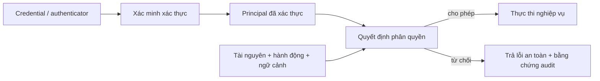
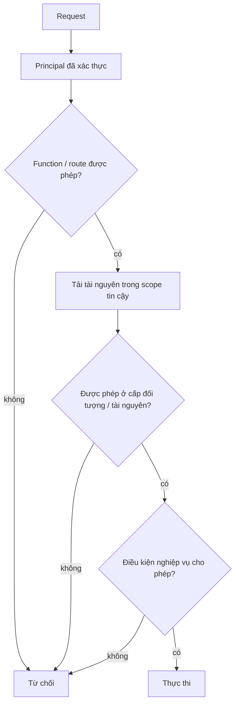
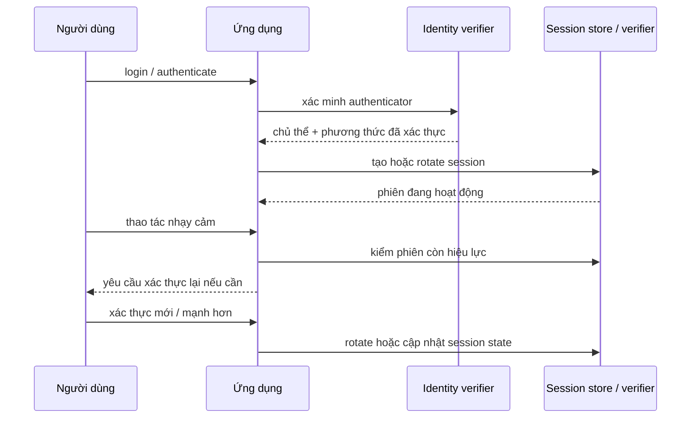

## Ví dụ mở đầu (giả định): BOLA xuyên tenant

**Tình huống minh họa (giả định):** Một khách hàng đăng nhập thành công rồi gọi `GET /api/v1/users/1042/profile`. Nếu API chỉ kiểm tra JWT và vai trò `user`, người đó có thể thử đổi mã định danh thành `1043` để đọc hồ sơ của người khác. Đây là kiểu lỗi **Broken Object Level Authorization (BOLA)**, được OWASP xếp ở API1:2023; ví dụ này **không phải báo cáo sự cố tại một công ty cụ thể**.

Xác thực xác minh quyền kiểm soát danh tính; phân quyền đánh giá **chủ thể + hành động + tài nguyên + ngữ cảnh** của mỗi yêu cầu. Có thể thực hiện quyết định này bằng RBAC theo phạm vi, ABAC, chính sách dựa trên quan hệ hoặc cách kết hợp. Chữ ký token giúp xác minh tính toàn vẹn và nguồn phát hành theo cơ chế xác thực, nhưng không tự cấp quyền đọc một đối tượng hay bảo vệ token khỏi bị đánh cắp.



> 💡 **Quy tắc bỏ túi:** Xác thực (Authentication) trả lời câu hỏi “bạn là ai”; phân quyền (Authorization) trả lời câu hỏi “bạn được phép làm gì vào lúc này”. Không được xem một token hợp lệ hay vai trò chung chung là bằng chứng cho quyền truy cập vào một mã tài nguyên cụ thể.

### TL;DR 2.0
- **Hai cổng kiểm soát độc lập:** Xác thực (Authentication) kiểm tra thông tin xác thực để thiết lập một chủ thể bảo mật đáng tin cậy (principal); Phân quyền (Authorization) quyết định cho phép hay từ chối dựa trên bốn yếu tố: `chủ thể + hành động + tài nguyên + ngữ cảnh` (`subject + action + resource + context`).
- **Mặc định từ chối ở cấp đối tượng:** Việc kiểm tra token hoặc vai trò tại tuyến API không tự cấp quyền trên đối tượng do client chỉ định. Hãy áp dụng chính sách ở cấp tài nguyên (RBAC có phạm vi, ABAC, ReBAC hoặc cơ chế tương đương), kiểm tra chủ sở hữu hoặc tenant khi phù hợp, và mặc định từ chối nếu không có quyền được cấp rõ ràng.
- **Quản lý vòng đời phiên theo mô hình đe dọa:** Chống chiếm quyền phiên (session fixation), đổi mã phiên khi thay đổi mức quyền, thiết lập thời hạn không hoạt động và thời hạn tối đa cho phiên, đồng thời chọn cơ chế thu hồi phù hợp. JWT tự chứa đã phát hành không thể bị vô hiệu hóa tức thì trên mọi dịch vụ chỉ bằng cách xóa phiên ở một nút; khi cần, có thể dùng TTL ngắn, danh sách thu hồi (denylist), cơ chế introspection hoặc phiên bản token.
- **Danh tính dịch vụ và máy móc (Service Identity):** Tác vụ nền, tác vụ định kỳ và các vi dịch vụ nội bộ cũng là những principal độc lập. Hãy cấp cho mỗi principal quyền tối thiểu cần thiết (least privilege) và thông tin xác thực có thời hạn ngắn; không dùng chung API key hoặc bỏ qua phân quyền chỉ vì yêu cầu xuất phát từ mạng nội bộ.
- **Rủi ro có tác động lớn:** Nếu chỉ kiểm tra đăng nhập mà bỏ qua phân quyền ở cấp đối tượng, người dùng đã xác thực có thể truy cập dữ liệu của người khác hoặc tenant khác bằng cách thay `userId` hay `resourceId` tại API không kiểm tra quyền tương ứng (IDOR / BOLA).

<TermBox term="Principal">
**Principal** là danh tính bảo mật mà ứng dụng dùng khi ra quyết định sau bước xác thực. Principal thường gồm một định danh chủ thể ổn định và một số thuộc tính được chọn, chẳng hạn tenant, vai trò, phương thức xác thực hoặc mức bảo đảm.

**Vì sao điều này quan trọng:** Mã nghiệp vụ phải thực hiện phân quyền dựa trên một principal rõ ràng, thay vì suy đoán danh tính từ các trường trong yêu cầu mà client có thể tự thay đổi.
</TermBox>

## 1. Xác thực chứng minh quyền kiểm soát, không tạo ra quyền vô hạn

Xác thực kiểm tra bằng chứng do người yêu cầu đăng nhập cung cấp. Tùy hệ thống, bằng chứng có thể là mật khẩu, passkey, khóa bảo mật phần cứng, mã dùng một lần, chứng thư máy khách hoặc xác nhận danh tính liên kết đã được kiểm tra đúng cách.

Cần tách ba khái niệm:

1. **Xác minh danh tính ban đầu (identity proofing)** đánh giá mức độ chắc chắn khi liên kết tài khoản với danh tính ngoài đời thật, trong những trường hợp việc liên kết đó cần thiết.
2. **Xác thực** hỏi claimant hiện có kiểm soát authenticator gắn với tài khoản/chủ thể đó hay không.
3. **Phân quyền** xác định principal đã xác thực được phép thực hiện hành động nào vào thời điểm hiện tại.

Theo [NIST SP 800-63B-4](https://pages.nist.gov/800-63-4/sp800-63b/aal/), hệ thống **áp dụng khung mức bảo đảm NIST** ở AAL2 phải sử dụng hai yếu tố xác thực và bên xác minh phải cung cấp ít nhất một phương thức chống lừa đảo (phishing-resistant). AAL3 yêu cầu hai yếu tố xác thực cùng một bộ xác thực mật mã chống lừa đảo, sử dụng khóa xác thực không thể xuất (non-exportable). Đây là yêu cầu dành cho tổ chức áp dụng khung tiêu chuẩn này, đặc biệt là dịch vụ chính phủ Hoa Kỳ, **không phải quy định bắt buộc cho mọi website**. Hãy chọn mức bảo đảm dựa trên mô hình đe dọa và các quy định có liên quan.

Điều đó không có nghĩa là phải buộc người dùng sử dụng phương thức mạnh nhất ở mọi trang. Hãy chọn mức xác thực theo mức độ tác động và mô hình đe dọa; chỉ yêu cầu xác thực tăng cường (step-up) khi thao tác nhạy cảm cần bằng chứng mạnh hơn.

<TermBox term="Xác thực kháng phishing">
Một phương thức **xác thực chống lừa đảo (phishing-resistant)** sử dụng giao thức ngăn bên xác minh do kẻ tấn công kiểm soát phát lại hoặc chuyển tiếp bí mật xác thực để giả mạo người dùng trước bên xác minh hợp lệ.

**Tại sao quan trọng:** xác thực mạnh hơn làm giảm khả năng hệ thống đưa ra quyết định phân quyền cho kẻ tấn công đang điều khiển một phiên bị đánh cắp.
</TermBox>

## 2. Xây dựng principal một cách có chủ đích

Sau khi xác minh thông tin xác thực, hãy tạo principal tối thiểu từ dữ liệu danh tính mà máy chủ tin cậy. Các trường thường gặp gồm:

```text
subject_id
principal_type = user | service
organization_or_tenant_id
roles / groups / entitlements
session_id hoặc token identifier
authentication_time
authentication_method / assurance
```

Không sao chép tùy tiện claim do client gửi vào principal. Với token đã ký, vẫn phải kiểm tra chữ ký (signature), bên phát hành (issuer), đối tượng nhận (audience), thời hạn hiệu lực (lifetime) và các claim mà ứng dụng mong đợi trước khi dùng chúng làm đầu vào đáng tin cậy.

Nếu cần thu hồi quyền nhanh, tránh đưa các quyền thường xuyên thay đổi vào thông tin xác thực có thời hạn quá dài. Một token vẫn hợp lệ về mặt mật mã có thể tiếp tục thể hiện thẩm quyền mà ứng dụng không còn muốn cấp.

## 3. Biến phân quyền thành một quyết định rõ ràng

Một mental model hữu ích là:

```text
chủ thể + hành động + tài nguyên + ngữ cảnh -> cho phép | từ chối
```

Tương đương:

```text
subject + action + resource + context -> allow | deny
```

Ví dụ:

```text
chủ thể   = user:123 trong tenant:acme
hành động = invoice.read
tài nguyên = invoice:inv_42 thuộc tenant:acme
ngữ cảnh  = phiên khách hàng bình thường, region=VN
```

Phân quyền phải tuân theo nguyên tắc **mặc định từ chối**. Nếu không có chính sách nào cấp quyền rõ ràng cho thao tác, hãy từ chối yêu cầu.



OWASP Authorization Cheat Sheet khuyến nghị nguyên tắc mặc định từ chối và kiểm tra quyền trên mọi yêu cầu. Middleware hoặc hạ tầng chính sách tập trung có thể giúp việc thực thi nhất quán hơn, nhưng chính sách vẫn phải nhận đủ thông tin về tài nguyên và hành động để đưa ra quyết định chính xác.

## 4. Kiểm tra tuyến API chưa đủ: phải phân quyền trên đối tượng

Một tuyến API như `GET /invoices/:id` có thể chỉ cho khách hàng đã đăng nhập truy cập nhưng vẫn tồn tại lỗ hổng.

Nếu bộ xử lý yêu cầu tải `invoice_id = 42` rồi trả dữ liệu chỉ vì người gọi đã đăng nhập, hệ thống mới có xác thực mà chưa có phân quyền ở cấp đối tượng.

OWASP gọi nhóm lỗ hổng này là **Broken Object Level Authorization (BOLA)**. Chỉ đổi mã định danh sang UUID khó đoán không giải quyết được vấn đề. Mã ngẫu nhiên có thể làm giảm khả năng đoán trúng, nhưng mọi lần truy cập vẫn phải được kiểm tra quyền.

Khi có thể, hãy đưa phạm vi sở hữu đã được xác minh vào ngay trong truy vấn dữ liệu:

```text
TỆ:
  invoice = invoices.findById(request.params.id)
  return invoice

TỐT HƠN:
  invoice = invoices.findByTenantAndId(principal.tenantId, request.params.id)
  authorize(principal, "invoice.read", invoice)
  return invoice
```

Giới hạn truy vấn theo tenant rồi kiểm tra chính sách riêng giúp tạo thêm một lớp bảo vệ. Tenant ID phải xuất phát từ ngữ cảnh danh tính do máy chủ xác minh, không được lấy trực tiếp từ tham số của yêu cầu. Với hệ thống nhiều tenant, nên tăng cường cô lập tại tầng truy cập dữ liệu hoặc cơ sở dữ liệu nếu nền tảng hỗ trợ; một truy vấn có giới hạn không bảo vệ được các API khác hay những luồng quản trị cần truy cập qua nhiều tenant.

**Kiểm thử phủ định (tình huống giả định):** Với phiên hợp lệ thuộc `tenant:acme`, yêu cầu đọc hóa đơn của `tenant:other` phải bị từ chối an toàn, không để lộ bất kỳ trường dữ liệu nào. Nếu chính sách còn xét quyền sở hữu, hãy thử thêm trường hợp hóa đơn cùng tenant nhưng không thuộc người gọi. Tên tenant và mã hóa đơn ở đây chỉ là dữ liệu kiểm thử tự tạo, không phải bằng chứng về một vụ rò rỉ có thật.

## 5. Vai trò chỉ là đầu vào của chính sách, không phải toàn bộ chính sách

RBAC hữu ích cho những quyền ở mức khái quát, chẳng hạn “nhân viên hỗ trợ được sử dụng công cụ hỗ trợ”, nhưng thường không đủ để diễn đạt các quy tắc như:

- người dùng chỉ được sửa hồ sơ của chính mình;
- thành viên dự án chỉ được đọc kho mã khi tư cách thành viên còn hiệu lực;
- approver chỉ duyệt payment dưới giới hạn cấu hình và không được duyệt yêu cầu của chính mình;
- một dịch vụ chỉ được ghi vào đúng tenant hoặc hàng đợi đã chỉ định.

Những quyết định này phụ thuộc vào thuộc tính hoặc mối quan hệ giữa principal, tài nguyên và ngữ cảnh. Quy tắc cần gắn đủ chặt với nghiệp vụ để truy cập được các dữ kiện đó; việc thực thi cũng phải nhất quán để không có API nào bị bỏ sót và trở thành đường vòng.

**Giới hạn thu hồi token:** Đăng xuất hoặc thay đổi vai trò không tự động làm mất hiệu lực các access token còn hạn ở những dịch vụ khác. Hãy cân nhắc TTL, `token_version`, danh sách thu hồi (denylist), introspection hoặc kiểm tra chính sách ở phía máy chủ. Sau khi người dùng xác thực lại, hệ thống vẫn phải đánh giá quyền trên đối tượng như bình thường.

## 6. Vòng đời phiên là một phần của xác thực

Đăng nhập thành công chỉ bắt đầu hoặc nâng cấp phiên đã xác thực; nó không kết thúc bài toán xác thực.



Hãy vận hành phiên theo các quy tắc vòng đời rõ ràng:

- sử dụng mã phiên khó đoán hoặc token đã được xác minh đầy đủ;
- cấp mã phiên mới sau khi xác thực hoặc thay đổi quyền để ngăn chiếm quyền phiên (session fixation);
- xác định thời hạn không hoạt động và tổng thời hạn của phiên theo mức độ rủi ro;
- yêu cầu **xác thực lại** trước thao tác nhạy cảm hoặc khi xuất hiện dấu hiệu rủi ro, chẳng hạn khôi phục tài khoản, thay đổi thông tin xác thực hoặc hoạt động bất thường;
- hỗ trợ **thu hồi phiên hoặc token** sau khi đăng xuất, lộ thông tin xác thực, thay đổi quyền hoặc có yêu cầu quản trị, khi mô hình đe dọa đòi hỏi phải chấm dứt thẩm quyền ngay;
- không nhầm lẫn giữa thời điểm token hết hạn và việc token bị thu hồi.

Hướng dẫn OWASP về xác thực và quản lý phiên khuyến nghị yêu cầu xác thực lại khi có sự kiện rủi ro hoặc thao tác nhạy cảm, đồng thời cấp lại mã phiên sau khi thay đổi mức quyền.

## 7. Xác thực tăng cường (step-up) phối hợp với phân quyền

Chính sách có thể yêu cầu xác thực mạnh hơn đối với một hành động cụ thể mà không buộc mọi trang phải sử dụng cùng mức xác thực đó.

Ví dụ:

```text
đọc đơn hàng của mình  -> phiên đã xác thực là đủ
đổi mật khẩu           -> yêu cầu xác thực lại mới
thêm payout account    -> policy ưu tiên/yêu cầu MFA kháng phishing
duyệt payout lớn       -> xác thực mạnh hơn + rule phân quyền độc lập
```

Mức độ mạnh của xác thực là một đầu vào cho quyết định phân quyền, chứ không thay thế quyết định đó. Một quản trị viên vừa xác thực lại vẫn có thể bị cấm phê duyệt khoản thanh toán của chính mình.

## 8. Danh tính dịch vụ cũng là principal

Worker chạy nền, tác vụ định kỳ, hệ thống CI và các dịch vụ đều là principal, ngay cả khi không có người trực tiếp thao tác.

Hãy cấp **danh tính dịch vụ** hoặc danh tính máy riêng với thẩm quyền được giới hạn chặt chẽ. Ưu tiên thông tin xác thực ngắn hạn dành cho workload hoặc cơ chế định danh của nền tảng, thay vì sao chép token người dùng có thời hạn dài hay dùng chung API key.

Principal đại diện cho dịch vụ vẫn phải được đánh giá theo mô hình:

```text
chủ thể + hành động + tài nguyên + ngữ cảnh
```

Các giới hạn hữu ích có thể bao gồm đối tượng nhận (audience), môi trường (environment), namespace, tenant, thao tác được phép và thời hạn của thông tin xác thực.

Đừng biến “lưu lượng nội bộ” thành lý do bỏ qua phân quyền. Vị trí mạng chỉ là một yếu tố của ngữ cảnh, không chứng minh rằng mọi bên gọi từ mạng nội bộ đều nên có toàn bộ quyền.

## 9. Từ chối phải an toàn và để lại bằng chứng hữu ích

Lỗi phân quyền không nên làm lộ nhiều thông tin hơn mức cần thiết. Tùy theo hợp đồng API, trả `404` thay vì `403` có thể phù hợp khi việc tiết lộ một tài nguyên có tồn tại hay không cũng là thông tin nhạy cảm.

Ghi đủ dữ liệu **kiểm toán** để có thể dựng lại các quyết định quan trọng mà không lưu bí mật:

```text
request_id / trace_id
principal subject hoặc định danh an toàn
principal type
phương thức / độ mới của xác thực khi cần
action
resource type + định danh an toàn
tenant / scope
decision = allow | deny
policy hoặc rule identifier
reason category
```

Theo dõi tỷ lệ từ chối quyền và các mẫu truy cập bất thường, nhưng không ghi nhật ký bearer token, mật khẩu, bí mật phiên hoặc dữ liệu nhạy cảm trong nội dung yêu cầu.

Nhật ký kiểm toán là bằng chứng, không phải cơ chế ngăn chặn. Một hành động trái phép dù được ghi nhận đầy đủ vẫn là hành động trái phép.

## Kịch bản minh họa (giả định): truy cập trái phép giữa các tenant

> **Tình huống:** Một API hóa đơn SaaS yêu cầu khách hàng có phiên hợp lệ. Bộ xử lý nhận đường dẫn `/invoices/:id`, tìm hóa đơn bằng mã định danh toàn cục rồi trả dữ liệu. Hệ thống không có chính sách đối chiếu tenant của principal đã xác thực với tenant sở hữu hóa đơn.

**Hậu quả:** Một khách hàng thay mã hóa đơn và đọc được metadata của hóa đơn thuộc tenant khác. Vì mọi yêu cầu đều đi kèm phiên hợp lệ, bảng theo dõi xác thực thông thường vẫn hiển thị tỷ lệ đăng nhập thành công như bình thường.

**Nguyên nhân cốt lõi:** Dịch vụ đánh đồng “khách hàng đã xác thực” với “được phép truy cập hóa đơn này”. Cơ chế xác thực ở tầng định tuyến đã có, nhưng phân quyền ở cấp tài nguyên lại bị bỏ sót. Hệ thống cũng nhầm độ khó đoán của mã định danh với một ranh giới bảo mật.

**Cách khắc phục chuẩn:** Xác thực bên gọi, tạo principal đáng tin cậy, truy vấn đối tượng trong phạm vi tenant của principal khi có thể, sau đó áp dụng chính sách rõ ràng dựa trên `chủ thể + hành động + tài nguyên + ngữ cảnh`. Mặc định từ chối, kiểm thử quyền truy cập đối tượng giữa các tenant và ghi lại bằng chứng kiểm toán an toàn cho những quyết định từ chối.

## Checklist vận hành ranh giới truy cập

- [ ] **Xác thực:** Phương thức xác thực có đủ mạnh so với mức độ rủi ro của hành động không?
- [ ] **Principal:** Danh tính và thuộc tính dùng để phân quyền có chỉ xuất phát từ dữ liệu đã được máy chủ xác minh không?
- [ ] **Mặc định từ chối:** Khi không có quy tắc nào phù hợp, hệ thống có từ chối thay vì ngầm cho phép không?
- [ ] **Mọi yêu cầu:** Việc phân quyền có được thực thi trên mọi đường xử lý được bảo vệ, chứ không chỉ ở giao diện hoặc một nhóm bộ điều khiển không?
- [ ] **Phân quyền cấp tài nguyên:** Quyền có được xác định dựa trên đối tượng, tenant và mối quan hệ thực tế thay vì chỉ dựa vào vai trò ở tuyến API không?
- [ ] **Trường dữ liệu nhạy cảm:** Các thuộc tính được đọc hoặc ghi có bị giới hạn theo chính sách, thay vì phụ thuộc hoàn toàn vào cơ chế tuần tự hóa hoặc liên kết dữ liệu tự động không?
- [ ] **Phiên:** Mã phiên có được cấp lại sau khi xác thực hoặc thay đổi quyền không?
- [ ] **Xác thực lại:** Các thao tác nhạy cảm và sự kiện rủi ro có yêu cầu xác thực đủ mới và đủ mạnh không?
- [ ] **Thu hồi:** Khi cần, hệ thống có thể chấm dứt thẩm quyền đã bị lộ hoặc bị rút trước khi token tự hết hạn không?
- [ ] **Danh tính dịch vụ:** Các hệ thống máy có dùng principal riêng, ngắn hạn và ít quyền thay vì mượn danh tính người dùng không?
- [ ] **Kiểm toán:** Người vận hành có thể dựng lại quyết định cho phép hoặc từ chối mà không cần lưu bí mật không?
- [ ] **Kiểm thử:** Các trường hợp truy cập chéo người dùng, chéo tenant, leo thang đặc quyền và thiếu chính sách có được kiểm tra tự động không?

## Kiểm tra mental model

> Một người dùng có phiên hợp lệ ở mức tương đương AAL2 gọi `DELETE /projects/alpha`. Tuyến API chỉ yêu cầu người dùng đã đăng nhập và có vai trò `member`. Điều đó đã đủ để cấp quyền xóa project chưa?

<details>
<summary>Xem giải thích chi tiết</summary>

Chưa. Xác thực mạnh làm tăng mức tin cậy về người đang kiểm soát phiên; vai trò `member` chỉ thể hiện một nhóm quyền khái quát. Dịch vụ vẫn cần đưa ra quyết định phân quyền ở cấp tài nguyên cho hành động xóa.

Một bước kiểm tra đầy đủ cần xét chủ thể đã xác thực, hành động `project.delete`, tài nguyên `project:alpha` thực tế và ngữ cảnh liên quan như tư cách thành viên tổ chức, quyền sở hữu, trạng thái dự án, nguyên tắc phân tách nhiệm vụ và độ mới của lần xác thực nếu xóa là thao tác nhạy cảm.

Nếu không có quy tắc rõ ràng cấp quyền cho tổ hợp đó, hãy từ chối. Nếu thao tác yêu cầu xác thực mới hơn, hãy xác thực lại rồi thực hiện đánh giá phân quyền lần nữa; việc xác thực lại không tự động đồng nghĩa với được cấp quyền.
</details>

## Quy tắc dành cho tác tử hỗ trợ lập trình

Khi thay đổi một luồng xử lý backend có xác thực, đừng dừng lại ở kết luận “token hợp lệ”. Hãy xác định principal được thiết lập như thế nào; hành động cần mức độ mạnh và độ mới của xác thực ra sao; quyết định phân quyền cụ thể dựa trên `chủ thể + hành động + tài nguyên + ngữ cảnh`; cách hệ thống mặc định từ chối; tác động đến vòng đời và thu hồi phiên; quy tắc dành cho danh tính máy; các kiểm thử phủ định; và dữ liệu kiểm toán chứng minh cơ chế phân quyền được thực thi trong môi trường vận hành thực tế.

## Nguồn

- [NIST SP 800-63-4 — Digital Identity Guidelines](https://pages.nist.gov/800-63-4/sp800-63.html)
- [NIST SP 800-63B-4 — Authentication and Authenticator Management](https://pages.nist.gov/800-63-4/sp800-63b.html)
- [OWASP Authorization Cheat Sheet](https://cheatsheetseries.owasp.org/cheatsheets/Authorization_Cheat_Sheet.html)
- [OWASP Authentication Cheat Sheet](https://cheatsheetseries.owasp.org/cheatsheets/Authentication_Cheat_Sheet.html)
- [OWASP Session Management Cheat Sheet](https://cheatsheetseries.owasp.org/cheatsheets/Session_Management_Cheat_Sheet.html)
- [OWASP API1:2023 — Broken Object Level Authorization](https://owasp.org/API-Security/editions/2023/en/0xa1-broken-object-level-authorization/)
