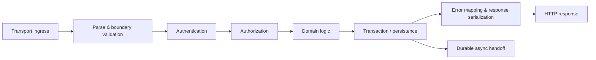
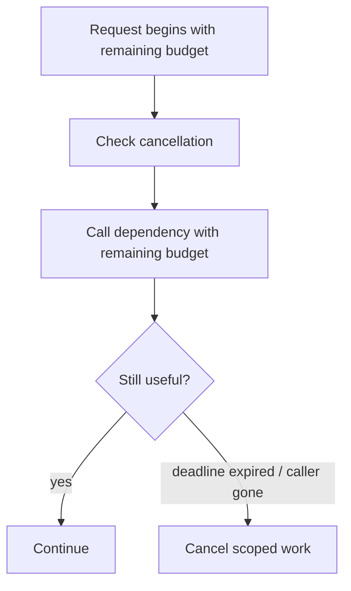
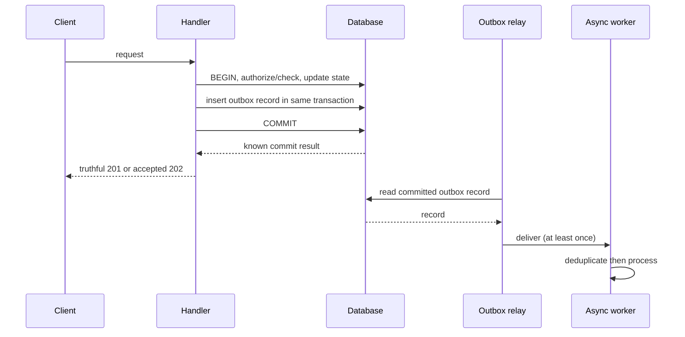

## TL;DR — one request, several failure boundaries

**Hypothetical checkout incident (not a documented outage):** A checkout handler opens a database transaction, then makes a payment-provider HTTP call before committing. When the provider becomes slow, the handler can hold database connections and locks while waiting. Under enough concurrency, a connection pool may fill even while application CPU looks healthy. An upstream gateway **might** respond with `504 Gateway Timeout` if it does not receive a timely response from its upstream; other clients may disconnect or see a different failure. This example asserts no measured QPS, CPU usage, pool size, outage duration, or payment-provider incident.

The timeout behavior depends on actual components and configuration. For example, NGINX's `proxy_read_timeout` defaults to `60s` for the HTTP proxy module, but measures the interval **between consecutive upstream reads**, **not** a 60-second deadline for an entire response. It is not interchangeable with an application request deadline, a database query timeout, or an RPC timeout. An Envoy deployment has its own separately configured timeouts.

A backend request crosses transport parsing, trust, domain, persistence and asynchronous-ownership boundaries. The design objective is to make each resource budget, authorization decision, durable outcome and response contract explicit—especially when a downstream service is slow or a caller disappears.



> 💡 **Rule of thumb:** Use a request-wide budget and propagate its remaining time when possible. Keep transactions only around the invariant they must protect. For a response that claims a write has committed, verify that commit; for an asynchronous `202 Accepted`, durably accept the work without falsely claiming completion. A timeout or cancellation does not prove that external effects or a database commit were undone.

### TL;DR 2.0
- **Request stages and optional branches:** A write request often crosses ingress, validation, authentication, authorization, domain work, persistence and response mapping; a read request need not open a transaction or enqueue asynchronous work. Order operations according to the real trust and consistency boundary.
- **Boundaries define correctness:** Parse transport formats at ingress, validate syntactic schemas at the boundary, and evaluate business invariants only inside domain logic. Never treat parsed transport headers as business truth.
- **End-to-end deadlines and cooperative cancellation:** Derive dependent call budgets from the remaining request budget where supported. Propagate cancellation to cooperative DB/RPC operations; a disconnect, cancellation request or timeout is not guaranteed to stop an already-running operation or undo an accepted side effect.
- **Truthful response and durable handoff:** If success means data was committed, verify the commit rather than trusting an in-memory promise. For accepted asynchronous work, persist the intent before returning `202` and offer observable status; process important side effects through durable work records or an outbox, with idempotent consumers.
- **High-impact failure mode:** Holding database transactions open across slow external HTTP calls can exhaust connections or prolong locks. Proxy read timeouts are not end-to-end deadlines; failure modes and resource exhaustion depend on measured concurrency, budgets and actual deployment behavior.

<TermBox term="Request context">
A **request context** is the small set of scoped information carried through one request: cancellation/deadline state, authenticated principal, request or correlation identifiers, trace context, and carefully selected metadata.

**Why it matters:** dependencies can share the same cancellation and observability boundary without using global state as an implicit transport.
</TermBox>

## 1. Ingress establishes transport facts, not business truth

At ingress, normalize only the facts needed to process safely: method, route, headers, body limits, proxy information according to the trust model, and inbound trace/request identifiers when valid.

Do not treat headers, route parameters, or JSON fields as trusted merely because a router parsed them. Parsing asks “can I represent this input?” Validation asks “is this structurally acceptable?” Authorization asks a different question: “may this principal perform this action on this resource?”

Set explicit body-size and parsing limits. Reject malformed input before expensive downstream work. Keep application assumptions visible even when a gateway also enforces limits so deployment changes cannot silently remove the protection.

## 2. Validate shape before domain work

Boundary validation should convert transport input into a form the domain layer can reason about. Typical checks include required fields, enum support, length/range limits, syntax, mutually exclusive options, and safe identifier normalization.

Keep **structural validation** separate from **business invariants**. “Quantity must be a positive integer” belongs near the boundary. “This account may not exceed its credit limit after the purchase” belongs with domain/persistence logic where concurrent state can be handled correctly.

## 3. Authentication and authorization are different gates

**Authentication** establishes who or what the caller is. **Authorization** decides whether that principal may perform the requested action on the target resource.

```text
parse credentials -> authenticate principal -> load relevant resource/context -> authorize action
```

Do not authorize only by a broad route role when the real rule is resource-specific. Conversely, avoid loading large domain graphs before rejecting unauthenticated callers when the resource is not needed for authentication.

Authentication failures and authorization denials should map to deliberate external semantics without leaking sensitive resource or identity details.

## 4. Give the request a deadline and propagate cancellation

A timeout in one dependency client is not a request-wide deadline. A request can spend time queueing, acquiring database connections, calling networks, retrying, serializing, and executing middleware before its final dependency call starts.

<TermBox term="Deadline and cancellation">
A **deadline** is the latest useful completion time for the request. **Cancellation** is the signal that scoped work should stop because the caller, server, or deadline no longer needs the result.

**Why it matters:** without propagation, downstream work can keep consuming scarce resources after its result is useless.
</TermBox>



Operational rules:

- derive dependency timeouts from remaining request budget instead of giving every layer a fresh full timeout;
- stop launching optional work when useful budget is nearly gone;
- propagate cancellation to database/network operations where supported; cancellation is cooperative and an in-flight call may ignore the signal or finish first;
- treat timeout, disconnect and an ambiguous commit/remote response as **unknown outcomes**, not proof of rollback. Expose an idempotency key or durable status lookup before client retries consequential requests;
- record deadline/cancellation distinctly from ordinary server failures.

Cancellation is resource control, not distributed rollback.

## 5. Keep domain work independent from HTTP mechanics

Translate validated input and principal context into an application/domain operation:

```text
HTTP request
  -> request DTO / command
  -> domain/application operation
  -> domain result or typed failure
  -> HTTP response mapping
```

Core rules should not need raw headers or status-code decisions. This keeps transport changes from rewriting invariants and allows the same operation to be invoked from a job, CLI, or another transport when appropriate.

Avoid a “service layer” that only renames controller methods without owning invariants or transaction boundaries; indirection alone is not a boundary.

## 6. Make the transaction boundary match the invariant

Open a database transaction only around state that must change atomically. Do not begin it at request ingress by default. Cheap validation and identity checks usually happen before the transaction; commit as soon as the required durable state is complete. However, authorization against mutable data can require rechecking or locking it **inside** the transaction to prevent a time-of-check/time-of-use race. Do not treat the conceptual diagram as a mandatory order for every endpoint.



Do not hold a transaction open while waiting on slow remote calls unless the invariant truly requires it and the lock/capacity cost is understood. A database transaction cannot atomically roll back email, a payment provider, webhook delivery, or another independent service.

If a side effect must be attempted after durable state commits, persist a durable handoff (for example an outbox record) in the same transaction when possible. A relay can retry and deliver duplicates, so the consumer needs idempotent processing; an outbox does **not** guarantee exactly-once external effects. Treat ambiguous commit acknowledgments as unknown outcomes and reconcile before retrying the entire write.

## 7. Separate response semantics from internal failures

<TermBox term="Error mapping">
**Error mapping** converts known internal outcomes into stable transport semantics: HTTP status, headers, and a machine-readable response body.

**Why it matters:** callers should react to documented categories rather than framework exception names or stack traces.
</TermBox>

| Internal outcome | Typical HTTP direction | Notes |
| --- | --- | --- |
| malformed request | 400 | request cannot be parsed or validated |
| unauthenticated | 401 | requires applicable `WWW-Authenticate` challenge under RFC 9110 |
| authenticated but forbidden | 403 | identity known, action denied |
| target absent | 404 | policy may intentionally avoid revealing existence |
| invariant conflict | 409 | useful for state/version conflicts |
| accepted async work | 202 | processing is not complete |
| upstream timeout observed by a gateway | 504 | emitted by an intermediary when the upstream does not respond in time; not every application timeout is 504 |
| unexpected dependency/server failure | 5xx | preserve internal evidence; return safe detail |

RFC 9110 defines HTTP status semantics. RFC 9457 defines a standard problem-details format for machine-readable API errors. Neither replaces domain-specific problem types and safe disclosure rules.

Do not convert every exception to `500` or every domain rejection to `400`. Preserve distinctions between caller-correctable input, authorization decisions, conflicts, accepted asynchronous work, and genuine server failures.

## 8. Decide what must finish before returning

There are three useful buckets:

1. **Must complete before response:** work required for the response to be truthful, such as committing the state the response claims exists.
2. **May continue asynchronously with durable ownership:** email, indexing, media processing, webhooks, or fan-out that must survive request-process death.
3. **Best-effort request-local work:** only effects whose loss is explicitly acceptable.

Avoid “fire and forget” promises created by launching an in-process task and returning `200`. The process can restart, scale down, or terminate after the response. If the effect matters, transfer ownership durably.

HTTP `202 Accepted` is intentionally noncommittal: processing was accepted, not completed, and it might never complete successfully. When the API claims durable acceptance, commit the job/intent first; return a status resource or equivalent authorized lookup so callers can observe progress and reconcile timeouts. Protect each status lookup with resource-level authorization.

## 9. Carry evidence through the lifecycle

Useful correlation fields include:

```text
request_id
trace_id / traceparent-derived trace identity
authenticated principal or safe principal class
route / operation name
result category
latency
selected dependency timings
```

A generated `request_id` can help support correlation, but it is not automatically the same as a distributed trace ID. W3C Trace Context standardizes `traceparent` and `tracestate` propagation so tracing systems can connect spans across service boundaries.

Do not put secrets, bearer tokens, whole request bodies, or unnecessary personal data into logs merely because the data is request-scoped.

Operators should be able to distinguish validation/auth rejection, domain conflict, deadline/cancellation, dependency failure, transaction failure, synchronous success, and accepted asynchronous handoff.

## Hypothetical failure: success returned before durable state existed

> **Constructed scenario, not a reported incident:** A handler validates an order, starts a database write, launches an in-process task to publish a confirmation event, and returns `200 OK` before awaiting commit. If the commit fails but the task publishes an event, the response and event both incorrectly claim the order exists.

**Impact:** Customers received confirmation for orders that did not exist durably. Downstream consumers observed events for missing state while API logs recorded successful responses.

**Root cause:** The lifecycle had no explicit truthful-response boundary. Durable state, asynchronous side effects, and HTTP response mapping were allowed to race independently.

**Correct pattern:** Define the invariant first. Commit required state and durable handoff together before claiming a completed write; emit external events only through committed outbox work, with idempotent consumers. Map known commit failures to an appropriate response. If the connection fails before the commit result is known, treat the outcome as **ambiguous**: reconcile via stable job/order identity before retry rather than claiming rollback.

## Operate the lifecycle as a checklist

- [ ] **Ingress:** Are body/header limits and proxy trust assumptions explicit?
- [ ] **Validation:** Are structural checks separate from concurrency-sensitive business invariants?
- [ ] **Identity:** Is authentication complete before principal-dependent work?
- [ ] **Authorization:** Is access checked against the real resource/action rather than only a broad role?
- [ ] **Deadline:** Is there one request-wide budget rather than a fresh full timeout at each layer?
- [ ] **Cancellation:** Can downstream work stop when the result is no longer useful?
- [ ] **Domain boundary:** Can core rules run without raw HTTP objects or status-code decisions?
- [ ] **Transaction:** Does the transaction cover exactly the atomic invariant and end promptly?
- [ ] **After commit:** Are important side effects durably owned before they run asynchronously, with duplicate-safe consumers?
- [ ] **Ambiguous outcome:** If a client or database times out after the write may have committed, can the caller reconcile by stable identity before retry?
- [ ] **Error mapping:** Are known failures mapped to stable client-visible semantics?
- [ ] **Response truth:** Has everything needed to make the response truthful completed before success is returned?
- [ ] **Evidence:** Can `request_id`/trace correlation reconstruct rejection, dependency time, transaction outcome, and async handoff?

## Check your mental model

> A request has 900 ms remaining. It needs a database write and then a confirmation email. The commit can take 300–700 ms; the email provider can take 2 seconds. What belongs inside the request path?

<details>
<summary>Show the reasoning</summary>

The database work required to make the response truthful belongs inside the bounded request path, with the remaining deadline propagated to connection acquisition, queries, and commit.

The email should not extend the transaction or receive a fresh two-second timeout after the request budget is exhausted. If delivery matters, persist a durable email/job handoff with the committed state, commit, return the synchronous result, then let an asynchronous worker send it using its own retry/deadline policy.

If the database definitely fails or rolls back, return the appropriate failure. If the deadline expires **without a known commit result**, return a documented *unknown/timeout* outcome rather than success and require safe idempotency/status reconciliation before another attempt. A lost response does not prove a lost commit.
</details>

## Agent rule

When changing a backend request path, do not reason only about the happy-path handler body. Identify the request-wide deadline/cancellation boundary, authentication and authorization gates, atomic transaction boundary, the point where a success response becomes truthful, ownership of work after commit, explicit error mapping, and correlation evidence that proves each boundary in production.

## Sources

- [RFC 9110 — HTTP Semantics](https://www.rfc-editor.org/rfc/rfc9110.html)
- [RFC 9457 — Problem Details for HTTP APIs](https://www.rfc-editor.org/rfc/rfc9457.html)
- [W3C — Trace Context](https://www.w3.org/TR/trace-context/)
- [NGINX HTTP proxy module — proxy_read_timeout](https://nginx.org/en/docs/http/ngx_http_proxy_module.html#proxy_read_timeout)
- [Go — Canceling in-progress database operations](https://go.dev/doc/database/cancel-operations)
- [AWS Prescriptive Guidance — Transactional outbox](https://docs.aws.amazon.com/prescriptive-guidance/latest/cloud-design-patterns/transactional-outbox.html)
