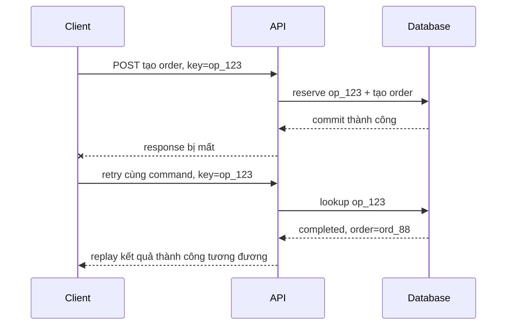
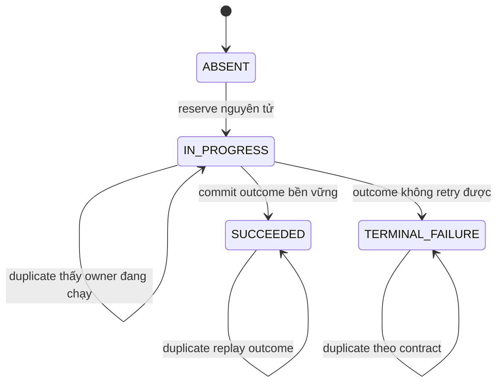
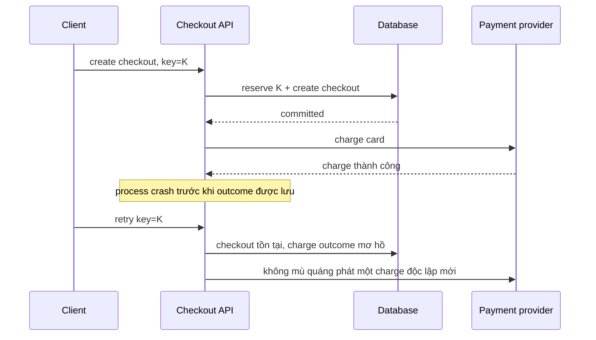

# Idempotency: Biến retry thành thao tác an toàn dù kết quả không chắc chắn

**Ví dụ tự xây dựng, không phải sự cố thanh toán thực tế:** Một khách hàng gửi yêu cầu thanh toán **200 USD** qua kết nối di động không ổn định. Cổng thanh toán xử lý yêu cầu đầu tiên, nhưng phản hồi bị mất. Ứng dụng tự thử lại, rồi khách hàng chủ động gửi lại cùng thao tác thêm một lần: tổng cộng **ba yêu cầu cho một lần mua**. Nếu mỗi yêu cầu có thể tạo giao dịch trừ tiền độc lập, khách hàng **có nguy cơ** bị trừ tới ba lần (600 USD) thay vì một lần (200 USD). Đây là tình huống minh họa, không phải số liệu sự cố hay tranh chấp được ghi nhận.

Trong mạng phân tán, lỗi timeout vốn dĩ mang tính chất mơ hồ: bạn không thể biết thao tác bị đứt gãy trước khi tới máy chủ, trong khi đang xử lý, hay trên đường trả về kết quả. **Tính lũy đẳng (Idempotency)** chính là giao ước kiến trúc biến việc thử lại khi gặp sự cố không chắc chắn thành một thao tác có thể thử lại an toàn trong phạm vi hợp đồng đã thiết kế.

## Tóm tắt nhanh

> 💡 **Quy tắc bỏ túi:** Phương thức HTTP an toàn như `GET` mang ngữ nghĩa chỉ đọc, dù máy chủ vẫn có thể ghi log hoặc số liệu vận hành. Phương thức lũy đẳng như `PUT` giữ nguyên **hiệu ứng dự kiến** khi lặp lại request giống nhau; mã phản hồi và log không nhất thiết giống hệt. Với thao tác nghiệp vụ cần retry an toàn, hãy ghi nhận Idempotency Key có phạm vi rõ ràng theo cách nguyên tử và bảo vệ từng tác dụng phụ bên ngoài transaction.

- **An toàn và lũy đẳng là hai thuộc tính khác nhau:** `GET`, `HEAD` có ngữ nghĩa yêu cầu chỉ đọc; máy chủ vẫn có thể ghi log. `PUT`, `DELETE` và các phương thức an toàn là lũy đẳng theo HTTP: lặp lại request giữ nguyên hiệu ứng dự kiến, không nhất thiết trả cùng response hoặc không tạo log. `POST` có thể được ứng dụng bổ sung hợp đồng retry riêng.
- **Định danh thao tác logic ổn định:** Client phải sinh `Idempotency-Key` một lần duy nhất khi hành động nghiệp vụ bắt đầu và tái sử dụng đúng key đó cho mọi nỗ lực thử lại; việc sinh UUID ngẫu nhiên mới ở mỗi lần retry qua mạng sẽ phá vỡ hoàn toàn cơ chế lọc trùng.
- **Giữ chỗ nguyên tử và đối chiếu nội dung yêu cầu:** Ghi nhận định danh thao tác theo cách nguyên tử, chẳng hạn dùng ràng buộc duy nhất và `INSERT ... ON CONFLICT`. Khi cần so sánh nội dung, gắn khóa với dấu vân tay (*fingerprint*) ổn định hoặc các trường đã chuẩn hóa. SHA-256 chỉ là một cách triển khai, **không phải yêu cầu bắt buộc của bản nháp IETF**. Từ chối việc dùng cùng khóa cho thao tác khác.
- **Điều phối hiệu ứng bên ngoài (External side effects):** Transaction cơ sở dữ liệu cục bộ không thể rollback cổng thanh toán bên thứ ba hay nhà cung cấp email; cần truyền downstream idempotency key hoặc ghi nhận trạng thái bền vững trước khi gọi ra ngoài.
- **Tranh chấp nguy hiểm:** Cách kiểm tra trước rồi trừ tiền (`if key not found -> charge -> insert key`) có thể khiến hai yêu cầu đồng thời cùng thấy khóa chưa tồn tại và cùng gọi lệnh trừ tiền. Cần bảo vệ riêng cả bước giữ chỗ nguyên tử lẫn định danh giao dịch tại cổng thanh toán.



<TermBox term="Idempotency">
**Tính lũy đẳng (idempotency)** nghĩa là nhiều lần thực hiện cùng yêu cầu có tác động dự kiến lên máy chủ giống như khi thực hiện một lần.

**Vì sao quan trọng:** hệ thống phân tán thường không biết chắc kết quả khi kết nối lỗi. Tính lũy đẳng cho phép bên gọi thử lại mà không vô tình tạo trạng thái nghiệp vụ trùng.
</TermBox>

## 1. Tính lũy đẳng của phương thức HTTP hữu ích nhưng chưa đủ cho ứng dụng

RFC 9110 định nghĩa một HTTP method là idempotent khi nhiều request giống hệt nhau có cùng **hiệu ứng dự kiến** như một request. Các phương thức an toàn, `PUT` và `DELETE` được định nghĩa là lũy đẳng theo ngữ nghĩa HTTP. RFC 9110 cho phép các hiệu ứng phụ như ghi access log và nêu rõ phản hồi giữa các lần gọi có thể khác nhau.

Điều đó không có nghĩa mọi implementation tự động đúng. Một handler `PUT` vẫn charge thẻ mỗi lần chạy đã thêm side effect không idempotent phía sau một method contract idempotent.

Ngược lại, một command `POST` có thể được thiết kế để retry của cùng một thao tác logic không tạo duplicate, dù `POST` nói chung không idempotent theo HTTP semantics.

Điểm cần tách rõ:

```text
thuộc tính của HTTP method -> repeated request được định nghĩa có ý nghĩa gì
application idempotency    -> một thao tác nghiệp vụ logic được nhận diện và bảo vệ ra sao
```

Đừng tuyên bố rằng thêm một header làm thay đổi semantics chuẩn của `POST`. Application của bạn đang bổ sung một retry contract mạnh hơn cho endpoint cụ thể.

## 2. Một thao tác logic cần một định danh ổn định

<TermBox term="Idempotency key">
**Idempotency key** là mã định danh ở tầng ứng dụng cho một thao tác nghiệp vụ. Mọi lần thử lại cùng thao tác phải dùng lại mã đó.

**Vì sao quan trọng:** nếu mỗi lần thử lại sinh khóa mới, máy chủ sẽ coi đó là thao tác mới và không phân biệt được với yêu cầu chủ ý khác.
</TermBox>

Ví dụ:

```http
POST /orders
Idempotency-Key: "3e8a3c8f-4f32-4474-b7fa-5f9760dd67b4"

{
  "cart_id": "cart_42",
  "shipping_address_id": "addr_7"
}
```

API phải công bố cách dùng khóa và quy tắc trả kết quả khi lặp yêu cầu. Tính đến **18/11/2026**, IETF HTTPAPI có bản nháp **đang hoạt động** `draft-ietf-httpapi-idempotency-key-header-08` (công bố 22/10/2026, dự kiến hết hạn 25/04/2027), **chưa phải RFC chính thức**. Theo bản nháp này, `Idempotency-Key` là chuỗi theo chuẩn trường HTTP có cấu trúc (RFC 9651), nên giá trị UUID trong ví dụ đặt trong dấu nháy kép. API nhà cung cấp có thể quy định cách xử lý khác; không mặc định tất cả đều tuân thủ bản nháp.

Client nên tạo key **một lần khi logical command được tạo**, sau đó giữ nguyên key cho mọi retry do timeout, connection reset, process restart hoặc retry scheduler.

Sai:

```text
attempt 1 -> key A
network timeout
attempt 2 -> key B   # server nhìn thấy operation khác
```

Đúng:

```text
logical checkout -> key A
attempt 1 -> key A
network timeout
attempt 2 -> key A
```

## 3. Giới hạn phạm vi khóa để các bên gọi không liên quan không va chạm

Raw key hiếm khi là toàn bộ lookup identity.

Scope hữu ích có thể là:

```text
tenant_id + operation_type + idempotency_key
account_id + endpoint + idempotency_key
principal_id + command_name + idempotency_key
```

Vì sao scope quan trọng:

- hai tenant có thể vô tình sinh cùng random value;
- một key dùng lại trên endpoint khác không nên alias hai command khác nhau;
- caller độc hại không nên đoán key của tenant khác rồi replay stored response;
- retention và uniqueness rule có thể khác nhau theo operation class.

Một record bền vững có thể trông như:

```text
scope_key       tenant_17:create_order
idempotency_key 3e8a3c8f-...
fingerprint     sha256(canonical request semantics)
state           IN_PROGRESS | SUCCEEDED | TERMINAL_FAILURE
resource_id     ord_88
status_code     201
response_ref    ...
created_at      ...
expires_at      ...
```

Schema cụ thể tùy hệ thống. Invariant là một scoped key chỉ tên một logical command trong cửa sổ retry được hỗ trợ.

## 4. Gắn khóa với nội dung có ý nghĩa của yêu cầu

Chỉ dựa vào khóa sẽ nguy hiểm nếu bên gọi vô tình dùng lại nó với nội dung khác. Cần quy định rõ khi nào hai yêu cầu thuộc cùng một thao tác.

Ví dụ:

```text
key = K, amount = 100 USD
sau đó: key = K, amount = 900 USD
```

Replay im lặng kết quả đầu tiên sẽ gây hiểu nhầm. Thực thi payload thứ hai thì phá deduplication.

Khi hợp đồng API yêu cầu, hãy lưu **dấu vân tay yêu cầu** hoặc đối chiếu các trường chuẩn hóa xác định thao tác. Khi gặp yêu cầu trùng:

```text
cùng key + cùng fingerprint -> đường retry/replay
cùng key + payload khác     -> conflict / client error
```

<TermBox term="Request fingerprint">
**Dấu vân tay của yêu cầu (request fingerprint)** là giá trị băm ổn định hoặc biểu diễn đã chuẩn hóa của các trường xác định thao tác nghiệp vụ. Đây là cơ chế **tùy chọn** trong bản nháp IETF, không bắt buộc dùng SHA-256.

**Vì sao quan trọng:** nó phát hiện việc cùng key bị dùng cho request khác nhau, dù do lỗi client hay cố ý.
</TermBox>

Canonicalization rất quan trọng. Hash raw JSON bytes có thể coi hai object tương đương nhưng khác thứ tự field là hai request khác nhau. Hãy quyết định những field đã normalize nào tham gia fingerprint, gồm path parameter và authenticated scope có ý nghĩa.

Không đưa transport field biến động như request ID hay timestamp vào fingerprint trừ khi chúng thật sự thuộc business semantics.

## 5. Phải giữ chỗ nguyên tử trước khi xử lý các yêu cầu trùng đồng thời

Implementation sau bị lỗi:

```text
if not exists(key):
    execute_business_effect()
    insert(key)
```

Hai retry đồng thời có thể cùng quan sát “không tồn tại” rồi cùng thực thi.

Key phải được **reserve nguyên tử trước khi các contender duplicate vượt qua ranh giới effect được bảo vệ**.

Primitive thường dùng:

- unique constraint trong database cùng `INSERT`/upsert;
- compare-and-set;
- tạo key nguyên tử trong shared store;
- transaction vừa insert operation record vừa thay đổi authoritative state.



Duplicate đến khi attempt đầu vẫn `IN_PROGRESS` cần contract rõ. Tùy endpoint, nó có thể:

- đợi ngắn để attempt đầu hoàn tất;
- trả trạng thái “operation đang xử lý”;
- trả resource/operation URL để client poll;
- chặn concurrent execution nhưng cho phép replay sau đó.

Không khởi động business effect thứ hai chỉ vì response của attempt đầu chưa sẵn sàng.

## 6. Khi có thể, lưu bản ghi chống lặp và dữ liệu chuẩn trong cùng một giao dịch

Giả sử create order ghi cả:

```text
idempotency_operations
orders
```

Nếu hai bảng cùng nằm trong một relational database, pattern mạnh là:

```text
BEGIN
  reserve scoped idempotency key
  kiểm fingerprint
  tạo authoritative order state
  lưu outcome/resource reference bền vững
COMMIT
```

Như vậy crash không thể commit order nhưng làm mất idempotency record, hoặc commit success record nhưng rollback order.

Đây là lý do “sau khi handler thành công thì ghi dedupe cache” yếu hơn vẻ ngoài. Process crash giữa business commit và dedupe write sẽ mở lại duplicate window.

Khi idempotency store và authoritative database là hai hệ thống khác nhau, phải mô tả partial-failure contract rõ. Không còn atomic boundary miễn phí.

## 7. Tác dụng phụ bên ngoài cần được bảo vệ riêng

Database transaction không thể biến email provider, payment gateway, webhook receiver và message broker thành một atomic commit duy nhất.

Xét flow:



Outer idempotency key không tự biến provider call thành “đúng một lần”.

Pattern an toàn có thể gồm:

- truyền stable downstream idempotency key nếu provider hỗ trợ;
- mô hình payment như một durable operation có identity và reconciliation state riêng;
- dùng transactional outbox để handoff side effect bất đồng bộ một cách bền vững;
- enforce natural uniqueness invariant tại downstream boundary;
- reconcile outcome mơ hồ từ provider trước khi phát command mới.

**Exactly-once luôn có scope theo một boundary.** Khi nói “endpoint idempotent”, phải chỉ rõ business effect nào thực sự được bảo vệ.

## 8. Trả lại kết quả tương đương, không nhất thiết giữ nguyên từng byte mãi mãi

Khi duplicate của operation đã hoàn tất đến, server thường không thực thi effect lần nữa. Nó có thể trả:

- status/body đã lưu;
- resource ID gốc cùng representation hiện tại được dựng lại;
- operation result reference ổn định;
- response khác nhưng được tài liệu hóa là equivalent replay semantics.

Lựa chọn đúng phụ thuộc API contract.

Stripe là một ví dụ implementation công khai: với idempotent request trong API v1, Stripe mô tả việc lưu status code và body của kết quả đầu tiên sau khi execution bắt đầu, so sánh parameter khi key được dùng lại, rồi trả stored result cho request sau. Đây là ví dụ cụ thể, không phải yêu cầu phổ quát cho mọi API.

Cần đặc biệt rõ với failure. Validation failure chưa vượt effect boundary có thể được sửa rồi retry; failure xảy ra sau khi effect bắt đầu có thể cần durable terminal state hoặc ambiguous state. Đừng cache mọi `500` theo phản xạ, và cũng đừng re-execute mọi `500` theo phản xạ. Contract phải xuất phát từ operation boundary.

## 9. Thời hạn lưu khóa quyết định phạm vi bảo đảm

Idempotency record không nhất thiết sống mãi.

Chọn thời gian lưu dựa trên:

- client retry/backoff horizon tối đa;
- queue redelivery horizon;
- retry offline/mobile;
- duplicate-risk hoặc dispute window của business;
- storage cost và privacy requirement;
- việc domain có natural business key tạo uniqueness dài hạn hơn hay không.

Nếu key bị xóa sau 24 giờ, retry ở giờ thứ 25 có thể bị xem là operation mới nếu không còn invariant nào khác ngăn duplicate.

Vì vậy hãy mô tả guarantee trung thực:

```text
cùng scoped key trong retention window -> duplicate-safe replay
cùng key sau khi retention hết hạn      -> có thể chạy như operation mới
```

TTL không chỉ là housekeeping cho storage. Nó xác định lúc duplicate protection chấm dứt.

## 10. Chống lặp và ràng buộc duy nhất bảo vệ hai lớp khác nhau

Đôi khi domain đã có natural unique identity:

```text
một invoice cho mỗi subscription + billing_period
một fulfillment cho mỗi order_line
một refund cho mỗi merchant_refund_id
```

Unique constraint trên invariant này mạnh hơn việc chỉ dựa vào arbitrary retry key.

Có thể dùng cả hai:

- idempotency key bảo vệ transport retry và tạo replay contract hướng caller;
- domain uniqueness bảo vệ business invariant kể cả khi caller mất hoặc đổi retry key.

Đừng để idempotency table trở thành lớp duy nhất ngăn business state bất khả thi.

## 11. Tình huống giả định: kiểm tra khóa rồi mới trừ tiền

**Ví dụ tự xây dựng, không phải báo cáo sự cố thực tế:** Xét một API thanh toán:

```text
if idempotency_key not found:
    charge_card()
    save_order()
    save_idempotency_result()
```

Hai request dùng cùng key đến gần như đồng thời vì mobile client retry khi mạng chậm. Cả hai process cùng check trước khi bất kỳ process nào insert key.

**Hậu quả:** khách hàng có thể bị charge hai lần dù cả hai request mang cùng một idempotency key. Support nhìn thấy một logical checkout nhưng nhiều provider charge.

**Nguyên nhân cốt lõi:** implementation xem idempotency như convention lookup thay vì concurrency invariant. `check -> effect -> insert` không nguyên tử, còn external charge không có stable downstream operation identity.

**Cách khắc phục chuẩn:** reserve scoped key một cách nguyên tử trước execution, bind key với request fingerprint, persist authoritative operation state trong transaction, và cho payment command một idempotent/reconciliation boundary riêng. Concurrent duplicate cùng quan sát một operation thay vì bắt đầu charge mới.

## 12. Theo dõi hiệu quả cơ chế chống lặp bằng số liệu

Signal hữu ích gồm:

- số operation mới;
- số duplicate replay;
- conflict cùng key nhưng khác fingerprint;
- collision đồng thời ở trạng thái `IN_PROGRESS`;
- tuổi của operation đang xử lý lâu nhất;
- latency/error của reservation store;
- phân bố outcome theo operation type;
- record hết retention trong khi retry vẫn đến;
- downstream duplicate hoặc reconciliation event;
- fail-open/fail-closed decision khi idempotency store không khả dụng.

Với write có rủi ro cao, fail-open âm thầm khi idempotency store lỗi có thể tệ hơn việc trả retryable error. Với operation ít rủi ro, availability có thể dẫn đến policy khác. Hãy explicit theo từng operation class.

## Tự kiểm tra

Client gửi `POST /payments` với idempotency key `K`. Server charge provider thành công nhưng timeout trước khi ghi idempotency result. Client retry cùng key.

Endpoint đã an toàn chỉ vì key được dùng lại chưa?

<details>
<summary>Xem giải thích chi tiết</summary>

Chưa. Dùng lại key là cần thiết nhưng không đủ. Durable operation state phía server vẫn nói payment outcome chưa biết, trong khi provider có thể đã charge. Retry path phải reconcile hoặc dùng lại stable downstream payment identity trước khi phát charge khác. Idempotency guarantee chỉ kéo dài tới những boundary mà hệ thống thực sự coordination được.

</details>

## Danh sách rà soát

- [ ] **Thao tác logic:** Một idempotency key đại diện chính xác cho intent nghiệp vụ nào?
- [ ] **Vòng đời key:** Key có được tạo một lần và dùng lại cho mọi retry của operation đó không?
- [ ] **Scope:** Lookup có scope theo tenant/principal và operation để command không liên quan không va chạm không?
- [ ] **Fingerprint:** Server có từ chối cùng key nhưng semantics request khác không?
- [ ] **Reservation nguyên tử:** Concurrent duplicate có thể cùng race qua check trước khi key được reserve không?
- [ ] **Đang xử lý:** Duplicate nhận gì khi attempt đầu vẫn active?
- [ ] **Transaction:** Authoritative state và idempotency outcome có commit cùng nhau được không?
- [ ] **External effect:** Mỗi downstream effect ngoài transaction có duplicate-safe hoặc reconciliation boundary riêng không?
- [ ] **Replay:** Hành vi response khi lặp lại có được tài liệu hóa ổn định cho client không?
- [ ] **Retention:** Cửa sổ retry được hỗ trợ có rõ không, và điều gì xảy ra sau khi hết hạn?
- [ ] **Domain invariant:** Có natural uniqueness constraint nào nên bảo vệ business state độc lập không?
- [ ] **Failure policy:** Điều gì xảy ra khi chính idempotency store không khả dụng?
- [ ] **Bằng chứng:** Operator có phân biệt first execution, replay, conflict, stuck operation và downstream ambiguity không?

## Quy tắc cho agent

Khi làm một operation idempotent, không dừng ở “nhận idempotency key”. Hãy định nghĩa một thao tác logic, stable key scope, request fingerprint, atomic reservation, hành vi khi đang `IN_PROGRESS`, durable outcome, retention horizon và mọi external effect boundary. Retry phải dùng lại cùng operation identity.

## Tài liệu tham khảo

- [RFC 9110 — Phương thức lũy đẳng §9.2.2](https://www.rfc-editor.org/rfc/rfc9110.html#section-9.2.2).
- [IETF HTTPAPI — Idempotency-Key, bản nháp 08](https://datatracker.ietf.org/doc/draft-ietf-httpapi-idempotency-key-header/): **Internet-Draft đang hoạt động** ngày 18/11/2026, chưa phải RFC.
- [RFC 9651 — Trường HTTP có cấu trúc](https://www.rfc-editor.org/rfc/rfc9651.html): cú pháp chuỗi có dấu nháy kép.
- [Stripe — Idempotent requests](https://docs.stripe.com/api/idempotent_requests): API v1 và API v2 có cách trả kết quả khác nhau; đây là ví dụ nhà cung cấp.
