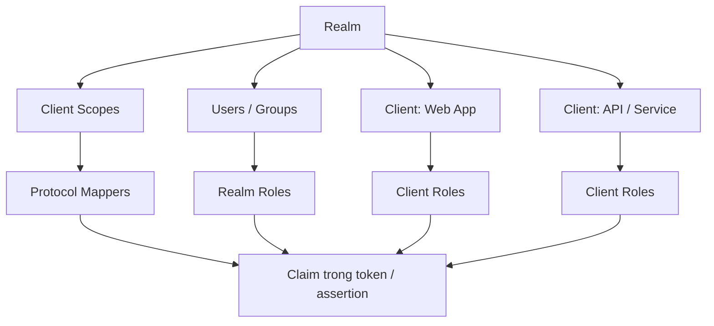
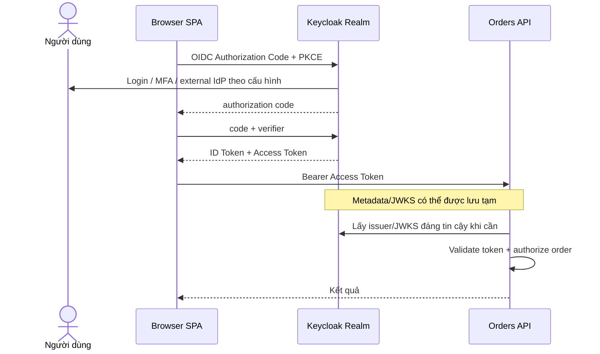
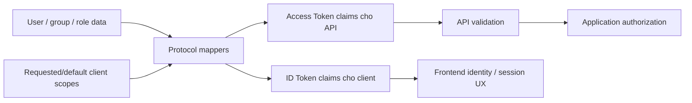

# Keycloak trong thực tế: Realm, client, vai trò, phạm vi và đăng nhập trình duyệt

## Tóm tắt nhanh

Keycloak dễ hiểu hơn khi ta không học thuộc tên các mục trên trang quản trị, mà gắn từng thành phần với trách nhiệm cụ thể trong giao thức.

**Realm** là một miền bảo mật. **Client** đại diện cho ứng dụng hoặc dịch vụ tương tác với Keycloak. **Client scope** và **protocol mapper** quyết định những thuộc tính/vai trò nào được đưa vào token hoặc thông điệp xác thực. Vai trò cấp realm hay client chỉ là đầu vào cho phân quyền, không thay thế bước kiểm tra quyền trên từng tài nguyên tại API.

Với ứng dụng JavaScript chạy hoàn toàn trên trình duyệt, client là **public**: không thể giữ client secret an toàn trong bundle. [Keycloak JavaScript adapter hiện hành](https://www.keycloak.org/securing-apps/javascript-adapter) dùng OIDC, mặc định Standard (Authorization Code) flow và `pkceMethod: 'S256'`. Đây là **hành vi của phiên bản adapter đang dùng**, không phải cam kết của mọi bản Keycloak hoặc mọi cách tích hợp; cần kiểm tra package/config thực tế.

> 💡 **Quy tắc bỏ túi:** Cấu hình Keycloak từ ngoài vào trong: **realm trust boundary → client type và redirect origin → login flow → token content → API validation → application authorization**.

- **Realm không phải không gian tên cho biến môi trường của giao diện.** Đó là ranh giới bảo mật và quản trị danh tính.
- **Client ID không phải secret.**
- **Realm role, client role, scope và claim là các khái niệm khác nhau.**
- **Protocol mapper định hình dữ liệu trong token và assertion, không trực tiếp thực thi quyền trên từng tài nguyên của API.**
- **Sai lầm rủi ro cao:** Đưa bí mật ứng dụng vào mã SPA hoặc cho mọi API chấp nhận JWT được Keycloak ký mà không kiểm tra nhà phát hành, đối tượng nhận và mục đích sử dụng token.



<TermBox term="Realm">
**Realm** là miền bảo mật của Keycloak chứa người dùng, thông tin xác thực, vai trò, đăng ký ứng dụng, phiên và chính sách. Các realm có ranh giới quản trị và trạng thái danh tính riêng.
</TermBox>

## 1. Liên hệ thuật ngữ Keycloak với trách nhiệm của giao thức

| Thuật ngữ Keycloak | Mô hình tư duy thực tế |
| --- | --- |
| Realm | Security/identity domain và issuer boundary |
| Client | Application hoặc service đăng ký với Keycloak |
| Client ID | Public identifier của client registration |
| Client authentication | Client có tự authenticate tại token endpoint hay không |
| Realm role | Role namespace dùng rộng trong realm |
| Client role | Role namespace thuộc riêng một client |
| Client scope | Bundle tái sử dụng cho scope/role mapping và token mapper |
| Protocol mapper | Rule map user/session/role data sang OIDC claim hoặc SAML assertion |
| Identity provider | External IdP mà Keycloak có thể broker |
| User federation | Tích hợp external user directory/store như LDAP |
| Service account | Client hành động thay mặt chính nó |

Admin Console trở nên dễ đọc hơn khi mỗi configuration được gắn lại với protocol boundary.

<TermBox term="Client Scope">
**Client scope** là configuration tái sử dụng trong Keycloak có thể đóng góp protocol mapper và role-scope mapping cho client. Nó giúp kiểm soát claim/role nào được request hoặc phát hành cho client.
</TermBox>

## 2. Tách trách nhiệm của giao diện và API

Giả sử bạn có:

- React SPA: `https://app.example.com`;
- Orders API: `https://api.example.com`;
- Keycloak issuer: `https://id.example.com/realms/acme`.

Giao diện là ứng dụng OIDC. API là máy chủ tài nguyên có nhiệm vụ xác minh access token và kiểm tra quyền truy cập.

Đừng để giao diện quyết định Alice có quyền sửa đơn hàng thuộc khách hàng tổ chức khác hay không.



## 3. Phân biệt ứng dụng công khai và ứng dụng giữ được bí mật

Với JavaScript chạy hoàn toàn trong trình duyệt, tài liệu Keycloak yêu cầu dùng ứng dụng công khai vì không có cách an toàn để lưu bí mật ứng dụng trong mã phía client.

Trên trang quản trị hiện tại, điều đó tương ứng với việc tắt `Client authentication` cho ứng dụng trình duyệt.

BFF chạy trên máy chủ có thể là confidential client vì có thể bảo vệ thông tin xác thực ứng dụng hoặc dùng phương thức xác thực client mạnh hơn.

Đừng chọn “confidential” chỉ vì ứng dụng xử lý dữ liệu quan trọng.

Câu hỏi đúng là:

> Client instance này có thật sự bảo vệ được authentication credential khỏi user và attacker kiểm soát client environment không?

## 4. Giới hạn chặt chẽ URI chuyển hướng và nguồn truy cập

Với SPA, một cấu hình dễ gây rủi ro là cho phép quá nhiều URI chuyển hướng hoặc nguồn truy cập.

Ưu tiên nguồn ứng dụng và địa chỉ callback chính xác hoặc được giới hạn chặt chẽ. Ký tự đại diện quá rộng có thể làm phản hồi ủy quyền bị gửi tới nơi không mong muốn, dẫn đến lộ mã ủy quyền hoặc token.

Tài liệu Keycloak JavaScript adapter khuyến nghị giữ `Valid Redirect URIs` và `Web Origins` cụ thể nhất có thể.

**Kiểm tra phiên bản và cơ chế token:** Khi nâng cấp Keycloak server hoặc `keycloak-js`, xác nhận `flow`, `pkceMethod` và redirect URI thực tế bằng network trace và test. PKCE không biến SPA thành confidential client; API phải xác thực access token theo issuer, audience/purpose và kiểm soát quyền trên từng object ngay cả khi role đã nằm trong token.

## 5. Hiểu rõ những gì thư viện Keycloak JavaScript thực hiện

Thư viện `keycloak-js` triển khai luồng OIDC cho ứng dụng trình duyệt tương tác với Keycloak.

Theo tài liệu hiện hành, thư viện có những đặc điểm sau:

- chạy trên OIDC;
- mặc định Authorization Code flow;
- PKCE `S256` bật mặc định;
- startup mode `login-required` và `check-sso`;
- ứng dụng phải tự gắn access token dưới dạng Bearer vào yêu cầu API; thư viện không tự thêm header vào mọi lệnh `fetch`;
- làm mới access token bằng `updateToken()`;
- thư viện giữ access token và refresh token trong bộ nhớ thay vì tự lưu vào bộ nhớ bền vững của trình duyệt.

Ví dụ cấu hình và gọi API ở mức khái niệm:

```ts
import Keycloak from 'keycloak-js';

const keycloak = new Keycloak({
  url: 'https://id.example.com',
  realm: 'acme',
  clientId: 'web-app',
});

await keycloak.init({
  onLoad: 'check-sso',
  pkceMethod: 'S256',
});

if (!keycloak.authenticated) throw new Error('Login required');
await keycloak.updateToken(30);
if (!keycloak.token) throw new Error('Missing access token');

const response = await fetch('https://api.example.com/orders', {
  headers: { Authorization: `Bearer ${keycloak.token}` },
});
```

**`keycloak-js` không tự gắn header `Authorization` cho `fetch`**. Ứng dụng phải kiểm tra phiên đăng nhập, làm mới token khi cần và tự thêm Bearer token vào yêu cầu API. Địa chỉ trong ví dụ là giả định; đoạn mã chưa xử lý các lỗi phản hồi hoặc điều kiện triển khai thực tế.

Không đưa bí mật ứng dụng vào cấu hình này.

**Giới hạn quyền riêng tư của trình duyệt:** Luồng `check-sso` im lặng và iframe kiểm tra phiên Keycloak chịu ảnh hưởng của chính sách cookie bên thứ ba. Khi cookie bên thứ ba bị chặn, thư viện có thể chuyển sang chuyển hướng trang chính, không dùng iframe hoặc chỉ phát hiện đăng xuất ở lần làm mới token sau đó. Không được mặc định đăng xuất liên ứng dụng luôn có hiệu lực tức thì.

## 6. Vai trò cấp realm và client là đầu vào cho phân quyền

Realm role như `employee` có thể tái sử dụng rộng.

Client role như `orders-api:refund` thuộc role namespace của một client.

Chọn model theo ownership và reuse:

- dùng realm role cho identity/entitlement category thật sự dùng toàn realm;
- dùng client role khi authority thuộc application/service namespace cụ thể;
- giữ role đủ coarse để quản lý, rồi áp resource/context check trong API.

Role claim `orders-admin` vẫn không trả lời “admin này có được sửa tenant X không?” nếu thiếu application policy.

## 7. Client scope và protocol mapper quyết định dữ liệu trong token

<TermBox term="Protocol Mapper">
**Protocol mapper** chỉ cho Keycloak cách map user attribute, role, session data hoặc fixed value thành OIDC token claim hay SAML assertion data cho client/client scope.
</TermBox>

Ví dụ:

- map internal user attribute `department=finance` sang token claim;
- include role namespace trong access token;
- rename claim cho legacy application;
- chỉ expose claim mà một client scope cụ thể cần.

Tránh đưa toàn bộ kho người dùng vào token. Quá nhiều thuộc tính làm tăng phụ thuộc giữa các hệ thống, nguy cơ lộ thông tin và rủi ro dùng quyền đã cũ.



## 8. Phân biệt phạm vi, vai trò và bộ ánh xạ

Khi gỡ lỗi, câu hỏi hữu ích là “trường này trong token đến từ đâu?”

Lần ngược:

1. token này là ID hay access token?
2. client nào request nó?
3. client scope nào được áp?
4. protocol mapper nào thêm claim?
5. user/group/role data nào cấp input cho mapper?
6. audience/resource server nào sẽ consume nó?

Cách này đáng tin hơn việc thay đổi ngẫu nhiên các mục trên trang quản trị cho tới khi thuộc tính xuất hiện.

## 9. Kết nối Keycloak với nhà cung cấp danh tính khác

Keycloak có thể làm identity broker giữa application của bạn và external IdP.

Ví dụ:

```text
App -> Keycloak -> Corporate Entra ID
                 <- OIDC/SAML response
    <- Keycloak session/tokens
```

Application tiếp tục trust Keycloak làm issuer trong khi Keycloak delegate primary authentication sang corporate IdP theo broker configuration.

Điều này khác LDAP user federation, nơi Keycloak nối tới user store/directory.

## 10. API tự xác minh token và thực thi phân quyền nghiệp vụ

Một API validation contract điển hình gồm:

- exact expected realm issuer;
- trusted signing algorithm/key từ JWKS;
- expiration/not-before constraint;
- expected audience/resource;
- token type/profile mà API yêu cầu;
- required scope/role/claim.

Sau đó API tự thực hiện authorization cho action và resource.

Đừng gọi Keycloak ở mỗi yêu cầu chỉ để kiểm tra chữ ký JWT nếu kiến trúc đã sử dụng xác minh chữ ký và thuộc tính tại API. Tuy vậy, hãy thiết kế kiểm tra phiên hoặc thu hồi token khi mô hình đe dọa yêu cầu hiệu lực gần như tức thì.

## 11. Chọn kiến trúc trình duyệt theo rủi ro thực tế

Direct SPA dùng `keycloak-js` là browser-based OAuth/OIDC client nên access token hiện diện trong JavaScript memory.

Kiến trúc BFF có thể giữ OAuth token trên máy chủ và chỉ cung cấp cho trình duyệt một phiên cookie được bảo vệ. RFC 10017 xếp BFF ở mức bảo vệ cao nhất trước rủi ro lộ token trong ba mô hình chính, nhưng vẫn cần máy chủ trung gian, cookie an toàn và cơ chế chống CSRF. Mã độc chạy cùng nguồn với ứng dụng vẫn có thể gửi yêu cầu đã xác thực qua phiên người dùng.

Keycloak làm việc với cả hai dạng. Đây là application architecture decision, không phải một checkbox trong Keycloak.

## Tình huống giả định: token quản trị vượt sai ranh giới

Một team tạo realm role chung tên `admin`, để broad role scope cho nhiều client rồi cấu hình nhiều API accept bất kỳ JWT nào được realm ký. Frontend nhận token intended cho một client nhưng gọi được administrative API không liên quan vì API chỉ kiểm signature và có role `admin`.

- **Hậu quả:** Quyền dành cho một ứng dụng bị dùng lại để truy cập những API không liên quan.
- **Nguyên nhân cốt lõi:** Vai trò quá rộng, token mang nhiều quyền và thiếu kiểm tra đối tượng nhận/tài nguyên đã xóa nhòa các ranh giới phân quyền.
- **Cách khắc phục chuẩn:** Quy định rõ vai trò theo từng ứng dụng, giới hạn phạm vi vai trò/client scope, xác minh audience và kiểu token mà API chấp nhận, đồng thời tự kiểm tra phân quyền tài nguyên thay vì phụ thuộc vào việc Keycloak đã phát vai trò.

## Tự kiểm tra mô hình tư duy

> **Kịch bản:** Bạn thêm `department=finance` bằng protocol mapper và thấy nó trong ID Token phía frontend. Điều đó có nghĩa Orders API nên trust ID Token rồi mở finance-only endpoint không?

<details>
<summary>Xem giải thích chi tiết</summary>

Không.

Mapper chỉ kiểm soát identity data được phát hành. Orders API phải nhận token type dành cho resource server, validate issuer/audience/profile rồi áp finance authorization policy của riêng nó. Một claim xuất hiện trong ID Token không biến token đó thành API access token.

</details>

## Danh sách kiểm tra tích hợp Keycloak

- [ ] **Realm:** Realm có phải security/administrative boundary được chọn có chủ đích không?
- [ ] **Client type:** Browser code có là public và server-side code chỉ confidential khi thật sự bảo vệ được credential không?
- [ ] **Redirects:** Valid Redirect URIs và Web Origins có cụ thể không?
- [ ] **Flow:** Browser flow có dùng Authorization Code + PKCE không?
- [ ] **Tokens:** ID và access token có được dùng đúng consumer không?
- [ ] **Scopes:** Default/optional client scope có được chọn có chủ đích không?
- [ ] **Roles:** Realm role và client role có được chọn theo ownership/reuse không?
- [ ] **Mappers:** Mọi custom token claim có trace được tới consumer requirement thật không?
- [ ] **Audience:** API có reject token không dành cho nó không?
- [ ] **Authorization:** API có enforce resource/context rule sau token validation không?
- [ ] **Lưu trữ:** Token trong trình duyệt có tránh bộ nhớ bền vững trừ khi quyết định theo mô hình đe dọa cho phép không? Ứng dụng có tự gắn access token sau khi kiểm tra/làm mới không?
- [ ] **Federation:** Identity brokering có được tách khỏi LDAP/user federation không?
- [ ] **Đăng xuất:** Đã phân biệt phiên ứng dụng, phiên SSO Keycloak và phiên các client khác, đồng thời tính đến giới hạn cookie bên thứ ba chưa?
- [ ] **Operations:** Signing-key rotation, session lifetime, audit event và incident revocation requirement có được hiểu không?

## Ranh giới với các bài Atlas liên quan

- [OAuth 2.0 & OpenID Connect](/vi/docs/backend-engineering/oauth-and-oidc) giải thích protocol mechanics đứng sau cấu hình Keycloak.
- [Đăng nhập Một lần & Liên kết Danh tính](/vi/docs/backend-engineering/sso-and-identity-federation) giải thích reusable login state, brokering, SAML, CAS và logout boundary.
- [Authentication & Authorization](/vi/docs/backend-engineering/authentication-and-authorization) sở hữu application principal và permission model.

## Nguồn tham khảo

- [Keycloak — Server Administration Guide](https://www.keycloak.org/docs/latest/server_admin/)
- [Keycloak — JavaScript Adapter](https://www.keycloak.org/securing-apps/javascript-adapter)
- [Ghi chú Keycloak 24 — PKCE S256 mặc định](https://www.keycloak.org/docs/24.0.0/release_notes/)
- [Keycloak — Securing applications and services with OpenID Connect](https://www.keycloak.org/securing-apps/oidc-layers)
- [RFC 10017 — OAuth 2.0 for Browser-Based Applications](https://www.rfc-editor.org/rfc/rfc10017.html)
- [RFC 9700 — Best Current Practice for OAuth 2.0 Security](https://www.rfc-editor.org/rfc/rfc9700.html)
