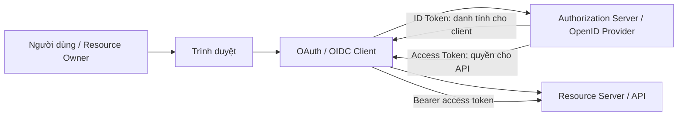
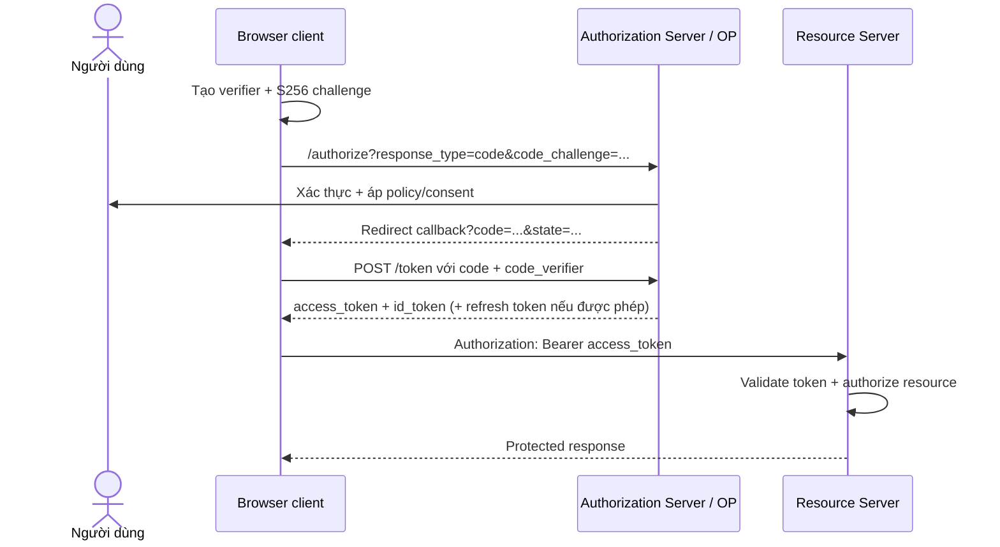
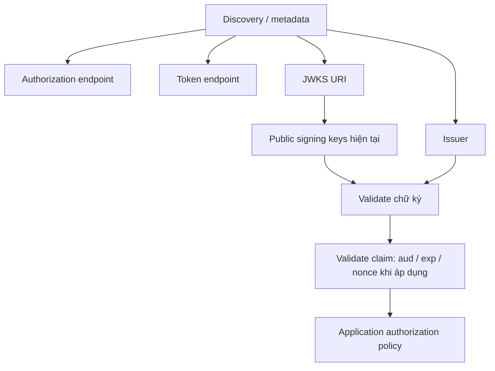

# OAuth 2.0 và OpenID Connect: Lần theo luồng đăng nhập trên trình duyệt

## Tóm tắt nhanh

OAuth 2.0 là một **khung ủy quyền**: nó cho phép ứng dụng nhận quyền truy cập có giới hạn tới tài nguyên được bảo vệ. OpenID Connect (OIDC) bổ sung **lớp định danh** để ứng dụng xác minh ai đã đăng nhập. Hai chuẩn liên quan chặt chẽ nhưng không trả lời cùng một câu hỏi.

Với ứng dụng công khai chạy trong trình duyệt, [RFC 9700](https://www.rfc-editor.org/rfc/rfc9700.html#section-2.1.1) **bắt buộc dùng PKCE** cùng Authorization Code; với ứng dụng bảo mật được bí mật máy chủ, chuẩn khuyến nghị PKCE. PKCE ràng buộc giao dịch ủy quyền, không xác minh danh tính người dùng. Trình duyệt chuyển hướng đến máy chủ ủy quyền, nhận mã ngắn hạn rồi đổi mã bằng giá trị xác minh riêng cho giao dịch. Mã JavaScript gửi xuống trình duyệt là **public client** và không thể giữ bí mật ứng dụng.

> 💡 **Quy tắc bỏ túi:** Luôn tách bốn câu hỏi: **ai đã được xác thực, client nào xin quyền, access token dành cho resource server nào, và token đó đại diện cho quyền hạn gì**.

- **OAuth tự thân không phải giao thức đăng nhập.** Nó ủy quyền truy cập; OIDC bổ sung ngữ nghĩa xác thực và ID Token.
- **ID Token ≠ Access Token.** ID Token dành cho client; access token dành cho resource server.
- **PKCE ràng buộc code exchange với authorization request qua verifier riêng:** `S256` khiến attacker không thể suy ra verifier từ challenge. Nó **không xác thực danh tính của public client** và không thay cho kiểm tra issuer, redirect URI, audience hay quyền truy cập tài nguyên.
- **Decode ≠ validate.** Đọc được JSON của JWT không chứng minh chữ ký, issuer, audience, expiry hay mục đích sử dụng.
- **Sai lầm rủi ro cao:** Coi “có token hợp lệ” đồng nghĩa “được quyền truy cập tài nguyên này”. API vẫn phải tự kiểm tra phân quyền theo đối tượng và thao tác.

<TermBox term="OAuth Client">
**Ứng dụng OAuth (OAuth client)** là bên xin quyền truy cập được ủy quyền. Một SPA chỉ chạy trong trình duyệt là ứng dụng công khai, vì thông tin xác thực bí mật được gửi vào JavaScript có thể bị người dùng hoặc mã độc chạy cùng nguồn đọc được.
</TermBox>

## 1. Tách xác thực khỏi ủy quyền truy cập

Giả sử một ứng dụng React cần gọi `api.example.com` thay mặt Alice.

Có hai câu hỏi độc lập:

1. **Xác thực:** nhà cung cấp danh tính đã xác thực Alice chưa?
2. **Ủy quyền truy cập:** ứng dụng này được giao những quyền hạn nào khi gọi API?

OAuth 2.0 chuẩn hóa vấn đề thứ hai. OIDC dùng các flow của OAuth 2.0 rồi thêm ngữ nghĩa danh tính như scope `openid` và ID Token.

Vì vậy “Sign in with …” thường dùng OIDC, còn một workload chỉ cần API token có thể dùng OAuth mà không có đăng nhập người dùng.

## 2. Học các actor trước khi học endpoint

| Vai trò | Mô hình tư duy |
| --- | --- |
| Resource Owner | Thường là người dùng có quyền hạn được ủy quyền |
| Client | Ứng dụng xin quyền truy cập |
| Authorization Server | Cấp OAuth token sau khi đánh giá authorization |
| OpenID Provider (OP) | Authorization Server nói ngữ nghĩa OIDC |
| Resource Server | API nhận access token |
| Relying Party (RP) | OIDC client tin vào identity assertion từ OP |

Một sản phẩm như Keycloak có thể đồng thời là Authorization Server và OpenID Provider. API của bạn vẫn là Resource Server riêng biệt dù cùng một đội vận hành cả hai.

## 3. Lần theo Authorization Code + PKCE từ đầu đến cuối

<TermBox term="PKCE">
**Proof Key for Code Exchange (PKCE)** ràng buộc authorization request với bước đổi code sau đó bằng một verifier có entropy cao. Client gửi `code_challenge` được dẫn xuất trước, rồi chứng minh mình giữ `code_verifier` gốc tại token endpoint.
</TermBox>

Mã ủy quyền không phải access token. Đó là thông tin xác thực trung gian có mục đích và thời hạn giới hạn. **Sơ đồ này minh họa một public client chạy trực tiếp trong trình duyệt.** Với kiến trúc BFF, phản hồi ủy quyền vẫn đi qua trình duyệt, nhưng BFF đổi mã lấy token và giữ token trên máy chủ; JavaScript của ứng dụng không nhận access token hay refresh token.

RFC 9700 yêu cầu public client dùng PKCE và khuyến nghị confidential client cũng dùng. RFC 10017 áp dụng hướng dẫn này trực tiếp cho ứng dụng trình duyệt hiện đại.

### Vì sao frontend không có client secret thật sự

Nếu bí mật có mặt trong JavaScript gửi xuống trình duyệt, nó không còn là bí mật. Thu gọn mã, dùng biến môi trường khi build hay giấu trong gói JavaScript đều không bảo vệ được giá trị đó.

Ứng dụng trên trình duyệt vẫn có thể có `client_id` ổn định; đây là mã định danh, không phải mật khẩu.

## 4. Biết mỗi token dành cho ai

<TermBox term="ID Token">
**ID Token** là security token của OIDC chứa claim về authenticated subject và authentication event. Nó được cấp cho OIDC client/Relying Party, không phải generic API credential.
</TermBox>

### Access Token

Mục đích: authorize request tới Resource Server.

Hãy nghĩ:

> “API có thể chấp nhận quyền được ủy quyền này cho audience và scope phù hợp.”

Access token không bắt buộc phải có định dạng JWT. Hãy coi nó là giá trị không cần giải nghĩa, trừ khi hợp đồng triển khai quy định API nhận và xác minh JWT access token.

### ID Token

Mục đích: giúp OIDC client thiết lập authenticated identity/session.

Các claim thường quan trọng:

- `iss` — issuer;
- `sub` — subject identifier trong issuer đó;
- `aud` — client audience;
- `exp` — thời điểm hết hạn;
- `iat` — thời điểm phát hành;
- `nonce` — transaction binding khi được dùng.

Đừng gửi ID Token sang API chỉ vì nó trông giống JWT.

### Refresh Token

Mục đích: lấy access token mới mà không cần lặp lại toàn bộ interactive authorization flow.

Refresh token có thể dùng để xin access token mới trong thời gian dài hơn nên cần bảo vệ nghiêm ngặt. Máy chủ ủy quyền có thể không cấp refresh token cho ứng dụng chạy trên trình duyệt. **Nếu cấp cho public client, RFC 9700 bắt buộc xoay vòng refresh token hoặc ràng buộc token với bên gửi.** RFC 10017 còn yêu cầu giới hạn thời hạn tối đa hoặc hết hạn khi không sử dụng và không kéo dài vô hạn thời hạn tuyệt đối đã đặt khi xoay vòng token. Xoay vòng không thể loại bỏ mọi rủi ro nếu mã độc có thể chạy cùng nguồn với ứng dụng. Với BFF, refresh token được giữ trên máy chủ thay vì trong JavaScript.

## 5. Phạm vi, thuộc tính, vai trò và quyền cụ thể là những khái niệm khác nhau

Các từ này thường xuất hiện cạnh nhau nhưng không thể thay thế cho nhau.

- **Scope** mô tả phạm vi truy cập được yêu cầu hoặc được cấp theo OAuth.
- **Claim** là một thuộc tính dữ liệu trong token hoặc phản hồi UserInfo.
- **Role** là nhóm vai trò trong ứng dụng hoặc hệ thống danh tính, được dùng làm đầu vào cho chính sách.
- **Permission** là quyền cụ thể được quyết định cho từng hành động và tài nguyên.

Token có thể chứa role claim, nhưng API vẫn phải quyết định principal đó có được update `invoice/42` hay không.

## 6. Metadata giúp ứng dụng tìm đúng điểm truy cập giao thức

OIDC deployment thường publish provider metadata qua well-known discovery location. OAuth Authorization Server Metadata cũng publish các field như:

- `issuer`;
- `authorization_endpoint`;
- `token_endpoint`;
- `jwks_uri`;
- supported scopes và response/grant capabilities.

Đừng sao chép cố định khóa ký từ bảng quản trị khi nền tảng hỗ trợ làm mới khóa công khai qua JWKS.

## 7. Xác minh JWT không chỉ là giải mã Base64

Resource server validate JWT access token thường phải kiểm tra deployment contract, gồm:

- chữ ký với algorithm và trusted key được phép;
- issuer;
- audience/resource indication khi áp dụng;
- expiry và các time constraint;
- token type/profile mà API kỳ vọng;
- scope/claim cần cho operation.

Client validate ID Token phải theo OIDC-specific validation, gồm issuer, audience và transaction binding như `nonce` khi dùng.

Không được thiết kế hệ thống bảo mật theo kiểu “giải mã được thì tin”.

**Những biện pháp này có thể cùng bảo vệ một số loại tấn công.** [RFC 9700](https://www.rfc-editor.org/rfc/rfc9700.html#section-2.1) cho phép dựa vào PKCE hoặc OIDC `nonce` để phòng CSRF trong điều kiện giao thức tương ứng được triển khai và kiểm tra đúng; nếu không, dùng `state` một lần gắn chắc với phiên trình duyệt. Khi client tích hợp **nhiều authorization server**, còn phải chống mix-up bằng issuer trong authorization response (`iss` theo RFC 9207) hoặc biện pháp tương đương. `state`, `nonce` và PKCE **không thay thế** issuer validation và exact redirect-URI matching.

## 8. `state`, `nonce` và PKCE giải quyết vấn đề khác nhau

Ba giá trị này dễ bị nhớ chung là “random string”, nhưng vai trò khác nhau.

- **PKCE** ràng buộc authorization code với client instance khởi tạo request.
- **`nonce`** ràng buộc OIDC authentication response/ID Token với transaction khởi tạo.
- **`state`** thường dùng để bind redirect state và request/response correlation; hãy theo đúng protocol/library guidance thay vì dùng một giá trị cho mọi mục đích.

Ưu tiên thư viện OAuth/OIDC trưởng thành thay vì tự ghép validation logic cho redirect bảo mật.

## 9. Kiến trúc trình duyệt quyết định mức độ lộ token

RFC 10017 mô tả ba kiến trúc chính:

1. **Backend for Frontend (BFF):** BFF phía server là OAuth client, giữ token khỏi JavaScript và dùng protected cookie session.
2. **Token-mediating backend:** backend xử lý OAuth nhưng trả access token cho browser để gọi API trực tiếp.
3. **Browser-based OAuth client:** browser app trực tiếp xử lý OAuth.

RFC sắp xếp các mô hình theo mức bảo vệ giảm dần trước các mối đe dọa đã phân tích. BFF giảm việc lộ token trực tiếp cho JavaScript bị chèn vào, nhưng mã độc chạy cùng nguồn vẫn có thể gửi yêu cầu đã xác thực qua phiên người dùng. BFF cũng cần máy chủ, cookie được bảo vệ, cơ chế chống CSRF và việc chuyển tiếp yêu cầu.

Hãy chọn kiến trúc theo các rủi ro thực tế; đừng mặc định SPA phải lưu token vào `localStorage`.

## Tình huống giả định: gửi nhầm ID Token tới API

Đội frontend triển khai OIDC login và nhận cả ID Token lẫn access token. Vì cả hai đều trông như JWT, interceptor gửi ID Token trong `Authorization: Bearer ...` tới Orders API. API chỉ kiểm tra chữ ký đến từ trusted issuer rồi chấp nhận.

- **Hậu quả:** Token được cấp cho ứng dụng giao diện bị dùng làm thông tin truy cập API, phá vỡ ranh giới đối tượng nhận token.
- **Nguyên nhân cốt lõi:** Hệ thống coi mọi JWT có chữ ký từ cùng nhà phát hành là như nhau, không kiểm tra mục đích và đối tượng nhận.
- **Cách khắc phục chuẩn:** Chỉ gửi access token đến API, kiểm tra nhà phát hành, đối tượng nhận và định dạng token được chấp nhận, giữ ID Token tại ứng dụng OIDC và kiểm tra phân quyền trên từng tài nguyên sau khi xác minh token.

## Tự kiểm tra mô hình tư duy

> **Kịch bản:** Bạn paste access token vào jwt.io hoặc local decoder. Payload có `sub=alice`, `role=admin` và expiry ngày mai. Điều đó đã chứng minh Alice là administrator được phép xóa customer 123 chưa?

Xem giải thích chi tiết

Chưa.

Giải mã chỉ hiển thị dữ liệu chưa đáng tin cho tới khi token được xác minh. Ngay cả sau khi kiểm tra chữ ký và ngữ nghĩa giao thức thành công, thuộc tính vai trò cũng chỉ là đầu vào của quyết định phân quyền. API phải tiếp tục kiểm tra danh tính đã xác thực có được phép thực hiện thao tác trên tài nguyên cụ thể theo chính sách hiện tại hay không.

## Checklist từ frontend tới API

- [ ] **Protocol:** Đây là OAuth, OIDC hay cả hai?
- [ ] **Client type:** Browser client có được xem đúng là public client không?
- [ ] **Flow:** Browser app có dùng Authorization Code + PKCE thay vì dựa vào legacy Implicit pattern không?
- [ ] **Redirects:** Redirect URI có được đăng ký chính xác/đủ hẹp không?
- [ ] **Tokens:** ID Token có được tách khái niệm khỏi access token không?
- [ ] **Storage:** Token exposure với browser JavaScript có được giảm theo architecture đã chọn không?
- [ ] **Discovery:** Issuer/endpoint/JWKS có lấy từ trusted metadata khi phù hợp không?
- [ ] **Validation:** Có validate signature, issuer, audience, expiry, token purpose và required claim không?
- [ ] **Authorization:** API có enforce permission trên resource cụ thể sau authentication không?
- [ ] **Làm mới token:** Nếu public browser client được cấp refresh token, máy chủ có xoay vòng hoặc ràng buộc với bên gửi và giới hạn thời hạn không? Có giữ token ở đúng phía theo kiến trúc BFF hay trình duyệt trực tiếp không?
- [ ] **Logout:** Local application logout có được tách khỏi identity-provider/session logout không?

## Ranh giới với các bài Atlas liên quan

- [Authentication & Authorization](/vi/docs/backend-engineering/authentication-and-authorization) sở hữu ranh giới tổng quát giữa identity và permission.
- [Single Sign-On & Identity Federation](/vi/docs/backend-engineering/sso-and-identity-federation) giải thích cách nhiều application tái sử dụng authentication context và so sánh OIDC với SAML/CAS.
- [Keycloak Thực chiến](/vi/docs/backend-engineering/keycloak-in-practice) ánh xạ các khái niệm protocol sang realm, client, role, scope và mapper.

## Nguồn tham khảo

- [RFC 10017 — OAuth 2.0 for Browser-Based Applications](https://www.rfc-editor.org/rfc/rfc10017.html)
- [RFC 9700 — Best Current Practice for OAuth 2.0 Security](https://www.rfc-editor.org/rfc/rfc9700.html)
- [RFC 7636 — Proof Key for Code Exchange by OAuth Public Clients](https://www.rfc-editor.org/rfc/rfc7636.html)
- [RFC 8414 — OAuth 2.0 Authorization Server Metadata](https://www.rfc-editor.org/rfc/rfc8414.html)
- [RFC 9207 — Định danh nhà phát hành OAuth trong phản hồi ủy quyền](https://www.rfc-editor.org/rfc/rfc9207.html)
- [OpenID Connect Core 1.0](https://openid.net/specs/openid-connect-core-1_0-18.html)
