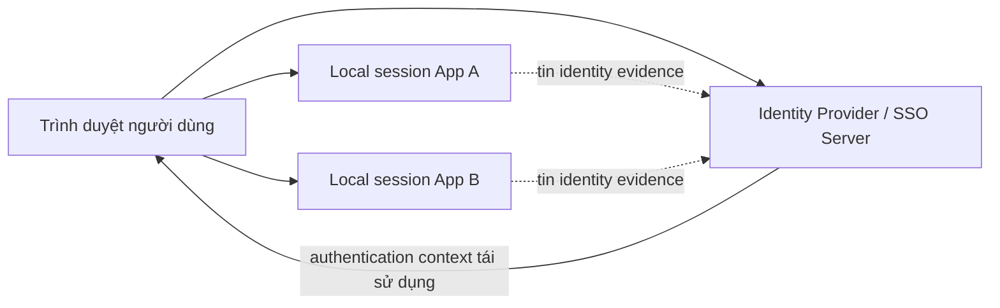
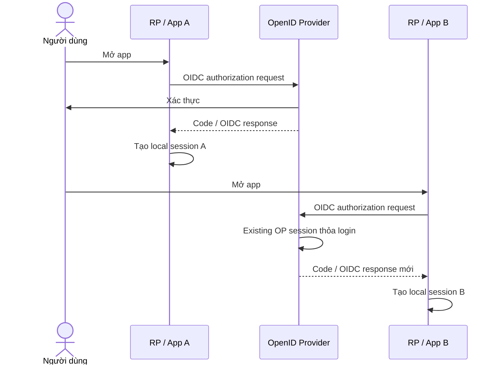
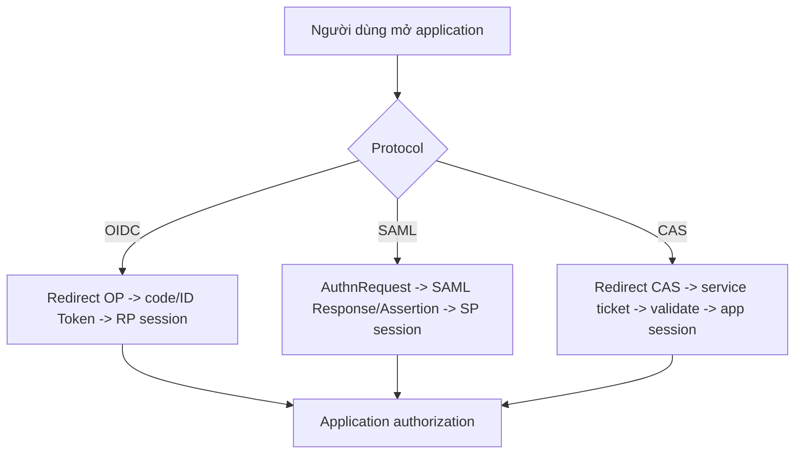
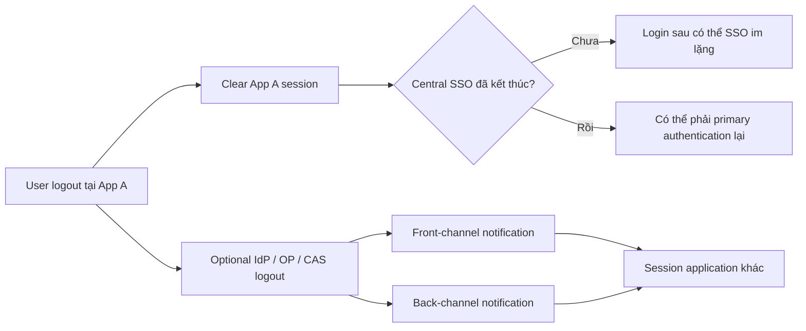

# Đăng nhập một lần và liên kết danh tính: Phiên, niềm tin, OIDC, SAML và CAS

## Tóm tắt nhanh

**Đăng nhập một lần (SSO)** không có nghĩa mọi ứng dụng chia sẻ một cookie. Nhiều ứng dụng có thể dựa vào phiên xác thực tại một hệ thống danh tính chung, để người dùng không phải nhập lại mật khẩu hay thông tin xác thực ban đầu cho từng ứng dụng.

**Liên kết danh tính** mở rộng mô hình đó qua ranh giới tin cậy: một hệ thống chấp nhận bằng chứng danh tính do hệ thống khác phát hành theo giao thức và cấu hình tin cậy đã thống nhất.

> 💡 **Quy tắc bỏ túi:** Khi gỡ lỗi SSO, hãy phân biệt **ba trạng thái**: phiên của người dùng tại nhà cung cấp danh tính, phiên cục bộ tại từng ứng dụng và bằng chứng giao thức dùng để xác lập sự tin cậy giữa các bên.

- **SSO tái sử dụng kết quả xác thực, không chia sẻ quyết định phân quyền nghiệp vụ.**
- **Mỗi ứng dụng thường vẫn quản lý phiên cục bộ riêng.**
- **OIDC, SAML và CAS truyền bằng chứng xác thực bằng các cơ chế khác nhau.**
- **Đăng xuất là bài toán vô hiệu hóa trạng thái trên nhiều hệ thống, không chỉ đảo ngược luồng chuyển hướng khi đăng nhập.**
- **Giả định rủi ro cao:** Đăng xuất khỏi ứng dụng A không chứng minh phiên tại nhà cung cấp danh tính, phiên ứng dụng B hay mọi access token đã bị vô hiệu hóa.

<TermBox term="Single Sign-On">
**Đăng nhập một lần (SSO)** là mô hình trải nghiệm và tin cậy cho phép tái sử dụng phiên xác thực để tạo phiên tại nhiều ứng dụng, mà không cần liên tục yêu cầu nhập lại thông tin xác thực ban đầu.
</TermBox>

## 1. SSO không phải một phiên dùng chung khổng lồ

Giả sử có hai ứng dụng:

- `billing.example.com`;
- `support.example.com`.

Cả hai cùng tin cậy một nhà cung cấp danh tính của tổ chức.

Trình duyệt có thể đồng thời lưu:

- phiên SSO tại nhà cung cấp danh tính (IdP);
- phiên cục bộ của ứng dụng Billing;
- phiên cục bộ của ứng dụng Support.

Các phiên có thể có thời hạn, thiết lập cookie, chính sách rủi ro và cách đăng xuất khác nhau.

Khi người dùng mở Support lần đầu, ứng dụng có thể chuyển hướng tới IdP. Nếu phiên SSO hiện có đáp ứng chính sách xác thực, IdP không yêu cầu nhập lại thông tin ban đầu; hệ thống phát hành bằng chứng giao thức mới cho Support, chuyển hướng trình duyệt về và Support tạo phiên cục bộ của riêng mình.

Đó là SSO mà không cần chia sẻ cookie của ứng dụng Billing.

<TermBox term="Identity Federation">
**Liên kết danh tính** là thỏa thuận tin cậy giữa các miền bảo mật: một miền chấp nhận thông tin danh tính do miền khác phát hành theo giao thức, định danh, khóa/chứng chỉ, điểm truy cập và chính sách đã thống nhất.
</TermBox>

## 2. Vai trò nhà cung cấp danh tính và ứng dụng phụ thuộc giao thức

<TermBox term="Identity Provider">
**Nhà cung cấp danh tính (IdP)** xác thực người dùng hoặc chủ thể và tạo bằng chứng danh tính cho ứng dụng tin cậy. OIDC gọi bên phát hành là OpenID Provider (OP); SAML dùng IdP và Service Provider (SP); CAS có CAS Server trung tâm và ứng dụng khách CAS.
</TermBox>

Dùng đúng thuật ngữ của từng giao thức giúp tránh nhầm lẫn về trách nhiệm.

| Protocol | Phía identity | Phía application | Evidence điển hình |
| --- | --- | --- | --- |
| OIDC | OpenID Provider (OP) | Relying Party (RP) | ID Token cùng OAuth artifact |
| SAML 2.0 | Identity Provider (IdP) | Service Provider (SP) | Signed SAML Response / Assertion |
| CAS | CAS Server | CAS Client / Service | Service Ticket được validate với CAS |

## 3. OIDC SSO tái sử dụng phiên tại OP

OIDC được xây dựng trên OAuth 2.0. Ứng dụng tin cậy (RP) khởi tạo yêu cầu xác thực/ủy quyền. Nếu OP đã có phiên người dùng đáp ứng chính sách, OP có thể xử lý yêu cầu mà không bắt người dùng nhập lại thông tin xác thực ban đầu.

RP vẫn phải xác minh phản hồi OIDC và thường tạo phiên ứng dụng riêng. Sơ đồ dưới đây rút gọn các lần chuyển hướng qua trình duyệt và bước đổi mã lấy token có thể diễn ra qua kênh máy chủ; đây là sơ đồ tin cậy minh họa, không phải toàn bộ chuỗi HTTP thực tế.

Điểm quan trọng: ứng dụng B không “mượn” phiên của A. Nó xác lập kết quả tin cậy riêng nhờ phiên xác thực có thể tái sử dụng tại IdP.

## 4. SAML Web Browser SSO truyền xác nhận danh tính có chữ ký

SAML 2.0 dùng XML và thường gặp trong các hệ thống liên kết danh tính doanh nghiệp.

Trong Web Browser SSO profile:

1. SP gửi authentication request hoặc user bắt đầu từ IdP;
2. IdP xác thực subject hoặc tái sử dụng IdP security context;
3. IdP tạo SAML Response chứa assertion;
4. browser chuyển response tới Assertion Consumer Service của SP, thường bằng HTTP POST;
5. SP kiểm tra chữ ký trên phản hồi hoặc assertion tùy cách ký, nhà phát hành, đối tượng nhận, địa chỉ đích, điều kiện thời gian và chống phát lại rồi tạo phiên cục bộ;
6. authorization vẫn là quyết định của SP/application.

Đừng coi SAML chỉ là “OIDC đời cũ”. Định dạng thông điệp, cách truyền, metadata, chứng chỉ và môi trường triển khai có những khác biệt quan trọng.

## 5. CAS dùng vé truy cập và xác minh tập trung

CAS là giao thức SSO cho web với một máy chủ CAS trung tâm.

Luồng đơn giản cho một ứng dụng:

1. ứng dụng chuyển hướng trình duyệt tới CAS `/login?service=...`;
2. CAS xác thực người dùng hoặc tái sử dụng phiên SSO;
3. CAS chuyển hướng về ứng dụng kèm `ticket` ngắn hạn;
4. ứng dụng xác minh vé dành riêng cho dịch vụ đó với CAS;
5. ứng dụng tạo phiên cục bộ riêng.

Ticket Granting Cookie của CAS gắn với phiên SSO trung tâm. **Service Ticket chỉ hợp lệ cho đúng dịch vụ đã đăng ký và phải bị tiêu thụ sau một lượt xác minh, dù thành công hay thất bại**; vé chưa xác minh phải được giới hạn thời hạn. Không thể dùng vé đó như access token tái sử dụng hoặc đưa sang dịch vụ khác.

## 6. Liên kết danh tính dựa vào cấu hình tin cậy, không chỉ chuyển hướng

Chuyển hướng chỉ đưa trình duyệt tới một địa chỉ khác. Sự tin cậy đến từ cấu hình và quy trình xác minh.

Tùy protocol, các hệ thống cần thống nhất các yếu tố như:

- issuer/entity identifier;
- registered redirect/consumer/service URL;
- signing key hoặc certificate;
- metadata endpoint/document;
- client/SP/service identifier;
- allowed algorithm;
- attribute/claim mapping;
- authentication requirement;
- clock/lifetime constraint.

Nếu ứng dụng nhận chấp nhận bằng chứng từ nhà phát hành sai, dành cho đối tượng/dịch vụ khác hoặc ngoài điều kiện thời gian và chống phát lại, ranh giới liên kết danh tính đã bị phá vỡ dù chữ ký vẫn đúng về mặt toán học.

## 7. Kết nối với IdP khác với liên kết kho người dùng

Hai cơ chế này thường bị nhầm lẫn trong sản phẩm như Keycloak.

**Kết nối IdP (identity brokering):** hệ thống danh tính chuyển việc xác thực tới IdP bên ngoài, chẳng hạn Entra ID của doanh nghiệp qua OIDC/SAML, rồi phát hành phiên/token riêng cho ứng dụng.

**Liên kết kho người dùng (user federation):** hệ thống danh tính tra cứu hoặc xác thực người dùng qua kho tài khoản bên ngoài như LDAP hay Active Directory.

Cơ chế đầu kết nối **giao thức giữa các IdP**; cơ chế sau kết nối **kho người dùng hoặc thông tin xác thực**.

## 8. SSO không tập trung quyền quyết định nghiệp vụ

IdP có thể cung cấp group, role, authentication method hoặc attribute. Đây là input về identity/security context.

Application hoặc API vẫn sở hữu câu hỏi:

- employee này có được approve invoice 42 không?
- support agent này có được xem tenant A không?
- user này có được thay production configuration không?

Đăng nhập SSO thành công không đồng nghĩa người dùng có quyền thực hiện một thao tác nghiệp vụ.

**Đăng xuất không phải giao dịch nguyên tử giữa các ứng dụng.** Xóa cookie của A không tự động kết thúc phiên IdP, phiên B hoặc access token chưa hết hạn. Đăng xuất OIDC qua kênh trước/sau, cũng như SAML Single Logout, phụ thuộc khả năng hỗ trợ của các bên và việc truyền/nhận thông báo; một ứng dụng ngoại tuyến vẫn có thể giữ phiên. Ngay cả khi IdP trả lời đăng xuất thành công, điều đó chưa chứng minh mọi ứng dụng đã xóa phiên. Hãy xác định nút “Đăng xuất” chỉ kết thúc phiên hiện tại hay yêu cầu đăng xuất phối hợp theo khả năng thực tế.

## 9. Đăng xuất có nhiều phạm vi

“Đăng xuất” có thể bao gồm:

- hủy local session của một application;
- revoke hoặc expire token;
- terminate IdP/OP/CAS SSO session;
- notify application khác để clear session;
- chờ short-lived session/token hết hạn.

OIDC định nghĩa RP-Initiated Logout cùng front-channel/back-channel logout. SAML định nghĩa Single Logout profile. CAS có thể hỗ trợ Single Logout notification.

Các cơ chế có đặc điểm độ tin cậy và triển khai khác nhau.

## Tình huống giả định: vừa đăng xuất lại được đăng nhập

Một nhân viên bấm Đăng xuất trong ứng dụng web. Ứng dụng chỉ xóa cookie cục bộ rồi chuyển về trang chủ. Khi mở một trang cần xác thực, luồng đăng nhập OIDC lại bắt đầu. Vì phiên SSO tại OpenID Provider vẫn còn hiệu lực, người dùng được chuyển về với phản hồi ủy quyền mới và ứng dụng tạo phiên cục bộ mới.

- **Hậu quả:** Người dùng tưởng chức năng đăng xuất bị lỗi vì ứng dụng dường như đăng nhập lại ngay.
- **Nguyên nhân cốt lõi:** Nhóm phát triển đánh đồng việc kết thúc phiên ứng dụng với kết thúc phiên SSO tại nhà cung cấp danh tính.
- **Cách khắc phục chuẩn:** Xác định rõ phạm vi đăng xuất, xóa phiên cục bộ, dùng cơ chế đăng xuất RP/IdP mà giao thức hỗ trợ nếu cần đăng xuất toàn hệ thống, đồng thời xử lý trường hợp thông báo đến các ứng dụng chỉ thành công một phần.

## Tự kiểm tra mô hình tư duy

> **Kịch bản:** App A và App B dùng cùng IdP. Bạn xóa cookie của App A. App B có bắt buộc logout ngay không?

Xem giải thích chi tiết

Không.

Ứng dụng B có phiên cục bộ riêng. Xóa cookie A không xóa cookie B và cũng có thể không kết thúc phiên SSO tại IdP. Đăng xuất phối hợp cần giao thức và chiến lược triển khai rõ ràng; thông báo qua trình duyệt hoặc kênh máy chủ vẫn có thể không đến được tất cả ứng dụng.

## Danh sách kiểm tra SSO và liên kết danh tính

- [ ] **Sessions:** Bạn đã vẽ riêng IdP/SSO session và session từng application chưa?
- [ ] **Protocol roles:** OP/RP, IdP/SP hoặc CAS Server/client có được gọi đúng không?
- [ ] **Tin cậy:** Định danh nhà phát hành, khóa/chứng chỉ, điểm truy cập, đối tượng nhận, thời hạn và điều kiện chống phát lại có được kiểm tra không?
- [ ] **URLs:** Redirect, Assertion Consumer Service hoặc CAS service URL có được đăng ký đủ hẹp không?
- [ ] **Mapping:** Claim/attribute có được map có chủ đích thay vì copy mù quáng không?
- [ ] **Authorization:** Application vẫn tự quyết định resource-level permission chứ?
- [ ] **Lifetime:** Application session và IdP session lifetime có được chọn có chủ đích không?
- [ ] **Step-up:** Sensitive action có thể yêu cầu stronger/recent authentication khi cần không?
- [ ] **Phạm vi đăng xuất:** Đã phân biệt đăng xuất cục bộ với đăng xuất phối hợp theo khả năng thực tế, kể cả khi RP ngoại tuyến chưa?
- [ ] **Failure:** Điều gì xảy ra nếu logout notification không tới được một application?
- [ ] **Brokering:** External-IdP brokering có được tách khỏi LDAP/user federation không?
- [ ] **Observability:** Support team có xác định được session/protocol step nào lỗi không?

## Ranh giới với các bài Atlas liên quan

- [OAuth 2.0 & OpenID Connect](/vi/docs/backend-engineering/oauth-and-oidc) giải thích browser flow và token boundary của OIDC/OAuth.
- [Authentication & Authorization](/vi/docs/backend-engineering/authentication-and-authorization) sở hữu principal và permission model tổng quát.
- [Keycloak Thực chiến](/vi/docs/backend-engineering/keycloak-in-practice) ánh xạ federation và SSO sang một identity platform cụ thể.

## Nguồn tham khảo

- [OpenID Connect Core 1.0](https://openid.net/specs/openid-connect-core-1_0-18.html)
- [OpenID Connect Logout Specifications](https://openid.net/wg/connect/specifications/)
- [OASIS — SAML 2.0 Technical Overview](https://docs.oasis-open.org/security/saml/Post2.0/sstc-saml-tech-overview-2.0.html)
- [Apereo CAS — CAS Protocol 3.0 Specification](https://apereo.github.io/cas/development/protocol/CAS-Protocol-Specification.html)
