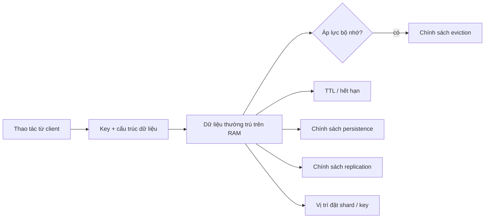
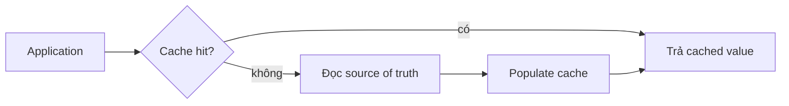
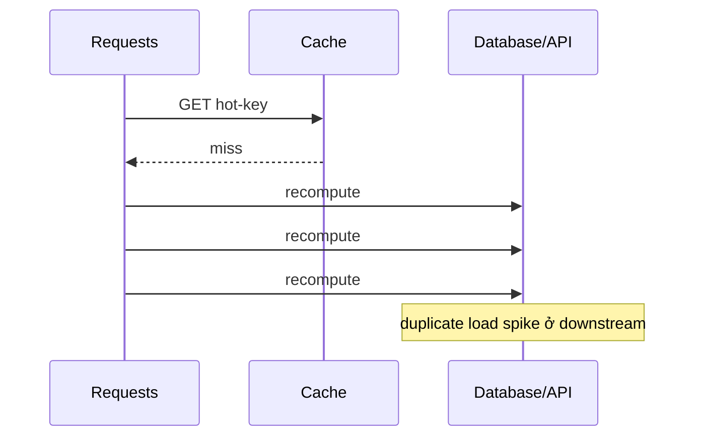
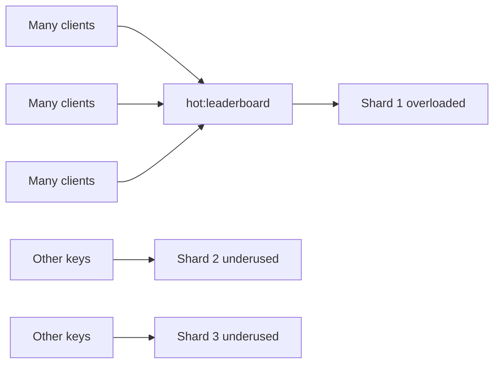

# In-Memory Data Stores: Suy luận về độ trễ, bộ nhớ và độ bền dữ liệu

## Tóm tắt

**Tình huống Redis giả định (không phải sự cố đã được xác minh):** Một dịch vụ lưu cả cache sản phẩm và bản ghi idempotency cho thanh toán trong Redis. Lệnh `KEYS *` có thể làm nghẽn xử lý trên keyspace lớn. Khi bộ nhớ chịu áp lực, Redis có thể evict key hoặc, với `noeviction`, từ chối lệnh ghi cần thêm bộ nhớ. Cache miss trên các khóa nóng còn có thể khiến nhiều request dồn xuống database nguồn. Đây là những đường lỗi khác nhau: Redis chạm `maxmemory` **không tự động dẫn đến việc hệ điều hành OOM-kill tiến trình**. Điều đó phụ thuộc vào giới hạn host/container, RSS thực tế và buffer. Ví dụ này không đưa ra số liệu thực tế về độ trễ, QPS, phần trăm bộ nhớ hay thời gian sự cố.

Trước hết phải phân loại từng key là cache có thể tái tạo, trạng thái điều phối có thời hạn hay dữ liệu có thẩm quyền, rồi mới chọn retention, persistence, replication và cách xử lý khi thiếu bộ nhớ.

> 💡 **Quy tắc bỏ túi:** RAM là ngân sách hữu hạn. Với từng loại dữ liệu, hãy xác định khả năng tái tạo và mức mất mát cho phép. Bảo vệ bản ghi quan trọng khỏi eviction trước hạn; nếu hiệu ứng nghiệp vụ không được thực hiện trùng khi retry, cần định danh thao tác bền vững ở nguồn phù hợp. Persistence và replication giúp giảm rủi ro nhưng không bảo đảm không bao giờ mất dữ liệu.

- **Vị trí RAM khác với độ bền:** Working set phục vụ từ **RAM**; khả năng phục hồi khi restart phụ thuộc vào cấu hình **RDB** và/hoặc **AOF**. Redis mặc định sao chép bất đồng bộ; xác nhận của `WAIT` không tương đương commit phân tán bền vững.
- **Eviction là cam kết về tính đúng đắn:** Khi chạm ngưỡng **maxmemory**, chính sách giải phóng bộ nhớ (**eviction**) sẽ loại bỏ key; nếu lưu token xác thực, bộ đếm giới hạn tốc độ hoặc khóa bất biến (idempotency key) chung với **cache** thông thường, hệ thống sẽ gánh chịu lỗi sai lệch logic nghiêm trọng khi bị evict sớm.
- **TTL và hiện tượng dồn tải:** TTL đặt thời điểm hết hạn; jitter giúp giãn thời điểm hết hạn của *các khóa khác nhau*, nhưng không chặn nhiều request cùng miss *một khóa nóng*. Khi phù hợp, hãy gộp lượt tải trùng nhau hoặc làm mới sớm với giới hạn độ cũ rõ ràng.
- **Sharding mở rộng tổng dung lượng:** Redis Cluster ánh xạ khóa vào 16.384 **hash slot**. Các phép ghi vào một hot key vẫn tập trung ở shard sở hữu nó; một phần tải đọc có thể chuyển sang replica/cache phía client nếu chấp nhận đánh đổi nhất quán. Thêm shard không tự chia một key.
- **Sai lầm có tác động lớn:** `KEYS *` là thao tác quét keyspace `O(N)`, có thể cản trở xử lý trên tập dữ liệu lớn. Khi tới ngưỡng bộ nhớ, `noeviction` có thể trả lỗi OOM cho lệnh ghi, còn chính sách eviction xóa key đủ điều kiện. Bị hệ điều hành OOM-kill là lỗi dung lượng khác, không phải phản ứng thông thường của `maxmemory`.

Mental model:

```text
yêu cầu gửi đến
  -> chọn khóa + cấu trúc dữ liệu phù hợp
  -> truy cập tập dữ liệu nóng nằm sẵn trên RAM
  -> có thể hết hạn hoặc bị giải phóng theo chính sách
  -> có thể ghi bền vững xuống ổ đĩa lưu trữ
  -> có thể sao chép sang node khác
  -> có thể định tuyến / phân mảnh qua cụm cluster
```

Mỗi chữ “có thể” ở trên là một quyết định về cam kết dịch vụ (contract decision), không phải chi tiết triển khai phụ.



<TermBox term="Working set">
**Working set (Tập dữ liệu nóng)** là phần dữ liệu mà khối lượng công việc (workload) cần truy cập liên tục trong một khoảng thời gian xác định.

**Vì sao quan trọng:** Thiết kế in-memory chỉ đạt hiệu quả kinh tế khi tập dữ liệu nóng nằm vừa vặn trong ngân sách bộ nhớ (RAM). Nếu ứng dụng liên tục chạm vào lượng dữ liệu lớn hơn dung lượng RAM sẵn có, hiện tượng giải phóng bộ nhớ (eviction), trượt cache (cache miss) và đọc dữ liệu từ xa sẽ chi phối toàn bộ độ trễ hệ thống.
</TermBox>

## 1. “In memory” nói về placement, không nói về correctness

RAM thay đổi latency profile, nhưng không cho biết dữ liệu có:

- durable sau process/host failure hay không;
- được replicate sang máy khác hay không;
- được phép biến mất khi thiếu memory hay không;
- tự động bị xóa sau TTL hay không;
- authoritative hay chỉ là bản copy;
- consistent giữa replica hay không;
- recover được về historical point hay không.

Hai hệ thống đều “in-memory” nhưng một cái có thể chỉ là evictable cache, còn cái kia là primary database với append-only persistence và replica.

Trước khi chọn product, hãy phân loại state:

```text
recomputable copy        -> cache
short-lived coordination -> lock / lease / rate counter
session-like state       -> lifetime có giới hạn, loss tolerance rõ
queue-like transient data -> delivery contract quan trọng
primary business record  -> durability + recovery contract quan trọng
```

Vai trò của dữ liệu quyết định failure nào được chấp nhận.

## 2. Cache và source of truth là hai vai trò khác nhau

Cache có giá trị vì application thường có thể phục hồi cache miss bằng cách load hoặc recompute từ authoritative source.



Recovery path này là lý do eviction có thể an toàn.

Nếu xóa một key đồng nghĩa mất vĩnh viễn bản duy nhất của business fact, store đó không còn “chỉ là cache”. Nó đang giữ authoritative state và phải được review theo durability, replication, backup, recovery và mutation semantics tương ứng.

Một câu hỏi review hữu ích:

> Nếu toàn bộ keyspace biến mất lúc 03:00, thứ gì rebuild được, thứ gì mất hẳn, và customer-visible contract nào bị vi phạm?

Nếu chưa trả lời được, source-of-truth boundary vẫn chưa rõ.

## 3. Memory là capacity budget, không phải speed tier vô hạn

RAM hữu hạn và đắt hơn cold storage. Thiết kế in-memory vì vậy cần memory budget tường minh.

Với Redis, `maxmemory` xác định memory limit của dataset, còn `maxmemory-policy` quyết định chuyện gì xảy ra khi vượt budget.

Điểm phân biệt quan trọng:

```text
memory budget bị vượt
  -> evict key được chọn
hoặc
  -> reject write cần thêm memory
```

Hai kết quả này có hệ quả khác nhau với ứng dụng.

Ngưỡng `maxmemory` **không phải trần cứng của RSS toàn tiến trình**: phân mảnh cấp phát, buffer persistence/replication và các cấp phát khác vẫn tiêu thụ RAM ngoài ngưỡng. `noeviction` không tự làm Redis crash mà có thể trả lỗi `OOM command not allowed when used memory > 'maxmemory'` cho lệnh ghi cần thêm bộ nhớ, trong khi đọc/xóa vẫn hoạt động. Trên keyspace lớn, ưu tiên `SCAN` tăng dần thay vì lặp lại `KEYS *` ở production, nhưng `SCAN` không tạo snapshot nhất quán khi dữ liệu thay đổi.

Đừng size chỉ từ raw payload bytes. Memory thực còn gồm key metadata, data-structure overhead, allocator fragmentation, replication/persistence buffer, client output buffer và temporary allocation theo workload.

Hãy đo workload thật thay vì giả định “10 GB JSON” bằng “10 GB RAM”.

## 4. Eviction là cam kết về tính đúng đắn của hệ thống

<TermBox term="Eviction">
**Eviction (Giải phóng bộ nhớ cưỡng bức)** là thao tác máy chủ chủ động loại bỏ bớt các bản ghi để giữ mức tiêu thụ bộ nhớ không vượt quá giới hạn cho phép (`maxmemory`).

Redis hỗ trợ nhiều chính sách như `allkeys-lru`, `allkeys-lfu`, các biến thể chỉ áp dụng trên key có gắn thời hạn (`volatile-*`), chọn ngẫu nhiên hoặc `noeviction` (từ chối mọi lệnh ghi mới khi bộ nhớ đầy).

**Vì sao quan trọng:** Một khi đã bật eviction, tầng ứng dụng phải chấp nhận một tiền đề: bất kỳ bản ghi nào đủ điều kiện đều có thể bốc hơi trước khi code chủ động xóa. Nếu dữ liệu đó mang tính sống còn đối với logic nghiệp vụ, việc bị evict sớm sẽ gây sai lệch trạng thái nghiêm trọng.
</TermBox>

Với một **cache** thuần túy (disposable cache), eviction là hành vi hoàn toàn bình thường: trượt cache thì chỉ việc tải lại từ **nguồn sự thật (source of truth)**.

Nhưng với trạng thái ảnh hưởng đến tính đúng đắn (correctness-bearing state), eviction có thể trở thành thảm họa:

```text
idempotency record bị evict sớm -> yêu cầu gửi lại có thể bị thực thi lần 2 (trùng lặp thanh toán)
bộ đếm rate-limit bị evict       -> client có thể spam vượt quá hạn mức cho phép
session state bị evict            -> người dùng bị văng phiên đăng nhập giữa chừng
lease metadata bị evict           -> các tiến trình phân tán tranh chấp tài nguyên lẫn nhau
```

Tuyệt đối không đặt các trạng thái quan trọng này vào chung một cụm bộ nhớ có bật eviction với các dữ liệu cache thông thường.

### LRU và LFU là thuật toán gần đúng, không thấu hiểu giá trị nghiệp vụ

Redis tài liệu hóa rõ ràng rằng các giải thuật LRU và LFU trong bộ nhớ là các phép xấp xỉ tối ưu hóa hiệu năng, chứ Redis không thể tự hiểu giá trị nghiệp vụ của từng bản ghi.

Một bản ghi idempotency ít khi được đọc lại có thể quan trọng gấp trăm lần một bản ghi cache thông tin sản phẩm được truy vấn hàng nghìn lần mỗi giây. Tần suất truy cập đơn thuần không thể phản ánh được mức độ quan trọng sống còn của dữ liệu.

Hãy tách biệt các khối lượng công việc (workload) khi ý nghĩa nghiệp vụ và khả năng chấp nhận rủi ro mất mát khác nhau.

## 5. TTL và eviction giải hai bài toán khác nhau

TTL nói key nên ngừng tồn tại khi nào vì lifetime đã hết.

Eviction nói key nào có thể bị loại sớm vì memory pressure.

```text
TTL / expiration -> time-based lifecycle policy
eviction         -> capacity-pressure policy
```

Hai khái niệm không thay thế nhau.

Redis `EXPIRE` gắn timeout với key. Sau khi timeout hết, Redis xóa key. Lifetime còn lại có thể xem bằng `TTL` hoặc `PTTL`.

Một key có thể biến mất vì:

- application code xóa;
- TTL hết hạn;
- eviction policy loại bỏ;
- dataset mất trong failure ngoài phạm vi durability/replication guarantee.

API contract không nên gom mọi trường hợp này thành “cache miss” nếu semantic khác nhau.

## 6. TTL là một phần business guarantee khi state có retention window

Ví dụ idempotency record:

```text
idempotency:{customer}:{operation}
  -> response/result fingerprint
  -> TTL = 24 giờ
```

TTL này không phải housekeeping trivia. Nó định nghĩa service hứa nhận ra retry như cùng logical operation trong bao lâu.

Tương tự:

```text
password-reset token -> security lifetime
rate-limit bucket     -> enforcement window
session               -> authentication/session lifetime
cache entry            -> freshness/recomputation policy
```

Với correctness-bearing state, hãy viết retention requirement trước khi chọn TTL.

Cũng phải nghĩ về synchronized expiry wave. Nếu hàng triệu key có gần cùng expiration time, application có thể gặp burst cache miss và recomputation cùng lúc.

Jitter có thể giãn thời điểm hết hạn của các khóa khác nhau, nhưng một khóa nóng vừa hết hạn vẫn có thể tạo bão miss. Khi đó cân nhắc single-flight theo khóa, làm mới có giới hạn hoặc phục vụ dữ liệu cũ trong phạm vi nghiệp vụ cho phép.

## 7. Cache stampede là concurrency problem

Khi một hot cache entry hết hạn, nhiều request có thể miss đồng thời và cùng recompute expensive value.



Hiện tượng này thường được gọi là cache stampede, dogpile hoặc thundering herd.

Mitigation thường gồm:

- single-flight/request coalescing để một caller refresh, caller khác chờ;
- stale-while-revalidate nếu stale data chấp nhận được;
- probabilistic/jittered early refresh;
- per-key lock với bounded wait và failure handling;
- prewarming khi hot set dự đoán được.

Strategy đúng phụ thuộc vào việc stale data có an toàn không và recomputation đắt đến đâu.

## 8. Persistence thay đổi restart behavior, không thay đổi việc RAM là serving path

<TermBox term="Persistence">
**Persistence** ghi đủ thông tin xuống durable storage để in-memory dataset có thể reconstruct sau restart hoặc failure.

Redis hỗ trợ RDB snapshot, AOF logging, kết hợp cả hai, hoặc không persistence.

**Vì sao quan trọng:** persistence biến “memory mất” từ guaranteed data loss thành recovery question, nhưng mỗi mode vẫn có latency, recovery-time và data-loss window riêng.
</TermBox>

Redis mô tả hai cơ chế persistence chính:

### RDB snapshot

RDB tạo point-in-time snapshot của dataset theo interval cấu hình.

Ưu điểm là snapshot compact và bulk restore nhanh. Đánh đổi là write sau snapshot gần nhất có thể mất nếu process/host chết trước snapshot tiếp theo.

### AOF

Append-only file log write operation để Redis replay khi startup.

Điểm phục hồi phụ thuộc chính sách fsync: `appendfsync everysec` có thể mất khoảng một giây ghi gần nhất khi gặp sự cố, còn `always` đánh đổi thông lượng và độ trễ để đồng bộ đĩa thường xuyên hơn. Điều này không bảo đảm replica được promote có bản ghi. Cần thử khôi phục và backup theo mục tiêu phục hồi.

### RDB + AOF

Kết hợp cả hai có thể lấy benefit của snapshot/recovery và granular write log.

Bài học không phải “luôn bật cả hai”, mà là viết recovery contract trước:

```text
Bao nhiêu acknowledged state được phép mất?
Service phải restart nhanh đến đâu?
Recovery file có thể lớn bao nhiêu?
Backup nào sống sót khi host/site mất?
```

## 9. Persistence không phải replication

Persistence trả lời:

> Node này có reconstruct data sau khi mất memory/restart không?

Replication trả lời:

> Có live node khác đang nhận copy của change không?

Nhiều hệ thống cần cả hai.

Redis replication mặc định asynchronous. Primary có thể acknowledge write trước khi replica xử lý xong. Redis có `WAIT` để chờ xác nhận replica đã theo kịp luồng replication, không phải fsync bền vững hay quorum commit phân tán. Tài liệu chính thức khẳng định lệnh này không bảo đảm nhất quán mạnh hoặc mọi write đã nhận sẽ sống sót khi failover.

Vì vậy đừng suy luận:

```text
có replica -> acknowledged write không thể mất
```

Hãy document failure + persistence configuration cụ thể tạo nên recovery point cần thiết.

## 10. Replication và failover có thể làm lộ stale hoặc lost state

Giả sử session token được write vào primary rồi primary fail ngay sau đó.

Nếu write chưa tới replica được promote, new primary có thể không có token đó.

Với disposable cache, đây có thể chỉ là harmless miss.

Với authoritative session, idempotency hoặc workflow state, đây có thể vi phạm user-visible guarantee.

Cùng một Redis topology có thể an toàn cho keyspace này nhưng không an toàn cho keyspace khác.

Hãy phân loại data theo loss tolerance thay vì phân loại product một lần cho mọi use case.

## 11. Sharding tăng aggregate capacity nhưng không làm mọi key nhanh hơn

Redis Cluster chia key qua **16.384 hash slot**. Mỗi key map vào một slot và mỗi slot thuộc một shard tại một thời điểm.

Điều này giúp cluster trải các key khác nhau qua node và scale tổng memory/throughput.

Nhưng một operation trên một key vẫn đi tới shard sở hữu key đó.

```text
nhiều independent key -> có thể spread qua shard
một cực-hot key       -> tập trung lên một shard
```

Điều này nối trực tiếp với bài Partitioning & Sharding: distribution chỉ giúp khi partitioning unit phù hợp workload.

## 12. Hot key là locality bottleneck

**Hot key** nhận tỷ lệ traffic vượt trội.



Thêm shard không tự động split một key qua nhiều shard.

Response thường gặp:

- redesign key để work partition được an toàn;
- replicate read-mostly hot data nếu consistency đánh đổi cho phép;
- aggregate write theo local/batch khi không cần global serialization từng event;
- đưa expensive computation khỏi hot request path;
- kiểm tra data structure/command có complexity cao ngoài dự tính không.

Đừng randomize key mù quáng nếu request cần atomic operation qua những value vừa bị tách ra.

## 13. Data structure quyết định cả latency lẫn semantics

In-memory system hấp dẫn một phần vì expose specialized structure gần serving path: string/counter, hash, set, sorted set, stream, probabilistic structure và hơn nữa.

Chọn structure từ operation cần atomic hoặc efficient.

Ví dụ:

```text
INCR-style counter -> rate/accounting counter
SET membership     -> deduplication / membership check
sorted set         -> ranking / delayed scheduling pattern
hash               -> group field dưới một key
stream             -> append/read consumer pattern
```

Nhưng đừng giả định mọi command đều constant time. Complexity thay đổi theo command, collection size, result size và implementation.

Fast storage medium không cứu được operation scan hoặc trả unbounded data.

## 14. Network round trip có thể lớn hơn tiny in-memory operation

Nếu server-side operation rất rẻ, client/server RTT có thể chiếm phần lớn request latency.

Redis pipelining cho phép client gửi nhiều command mà không chờ từng reply trước khi gửi command tiếp, giảm repeated RTT cost và tăng throughput.

Nhưng pipelining không phải correctness primitive và không chữa slow command/hot key. Pipeline quá lớn còn dùng memory để queue reply.

Hãy tách riêng:

```text
server execution cost
network round trips
payload size
client serialization
queueing under load
```

“In memory” chỉ trực tiếp giải một phần path.

## 15. Atomic operation có giá trị, nhưng multi-key boundary vẫn quan trọng

Một atomic counter increment an toàn hơn application-side read-modify-write:

```text
GET counter
counter = counter + 1
SET counter
```

vốn race dưới concurrency.

Ưu tiên datastore-native atomic operation cho counter, set-if-absent, conditional expiry và pattern được support.

Nhưng khi related key nằm trên shard khác nhau, multi-key operation có thể bị hạn chế hoặc cần coordination. Redis Cluster có hash tag để cố ý co-locate related key vào cùng hash slot khi cần atomic multi-key behavior.

Điều này tăng locality nhưng cũng tập trung các key đó lên một shard. Locality và distribution là đánh đổi, không phải hai knob độc lập.

## 16. Nếu có thể, tách cache failure khỏi application failure

Cache/in-memory dependency không nên mặc định trở thành single point of failure cho workflow có thể tiếp tục an toàn mà không cần nó.

Với cache-aside read:

```text
cache unavailable
  -> có thể fallback về source of truth
  -> bảo vệ source bằng bounded concurrency / load shedding
  -> tránh biến cache outage thành database stampede
```

Với correctness-bearing state:

```text
rate-limit store unavailable
idempotency store unavailable
session authority unavailable
```

có thể không có safe fallback. Application phải cố ý chọn fail-open, fail-closed, degraded mode hoặc reject request theo business/security invariant.

Đừng invent fallback chỉ vì availability nghe hấp dẫn.

## 17. Tình huống giả định: cache và bản ghi quan trọng dùng chung eviction pool

**Ví dụ dựng để giảng giải, không phải sự cố đã được xác minh:** Dịch vụ checkout dùng Redis cho cache sản phẩm, bộ đếm rate limit và bản ghi chống thanh toán trùng. Cluster dùng `allkeys-lru` vì team nghĩ “Redis chỉ là cache”. Một traffic spike làm memory đầy bởi product response lớn.

Eviction policy bắt đầu loại least-recently-used key trên toàn keyspace, bao gồm idempotency record đáng lẽ phải tồn tại 24 giờ.

**Hậu quả:** một số retry checkout không còn thấy idempotency record và thực hiện payment logical operation lần hai; rate-limit counter cũng biến mất sớm, tạm thời nới admission control; dashboard vẫn cho thấy Redis available vì không node nào crash.

**Nguyên nhân cốt lõi:** kiến trúc phân loại cả Redis deployment thay vì phân loại từng loại state. Disposable cache và correctness-bearing record có loss/retention contract khác nhau nhưng dùng chung memory budget và eviction policy.

**Cách khắc phục chuẩn:** tách state class có loss semantics khác nhau, hoặc dùng store/policy mà correctness-bearing record không thể bị evict trước retention window đã hứa; size và monitor memory headroom, làm TTL semantics rõ ràng, chọn persistence/replication theo recovery requirement, và bảo vệ payment retry thêm bằng durable business constraint khi có thể.

## 18. Review in-memory design bằng failure table

Trước production, hãy viết bảng kiểu:

| State | Authoritative? | TTL | Evictable? | Persistence | Replication | Loss tolerance | Rebuild path |
|---|---|---:|---|---|---|---|---|
| product cache | không | 5 phút | có | none | optional | mất hết vẫn ổn | database/API |
| login session | tùy contract | 8 giờ | thường không | explicit | explicit | product-defined | re-auth / durable record |
| idempotency key | correctness metadata | 24 giờ | không trước khi contract hết | explicit | explicit | rất thấp | durable operation record |
| rate counter | enforcement state | 1 phút | tùy contract | thường none | topology-dependent | security/product-defined | window tiếp theo |

Đáp án cụ thể có thể khác. Điều quan trọng là chúng tồn tại.

## Tự kiểm tra: persistence có làm eviction trở nên an toàn không?

Một Redis instance giữ payment idempotency record với TTL 24 giờ. Nó bật AOF persistence nhưng cũng dùng `allkeys-lru` vì memory chật.

AOF có đảm bảo idempotency record luôn tồn tại đủ 24 giờ không?

<details>
<summary>Xem giải thích chi tiết</summary>

Không. Persistence và eviction giải hai bài toán khác nhau.

AOF có thể giúp reconstruct dataset từ persisted write history sau restart theo durability policy. Nhưng eviction policy được phép xóa eligible key trong normal operation khi memory budget bị vượt.

Khi idempotency key đã bị evict, deletion đó trở thành state hiện tại của datastore. Persistence không override eviction contract để hồi sinh key tới hết TTL ban đầu.

Nếu business guarantee yêu cầu record tồn tại 24 giờ, memory/eviction design phải bảo toàn retention contract đó độc lập với persistence.
</details>

## Checklist production

- [ ] **Role:** phân loại từng keyspace là cache, coordination state, session state, transient stream hay authoritative business state.
- [ ] **Source of truth:** biết thứ gì reconstruct data nếu toàn bộ in-memory store biến mất.
- [ ] **Working set:** đo active working set và memory overhead thật, không chỉ serialized payload byte.
- [ ] **Memory budget:** cấu hình và monitor memory limit/headroom rõ ràng.
- [ ] **Eviction:** đảm bảo mọi key đủ điều kiện eviction đều an toàn khi mất sớm.
- [ ] **TTL contract:** coi TTL là retention/security/correctness semantics khi phù hợp.
- [ ] **Stampede control:** bảo vệ expensive recomputation path khi hot entry expire/evict.
- [ ] **Persistence:** chọn RDB/AOF/none từ recovery-point và recovery-time requirement đã viết.
- [ ] **Replication:** không giả định asynchronous replica có mọi acknowledged write.
- [ ] **Failover:** test state nào có thể biến mất khi replica trở thành primary.
- [ ] **Hot key:** quan sát per-key/per-shard concentration thay vì chỉ cluster-wide utilization.
- [ ] **Sharding:** chủ động colocate related atomic operation và đo hotspot risk sinh ra.
- [ ] **Operation complexity:** bound collection size, result size và expensive command.
- [ ] **Network path:** cân nhắc pipelining/batching khi repeated RTT chi phối và semantics cho phép.
- [ ] **Fallback:** định nghĩa fail-open, fail-closed, degraded hoặc source-of-truth fallback rõ ràng.
- [ ] **Evidence:** monitor memory usage, eviction, expiration, hit rate, latency, replication health, persistence health, hot key và shard imbalance.

## Quy tắc cho agent

Khi đề xuất in-memory data store, đừng biện minh chỉ bằng “Redis nhanh”. Hãy nêu dữ liệu có ý nghĩa gì, có authoritative không, có thể bị evict không, phải sống bao lâu, persistence/replication hứa gì sau failure, hot key map vào shard ra sao, và application làm gì khi store unavailable. Xem memory pressure là correctness event bất cứ khi nào eviction có thể loại state mà business vẫn cần.

## Nguồn tham khảo

- [Redis Docs — Key eviction](https://redis.io/docs/latest/develop/reference/eviction/)
- [Redis Docs — EXPIRE](https://redis.io/docs/latest/commands/expire/)
- [Redis Docs — TTL](https://redis.io/docs/latest/commands/ttl/)
- [Redis Docs — Persistence](https://redis.io/docs/latest/operate/oss_and_stack/management/persistence/)
- [Redis Docs — Replication](https://redis.io/docs/latest/operate/oss_and_stack/management/replication/)
- [Redis Docs — Scale with Redis Cluster](https://redis.io/docs/latest/operate/oss_and_stack/management/scaling/)
- [Redis Docs — Pipelining](https://redis.io/docs/latest/develop/using-commands/pipelining/)
- [Redis Docs — Diagnosing latency issues](https://redis.io/docs/latest/operate/oss_and_stack/management/optimization/latency/)
- [Redis Docs — noeviction and OOM write errors](https://redis.io/docs/latest/develop/reference/errors/common/oom/)
- [Redis Docs — SCAN vs KEYS](https://redis.io/docs/latest/develop/use/keyspace/)
- [Redis Docs — WAIT caveats](https://redis.io/docs/latest/commands/wait/)
- [Redis Docs — Memory and RSS](https://redis.io/docs/latest/management/optimization/memory-optimization/)

Bài này được phân loại **evolving** với chu kỳ review 180 ngày vì eviction option, persistence behavior, clustering capability và operational guidance của Redis tiếp tục thay đổi dù các đánh đổi cốt lõi về memory/durability khá bền vững.
