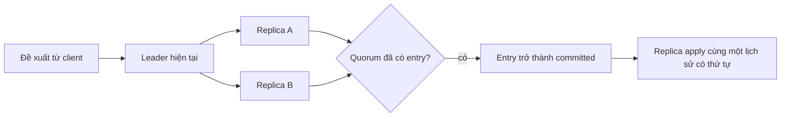
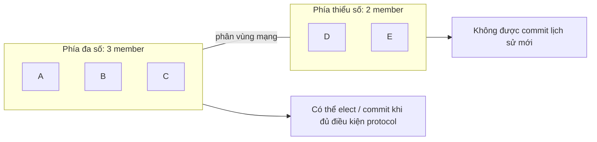

# Đồng thuận phân tán: Thống nhất một lịch sử đã cam kết khi xảy ra lỗi

**Tình huống minh họa (giả định):** Trong một cụm Raft gồm 5 nút, có 2 nút mất liên lạc. Ba nút còn lại chỉ có thể cam kết thao tác ghi khi liên lạc đủ quorum và đáp ứng các điều kiện bầu chọn leader cũng như kiểm tra nhật ký. Nếu mất quorum, các thao tác ghi cần cơ chế đồng thuận phải dừng hoặc trả lỗi; nút từng giữ vai trò leader không được phép bỏ qua giao thức.

Đồng thuận bảo toàn **lịch sử đã cam kết** trong mô hình lỗi dừng (crash) hoặc phân vùng mạng mà giao thức hỗ trợ; điều đó không có nghĩa mọi yêu cầu luôn được phục vụ hay hệ thống miễn nhiễm với lỗi triển khai.

> 💡 **Quy tắc bỏ túi:** Majority quorum giao nhau là điều kiện cần nhưng không phải toàn bộ bằng chứng safety. Raft còn có quy tắc bầu theo log mới nhất, log matching và current-term commit để bảo đảm leader mới giữ lịch sử đã commit.

## Tóm tắt

- **Đồng thuận là thống nhất về lịch sử đã cam kết, không chỉ là sao chép:** Gửi các mục nhật ký sang nút theo sau (follower) mới chỉ là sao chép dữ liệu. Giao thức đồng thuận buộc các nút thống nhất lịch sử nào có hiệu lực và xác lập ranh giới cam kết rõ ràng.
- **Giao điểm quorum phải đi cùng các quy tắc an toàn của Raft:** Hai nhóm đa số có thành viên chung, nhưng chỉ đếm thành viên không chứng minh leader mới giữ đủ mọi mục đã cam kết. Cần thêm quy tắc bỏ phiếu dựa trên nhật ký, tính khớp nhật ký và điều kiện cam kết trong nhiệm kỳ hiện tại.
- **Bầu chọn theo nhiệm kỳ:** Nút bị cô lập có thể vẫn nghĩ mình là leader, nhưng không thể cam kết thao tác ghi nếu không có quorum. Tính an toàn không đòi hỏi mọi nút phải đồng thời nhận biết cùng một leader.
- **Đồng thuận dựa trên quorum có thể hy sinh khả năng tiến triển ở phía thiểu số để giữ an toàn:** Khi phân vùng mạng chia cụm 5 nút thành phía đa số (3 nút) và phía thiểu số (2 nút), phía đa số chỉ tiếp tục khi còn đáp ứng các điều kiện bầu chọn leader, an toàn nhật ký và quorum; phía thiểu số không thể cam kết lịch sử mới. Đây là hành vi của giao thức cụ thể, không phải chính sách sẵn sàng bắt buộc cho mọi dịch vụ phân tán.
- **Rủi ro:** Xem entry mới append cục bộ nhưng chưa commit là quyết định nghiệp vụ bền vững. Entry chưa commit **có thể bị ghi đè** sau khi leader đổi; chỉ trả thành công khi đạt điều kiện commit.



<TermBox term="Quorum">
**Quorum** là tập vote tối thiểu mà protocol yêu cầu trước khi xem một quyết định là được chấp nhận hoặc committed.

Trong hệ majority đơn giản, group 3 node cần 2 vote và group 5 node cần 3. Lý do sâu hơn không chỉ là phép tính: các quorum hợp lệ được chọn để **giao nhau**, tạo quorum intersection nhằm ngăn hai đa số độc lập cùng commit hai lịch sử xung đột tại cùng một vị trí logic.
</TermBox>

## Sao chép không đồng nghĩa với đồng thuận

Sao chép trả lời câu hỏi: **làm thế nào nhiều nút có được các bản sao của trạng thái?**

Đồng thuận trả lời câu hỏi: **các nút thống nhất giá trị, leader hay lịch sử có thứ tự nào là nguồn có thẩm quyền bằng cách nào?**

Một nút chính (primary) có thể sao chép dữ liệu bất đồng bộ sang các nút theo sau mà không cần chạy giao thức đồng thuận cho từng lần cam kết. Một kho dữ liệu không có leader cố định có thể lưu nhiều phiên bản rồi đối soát sau. Ngược lại, máy trạng thái sao chép (replicated state machine) thường kết hợp cả hai: đồng thuận quyết định mục nhật ký nào được cam kết, sau đó cơ chế sao chép phân phối các mục đó tới những nút còn lại.

Vì vậy các suy luận tắt sau là không an toàn:

```text
ba replica -> consensus đã xảy ra
quorum read/write -> đã có một lịch sử consensus linearizable duy nhất
có leader -> leader vẫn còn authority
```

Đồng thuận nói về **quy tắc để các nút thống nhất**, chứ không đơn thuần là có nhiều bản sao hoặc một nút được gọi là “leader”.

## Safety và liveness kéo theo hai mục tiêu khác nhau

Hai từ giúp phân loại điều consensus system cố giữ:

- **Tính an toàn (safety):** không xảy ra điều sai. Hai nút hoạt động đúng không được cam kết hai quyết định mâu thuẫn tại cùng một vị trí.
- **Khả năng tiến triển (liveness):** cuối cùng một đề xuất mới sẽ được cam kết, miễn là các giả định cần thiết để giao thức tiếp tục hoạt động được đáp ứng.

Khi mạng bị phân vùng kéo dài, giao thức có thể chủ động hy sinh khả năng tiến triển ở phía thiểu số để giữ tính an toàn. Từ chối thao tác ghi đôi khi chính là kết quả đúng.

Đây cũng là thói quen suy luận từ các bài trước: timeout hoặc peer unreachable không chứng minh peer đã chết. Vì vậy consensus protocol cần voting rule và history rule vẫn an toàn khi failure detection không hoàn hảo.

<TermBox term="Term / epoch">
**Term** hoặc **epoch (thế hệ)** là một mốc logic tăng đơn điệu, dùng để phân biệt quyền điều phối cũ với quyền điều phối mới.

Raft gọi nó là term hay nhiệm kỳ. Hệ khác có thể dùng epoch, ballot number hoặc generation tương tự. Tên khác nhau nhưng mục đích liên quan: authority cũ không được vượt authority của một quyết định mới hơn.
</TermBox>

## Bầu chọn leader xác lập quyền điều phối hiện tại

Các giao thức đồng thuận dựa trên leader thường chia thời gian thành những nhiệm kỳ logic. Trong Raft, một nút có thể trở thành ứng viên (candidate), yêu cầu các nút ngang hàng bỏ phiếu và chỉ trở thành leader sau khi giành đủ số phiếu của quorum bầu chọn.

```mermaid
sequenceDiagram
  participant A as Node A
  participant B as Node B
  participant C as Node C

  A->>A: election timeout; bắt đầu term 12
  A->>B: xin vote cho term 12
  A->>C: xin vote cho term 12
  B-->>A: cấp vote
  C-->>A: cấp vote
  A->>A: đạt quorum; trở thành leader
  A-->>B: heartbeat / log replication
  A-->>C: heartbeat / log replication
```

Một node nhớ rằng nó *đã từng là leader* là chưa đủ. Authority của nó phụ thuộc vào term hiện tại và quorum rule của protocol.

Leader election chỉ là một phần của consensus. Câu hỏi safety khó hơn nằm ở chuyện lịch sử được xử lý thế nào trước, trong và sau khi leadership đổi.

## Nhật ký sao chép phân biệt đề xuất với mục đã cam kết

Raft là thuật toán đồng thuận dùng để quản lý một **nhật ký sao chép (replicated log)**. Leader sắp xếp các đề xuất thành những mục nhật ký có thứ tự rồi gửi cho follower. Một mục xuất hiện trên một hay nhiều nút chưa có nghĩa là nó đã được cam kết.

**Commit boundary** là ranh giới quan trọng:

1. client gửi proposal;
2. leader append entry cục bộ;
3. follower sao chép entry;
4. protocol quan sát điều kiện quorum cần thiết;
5. entry trở thành committed theo rule của protocol;
6. replica apply các entry đã committed vào state machine theo thứ tự.

Một mục **chưa được cam kết (uncommitted)** có thể biến mất hoặc bị ghi đè sau khi quyền lãnh đạo thay đổi. Client và người vận hành không được đánh đồng việc “nhìn thấy mục đó trong nhật ký của một nút” với việc “cả cụm đã cam kết mục đó”.

Tài liệu failure hiện tại của etcd minh họa đúng boundary này: sau leader failure, write đã gửi nhưng chưa commit có thể mất, trong khi write đã committed được consensus rule bảo toàn.

**Chỉ có giao điểm quorum vẫn chưa đủ để kết luận đã cam kết.** [Bài báo Raft](https://pdos.csail.mit.edu/6.824/papers/raft-extended.pdf) chỉ ra rằng một mục thuộc nhiệm kỳ trước có thể đã được sao chép tới đa số nút nhưng leader vẫn không thể tuyên bố mục đó đã cam kết chỉ dựa trên số lượng bản sao. Raft trực tiếp cam kết các mục thuộc **nhiệm kỳ hiện tại** khi đạt quorum; các mục cũ được cam kết gián tiếp thông qua tính khớp của nhật ký.

## Giao điểm quorum bảo đảm hai nhóm đa số luôn có thành viên chung

Với majority quorum đơn giản, bất kỳ hai đa số hợp lệ nào cũng có ít nhất một member giao nhau.

Với năm member:

```text
quorum A = {1, 2, 3}
quorum B = {3, 4, 5}
điểm giao nhau = {3}
```

Phần chồng lấp đó giúp protocol mang thông tin safety từ quyết định trước sang quyết định sau. Proof consensus thực tế có nhiều điều kiện hơn quan sát này, nhưng quorum intersection là hình dạng cốt lõi cần nhận diện.

Bảng này giả định tập thành viên cố định, quorum đa số đơn giản và lỗi giữa các nút độc lập. Lỗi tương quan hoặc thay đổi thành viên có thể làm kết quả vận hành khác đi. Các cụm có số nút lẻ thường được dùng vì thêm một nút để chuyển sang số chẵn thường làm tăng chi phí mà không tăng số lỗi nút đơn lẻ mà quorum đa số có thể chịu được:

| Số member | Majority | Số member lỗi vĩnh viễn chịu được trước khi mất quorum |
| ---: | ---: | ---: |
| 3 | 2 | 1 |
| 4 | 3 | 1 |
| 5 | 3 | 2 |
| 6 | 4 | 2 |
| 7 | 4 | 3 |

Điều này **không** có nghĩa “luôn dùng năm node” hoặc “thêm member là miễn phí”. Group rộng hơn đưa thêm replication, disk và network work vào consensus path.

## Phân vùng mạng tạo ra phía đa số và phía thiểu số

Xét consensus group 5 node bị phân vùng mạng thành hai nhóm 3 và 2.



Phía thiểu số vẫn có thể đang chạy, ổ đĩa vẫn hoạt động và tiến trình vẫn vượt qua bước kiểm tra sức khỏe. Tuy nhiên, phía này không có đủ phiếu để thiết lập một lịch sử mới đã cam kết một cách an toàn.

Nếu toàn cluster mất quorum, write cần consensus phải dừng. etcd ghi rõ điều này: mất đa số nghĩa cluster không thể nhận write mới cho đến khi quorum được khôi phục hoặc disaster recovery chủ đích tạo cluster mới từ một recovery point đáng tin cậy.

Đó là lý do “ép node bị cô lập tiếp tục phục vụ write” thường là availability shortcut nguy hiểm, không phải một chỉnh sửa vận hành vô hại.

## Đồng thuận luôn gắn với một mô hình lỗi cụ thể

Raft và các giao thức đồng thuận kiểu Paxos cổ điển thường được phân tích dưới giả định **lỗi dừng (crash failure)** và độ trễ mạng: nút có thể dừng, khởi động lại hoặc mất liên lạc, nhưng bản thân giao thức không được thiết kế để chống lại các thành viên tùy ý nói dối.

Một participant **Byzantine** có thể nói dối, equivocate hoặc gửi thông tin bịa khác nhau cho từng peer. Byzantine fault-tolerant protocol cần giả định và cơ chế khác.

Đừng nâng guarantee chỉ bằng từ vựng. Nói “chúng tôi dùng Raft” không đồng nghĩa Byzantine fault tolerance, miễn nhiễm software bug, business logic đúng, hay an toàn trước correlated operator mistake.

## Đồng thuận phải trả giá bằng độ trễ truyền thông

Agreement là coordination, và coordination đi qua máy khác.

Tài liệu etcd hiện tại cho biết độ trễ cam kết của giao thức đồng thuận bị giới hạn bởi thời gian khứ hồi mạng (RTT) và thao tác ghi đĩa bền vững. Đặt quorum ở nhiều khu vực địa lý có thể tăng khả năng tách biệt miền lỗi, nhưng cũng làm tăng độ trễ mạng trên đường xác lập sự đồng thuận.

Điều đó tạo tension thực tế:

```text
phân bố rộng hơn theo failure domain
  -> có thể sống tốt hơn trước local failure
  -> thường tăng consensus latency
  -> cần hiểu quorum placement nghiêm ngặt hơn
```

Vì vậy consensus phù hợp nhất với state thực sự cần một đường quyết định authoritative: cluster membership, leader ownership, metadata, coordination record, strongly ordered state-machine command và control state tương tự.

## Đồng thuận không bảo đảm mọi tác động nghiệp vụ chỉ xảy ra đúng một lần

Một nhóm đồng thuận có thể quyết định rằng mục nhật ký 184 được ghi nhận đúng một lần trong lịch sử nội bộ. Điều đó không tự động bảo đảm email, khoản thu thanh toán, webhook hay thao tác ghi vào cơ sở dữ liệu bên ngoài cũng chỉ xảy ra đúng một lần.

Ngay khi committed command kích hoạt effect bên ngoài consensus state machine, **Delivery Semantics**, idempotency, transaction và reconciliation lại trở nên quan trọng.

Giữ các boundary này tách biệt:

- consensus quyết định lịch sử authoritative trong scope của nó;
- replication phân phối state đó;
- consistency mô tả observer được phép nhìn thấy gì;
- delivery semantics mô tả xử lý message lặp hoặc bỏ sót;
- business correctness phụ thuộc vào cách effect đi qua các boundary đó.

## Kịch bản minh họa (giả định): leader cũ tự nhận quyền commit

Một dịch vụ mặt phẳng điều khiển lưu cấu hình định tuyến trong nhóm đồng thuận gồm 5 thành viên. Sự cố mạng cô lập 2 thành viên, trong đó có leader cũ, khỏi 3 thành viên còn lại.

Phía có 3 thành viên bầu được leader mới và tiếp tục cam kết các thay đổi cấu hình. Leader cũ bị cô lập vẫn có thể được một công cụ quản trị nội bộ truy cập; một cơ chế dự phòng tự chế để duy trì khả năng phục vụ cho phép công cụ đó ghi thẳng vào kho dữ liệu cục bộ của leader cũ mà không cần quorum.

**Hậu quả:** các kỹ sư vận hành chứng kiến hai cấu hình định tuyến hoàn toàn xung đột nhau. Khi kết nối mạng thông suốt trở lại, các lệnh ghi cục bộ từ phía thiểu số vĩnh viễn không thể trở thành một phần của lịch sử đồng thuận đã chốt, dù các hệ thống downstream có thể đã lỡ thực thi các hành động dựa trên dữ liệu sai lệch đó.

**Nguyên nhân cốt lõi:** Cơ chế dự phòng tự chế vẫn coi leader được biết đến gần nhất là có thẩm quyền sau khi nút đó mất quorum. Đội ngũ đã nhầm lẫn giữa việc tiến trình còn hoạt động và việc nút đó còn quyền tham gia đồng thuận, rồi tự ý vượt qua ranh giới cam kết.

**Cách khắc phục chuẩn:** bắt buộc mọi thao tác ghi được đồng thuận bảo vệ phải có thẩm quyền do quorum hiện tại xác lập, kiên quyết từ chối hoặc chặn ghi (fail closed) ở nhánh thiểu số, định danh việc mất quorum như một trạng thái vận hành rõ ràng, và chỉ kích hoạt các side effect bên ngoài dựa trên dữ liệu đã chốt (committed) thay vì quan sát cục bộ chưa commit. Nếu quorum mất vĩnh viễn, phải kích hoạt quy trình khắc phục thảm họa theo tài liệu chuẩn thay vì tự tạo ra một lịch sử dữ liệu thứ hai tại chỗ.

## Tự kiểm tra

Một group kiểu Raft có 5 member bị partition thành phía 2 member chứa leader trước đó và phía 3 member. Leader cũ vẫn reachable từ client nhưng không reach được ba member kia. Nó có thể an toàn tiếp tục commit entry mới chỉ vì trước partition nó là leader không?

<details>
<summary>Xem giải thích chi tiết</summary>

Không. Vai trò leader trước đây không thay thế yêu cầu quorum hiện tại. Phía thiểu số với 2 thành viên không thể tạo thành đa số của nhóm 5 nút, nên không được cam kết lịch sử mới. Phía có 3 thành viên có thể bầu leader mới và tiếp tục tiến triển. Để giữ tính an toàn, phía thiểu số phải dừng các thao tác ghi cần đồng thuận, dù điều đó khiến những client vẫn được định tuyến tới phía này tạm thời không thể ghi.

</details>

## Checklist review

- [ ] **Scope agreement:** Consensus group đang làm authoritative cho giá trị, log hay metadata history nào?
- [ ] **Quorum:** Cần bao nhiêu member cho election và commit, và các member đó nằm trong failure domain nào?
- [ ] **Authority:** Term, epoch, ballot hoặc generation tương đương vô hiệu leader cũ như thế nào?
- [ ] **Commit boundary:** Operator và client có phân biệt state đã replicate nhưng chưa commit với committed state không?
- [ ] **Partition behavior:** Phía thiểu số trả gì khi không thể tạo quorum?
- [ ] **Failure model:** Protocol chỉ thiết kế cho crash fault hay cho mô hình mạnh hơn như Byzantine fault?
- [ ] **Latency:** Network RTT và durable-storage latency nào nằm trên consensus path?
- [ ] **Recovery:** Quy trình majority-loss recovery có được tài liệu hóa và test mà không âm thầm tạo hai authoritative history không?

## Quy tắc cho agent

- [ ] **Không suy consensus từ bản sao:** Tìm election rule và commit rule thật trước khi claim một lịch sử authoritative.
- [ ] **Nêu rõ quorum:** Chỉ ra participant nào và bao nhiêu vote thiết lập authority hoặc commitment.
- [ ] **Tôn trọng state chưa commit:** Không nâng local log entry thành business truth chỉ vì một node đã persist nó.
- [ ] **Fail closed khi mất quorum:** Không phát minh write bypass tạo independent minority history.
- [ ] **Tách scope:** Phân biệt consensus, replication, consistency, delivery semantics và guarantee của external side effect.
- [ ] **Xác minh failure model:** Không mô tả crash-fault protocol là Byzantine fault tolerant nếu protocol thực tế không cung cấp thuộc tính đó.

## Nguồn tham khảo

Các nguồn chính được kiểm tra lại ngày **2026-11-27**:

- [Ongaro & Ousterhout — In Search of an Understandable Consensus Algorithm](https://raft.github.io/raft.pdf)
- [etcd v3.7 — Failure modes](https://etcd.io/docs/v3.7/op-guide/failures/)
- [etcd v3.7 — API guarantees](https://etcd.io/docs/v3.7/learning/api_guarantees/)
- [etcd v3.7 — Performance](https://etcd.io/docs/v3.7/op-guide/performance/)
- [etcd v3.7 — Disaster recovery](https://etcd.io/docs/v3.7/op-guide/recovery/)