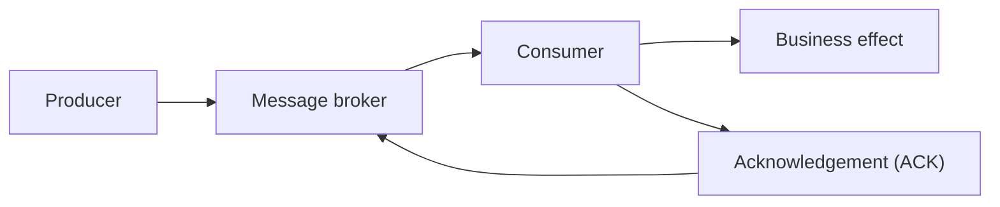
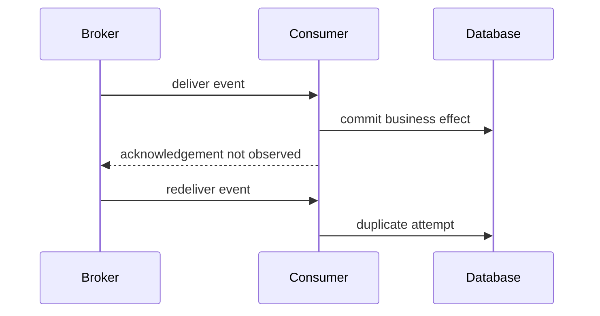
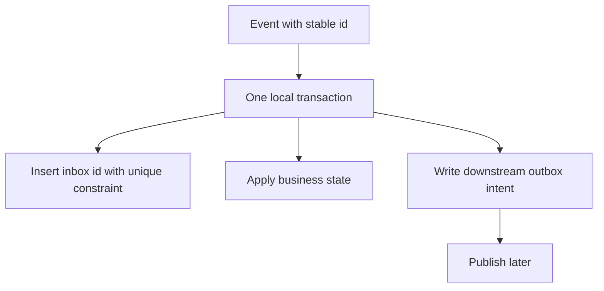

# Delivery Semantics: Reason About Loss, Duplicates, and Effects

**Illustrative scenario (hypothetical):** A consumer records a payment event in its database but loses its broker connection before the acknowledgement is confirmed. Under the broker's delivery contract, the same message may be delivered again. Without recognizing the same business operation, the consumer may repeat a payment-related effect or notification. This is a teaching scenario, not a documented incident.

Delivery semantics describe **message-handling guarantees within a defined boundary**. A redelivered message and a repeated **business side effect** are different phenomena; the latter depends on consumer transactions and deduplication.

## TL;DR

> 💡 **Rule of thumb:** A broker can guarantee message handoff only within a defined boundary; business-effect correctness needs separate protection. With at-least-once delivery, **design for possible duplicates**—not inevitable duplicates on every message. Ask exactly which operations a vendor's “exactly-once” contract covers.

- **At-most-once:** Within the stated broker/consumer handoff boundary, a message is not intentionally redelivered. This avoids protocol-level retries but permits message loss; it does not guarantee that the business effect occurs exactly once.
- **At-least-once:** Once accepted durably under the system's delivery contract and operational assumptions, a message may be redelivered until its acknowledgement is observed. **Duplicates are possible**, not inevitable for every message; consumers must tolerate repeated delivery.
- **"Exactly-once" processing:** A strictly bounded abstraction (such as Apache Kafka's transactional stream processing), never a universal guarantee covering external databases, third-party payment APIs, or email providers.
- **Ordering is decoupled from delivery:** At-least-once retries frequently disrupt message arrival sequences; partition-level or key-level serialization and monotonic versioning must be handled explicitly.
- **Failure boundary:** Acknowledging before committing an effect can lose work on a crash. Acknowledging afterward can lead to duplicate effects on redelivery unless the consumer makes the business operation idempotent.

<TermBox term="Delivery Semantics">
**Delivery semantics** describe the observable loss and duplication behavior of a message handoff under retries and failure. They are properties of a boundary and protocol, not a universal statement about the whole business workflow.
</TermBox>

## Start with the failure window

A consumer normally has to do two things:

1. apply some business effect;
2. tell the broker or log that the delivery is complete.

Those operations are rarely one atomic action.

If the consumer acknowledges **before** the effect, then a crash can lose work. If it acknowledges **after** the effect, then a crash between the effect and acknowledgement can cause redelivery and duplicate processing.

<TermBox term="Acknowledgement">
An **acknowledgement** is evidence that ownership of a delivery has moved far enough for the sender or broker to stop retaining or retrying it. Ack timing is part of your correctness model.
</TermBox>

## Compare the three common guarantees

| Guarantee | What failure may cause | Typical trade-off |
| --- | --- | --- |
| **At-most-once** | message loss | avoids protocol-level redelivery, but may drop work |
| **At-least-once** | duplicate delivery or processing | favors eventual processing; consumers must tolerate repeats |
| **Exactly-once** | depends on the defined boundary | usually requires deduplication or atomic coordination of input progress and output |

### At-most-once

At-most-once is appropriate when losing an occasional item is preferable to repeating it, or when the data is cheap to regenerate. A consumer can move its checkpoint or acknowledge before doing work, but failure after that point can drop the effect permanently.

Do not read “at-most-once” as “the business action happened once.” It can also mean **zero times**.

### At-least-once

At-least-once recovery retains or reoffers accepted work under a broker's defined failure assumptions. RabbitMQ with manual acknowledgements normally requeues unacknowledged deliveries when the consumer channel or connection closes. Amazon SQS standard queues document at-least-once delivery and may return duplicate copies **even within a visibility timeout**. Neither statement promises that an arbitrary external effect will complete at least once if consumers repeatedly fail.

At-least-once is often the practical default for durable work, but duplicate delivery is expected behavior, not an edge case to ignore.

### Exactly-once needs a boundary

“Exactly-once” is not one universal property. Ask exactly once **where?**

A stream processor may atomically commit consumed offsets and derived records inside one transactional system. An SQS FIFO queue can deduplicate producer sends in a bounded five-minute interval when identity and configuration satisfy its contract; this does not deduplicate external business effects. Neither claim automatically makes an external payment charge, email send, warehouse reservation, or webhook effect happen exactly once.

Apache Kafka's **4.0** design documentation (the version cited below) separates publisher durability from consumer processing semantics and scopes transactional exactly-once to coordinated Kafka input offsets and Kafka output records. An external datastore or payment provider needs its own effect/commit coordination; do not extrapolate this into an unversioned provider-wide guarantee.

### Broker acknowledgements and effect deduplication are separate

- [RabbitMQ](https://www.rabbitmq.com/docs/confirms) requeues manually acknowledged messages that remain unacked when a consumer channel or connection closes. That depends on broker state and the configured acknowledgement mode.
- [Amazon SQS Standard](https://docs.aws.amazon.com/AWSSimpleQueueService/latest/SQSDeveloperGuide/standard-queues.html) provides at-least-once delivery and **may** duplicate or reorder messages; not every message is duplicated.
- Persist a stable `event_id` or business-operation identity **atomically with the protected database change**. External payment/email effects require their own downstream idempotency or reconciliation contract; writing a local ID alone cannot roll back a remote call.

## Make duplicate processing converge

At-least-once delivery becomes safe when repeated processing converges on the same logical result.

Common patterns include:

- **Idempotent update:** set `order.status = 'shipped'` rather than “increment shipped count”.
- **Unique event identity:** record `event_id` under a unique constraint **in the same local transaction** that applies the protected effect; storing the ID in an unrelated transaction leaves a failure window.
- **Inbox table:** record consumed message IDs in the same database transaction as local state changes.
- **Idempotency key downstream:** reuse a stable key when calling another service that supports deduplication.
- **Outbox after local commit:** persist downstream intent with the business transaction and publish later.

<TermBox term="Idempotent Consumer">
An **idempotent consumer** can process the same logical message more than once without multiplying the intended business effect. This can come from naturally idempotent state transitions, deduplication records, uniqueness constraints, or downstream idempotency keys.
</TermBox>

The transaction above does not magically make every remote effect exactly once. The inbox identity, business mutation and outbox intent must all be committed together (or all rolled back); the later publisher and any external effect still require safe retries or reconciliation.

## Ordering is a separate contract

Delivery semantics and ordering are related but different.

A system can be at-least-once **and** ordered within a partition or message group. Another may redeliver an older message after a newer one has already been processed. Global ordering is expensive and uncommon; guarantees are usually scoped by partition, key, queue, or consumer group.

When order matters:

- identify the ordering key;
- include a monotonic version or sequence when possible;
- define whether late or duplicate events are ignored, merged, or reconciled;
- do not assume a retry preserves global order.

For state transitions such as `CREATED -> PAID -> SHIPPED`, a consumer should reject or reconcile stale transitions rather than blindly trusting arrival order.

## Poison messages and dead-letter handling

Some messages will never succeed without intervention: invalid payloads, unsupported schema versions, missing reference data, or deterministic business violations.

Infinite redelivery of a poison message wastes capacity and can block useful work. Bound attempts or delivery count, preserve diagnostic context, and route terminal failures to a **dead-letter queue or equivalent failure stream**.

A DLQ is not a correctness strategy by itself. Operators still need:

- reason and exception metadata;
- original message identity;
- replay rules;
- a way to prevent replay from duplicating effects;
- alerting on growth and age.

## Illustrative scenario (hypothetical)

A payment service emits `OrderPaid(eventId=evt-42, orderId=o-17)`. A fulfillment consumer inserts a shipment row, then acknowledges the message.

The database commit succeeds, but the consumer crashes before the broker observes the acknowledgement. The broker redelivers `evt-42`.

**Impact:** a naive consumer **may** insert a second shipment, trigger an additional reservation or send a duplicate downstream command when it treats the redelivery as a new event. This is a hypothetical failure outcome, not a reported incident.

**Root cause:** the team treated message acknowledgement as if it were atomic with the business effect and interpreted “reliable delivery” as “one business effect.”

**Correct pattern:** keep `eventId` stable across deliveries and insert it under a unique constraint in the same local transaction that creates the shipment. For a known duplicate whose prior transaction committed, skip the local mutation and acknowledge according to the broker contract; for an uncertain/in-progress attempt, resolve ownership before returning success. If a downstream reservation must happen later, write outbox intent atomically and use a documented downstream idempotency or reconciliation contract.

This gives the local service **effectively-once business state transition under redelivery** without pretending the entire distributed workflow has one global exactly-once transaction.

## Reasoning checklist for any messaging guarantee

When a platform says “exactly once,” ask:

1. Is the claim about producer publish, broker storage, consumer delivery, stream processing, or external effects?
2. What happens if the consumer crashes after the effect but before ack or checkpoint commit?
3. Can the same logical event carry a stable identity?
4. Where is deduplication state stored, and is it atomic with the local effect?
5. What is the ordering scope?
6. What happens to poison messages?
7. How are replays distinguished from accidental duplicates?

## Self-check

In a hypothetical checkout flow, a consumer charges a card, then commits its queue checkpoint. The charge succeeds but the process crashes before the checkpoint commit. The broker may redeliver the message. Does an “at-least-once” queue violate its contract?

Show the reasoning

No. Redelivery is allowed by at-least-once delivery. The unsafe part is the business effect: the consumer performed a potentially non-idempotent remote action before durably recording completion. Use a **provider-enforced** stable payment identity or reconcile ambiguous charges before repeating the remote effect; local checkpointing alone cannot make a remote charge atomic.

## Delivery semantics checklist

- [ ] Name the guarantee and its exact boundary.
- [ ] Model the crash window around effect and acknowledgement.
- [ ] Expect duplicates under at-least-once delivery.
- [ ] Give logical events stable identities.
- [ ] Make local effects idempotent or deduplicated atomically.
- [ ] Define ordering scope and stale-event behavior.
- [ ] Bound poison-message retries and operate a DLQ or failure stream.
- [ ] Treat vendor “exactly-once” claims as scoped, not global business guarantees.
- [ ] Observe deliveries, redeliveries, duplicate suppressions, DLQ volume, and consumer lag.

## Agent rule

Before accepting a messaging guarantee, recover the full failure boundary: producer confirmation, broker durability, consumer acknowledgement, checkpoint timing, duplicate behavior, ordering scope, local transaction boundary, downstream side effects, replay behavior, and poison-message policy. Never translate a scoped transport guarantee into a stronger business-effect guarantee without proving the coordination mechanism.

## Sources

Primary references rechecked on **2026-11-18**:

- [Apache Kafka 4.0 Design — Message Delivery Semantics](https://kafka.apache.org/40/design/design/) — explicitly version-scoped Kafka transactions
- [RabbitMQ — Consumer Acknowledgements and Publisher Confirms](https://www.rabbitmq.com/docs/confirms)
- [Amazon SQS — At-least-once delivery](https://docs.aws.amazon.com/AWSSimpleQueueService/latest/SQSDeveloperGuide/standard-queues-at-least-once-delivery.html)
- [Amazon SQS — Visibility timeout](https://docs.aws.amazon.com/AWSSimpleQueueService/latest/SQSDeveloperGuide/sqs-visibility-timeout.html) — duplicate reception remains possible during invisibility
- [Amazon SQS — FIFO deduplication](https://docs.aws.amazon.com/AWSSimpleQueueService/latest/SQSDeveloperGuide/FIFO-key-terms.html) — broker-scoped five-minute deduplication
