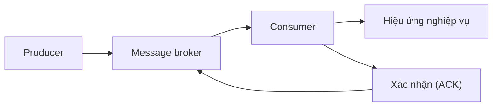
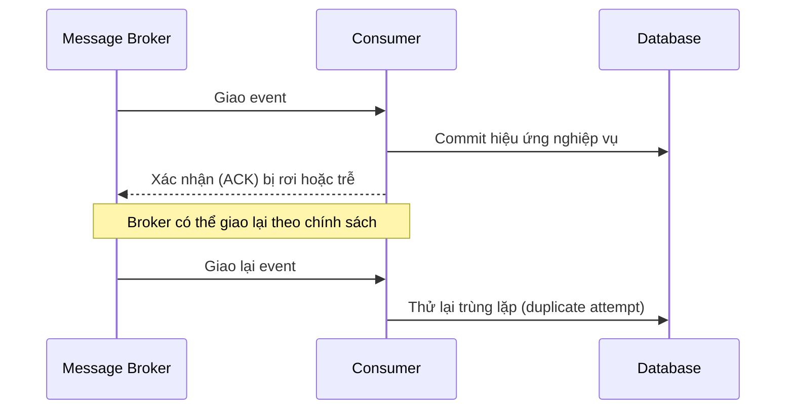
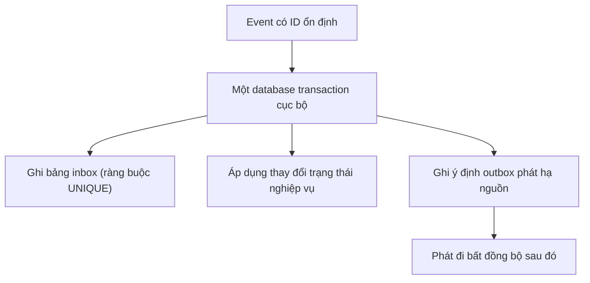

# Ngữ nghĩa giao nhận: Suy luận về mất mát, trùng lặp và hiệu ứng

**Tình huống minh họa (giả định):** Consumer xử lý một sự kiện thanh toán, lưu kết quả vào database rồi mất kết nối trước khi broker nhận được ACK. Theo hợp đồng giao nhận của hệ thống, broker có thể giao lại cùng thông điệp. Nếu bước xử lý thứ hai không nhận ra cùng một thao tác nghiệp vụ, việc ghi nhận thanh toán hoặc gửi thông báo có thể bị lặp. Đây không phải báo cáo sự cố thực tế.

Ngữ nghĩa giao nhận mô tả **phạm vi và điều kiện giao/nhận thông điệp**. Cần phân biệt giao lại thông điệp với việc thực hiện lại **hiệu ứng nghiệp vụ**, vốn phụ thuộc vào transaction và khả năng lọc trùng của consumer.

## Tóm tắt nhanh

> 💡 **Quy tắc bỏ túi:** Broker có thể bảo đảm việc phát hoặc giao message theo phạm vi xác định; tính đúng đắn của **hiệu ứng nghiệp vụ** cần được bảo vệ riêng. Với at-least-once, hãy **thiết kế cho khả năng nhận trùng**, không mặc định lần nào cũng có trùng. Luôn hỏi “exactly-once đối với bước nào?” trước khi áp dụng bảo đảm của Kafka, SQS hoặc broker khác.

- **At-most-once (tối đa một lần):** Trong phạm vi cơ chế giao nhận được mô tả, broker/consumer không chủ động phát lại message khi chưa được xử lý. Điều này tránh redelivery do chính giao thức ấy, nhưng message có thể mất và không tự bảo đảm hiệu ứng nghiệp vụ diễn ra đúng một lần.
- **At-least-once (ít nhất một lần):** Khi thông điệp đã được hệ thống chấp nhận bền vững và các điều kiện vận hành giữ đúng, hệ thống có thể giao lại nếu chưa xác nhận xử lý. **Message có thể bị nhận nhiều lần**, không có nghĩa mọi message chắc chắn bị giao trùng hoặc mọi side effect đều lặp.
- **Exactly-once (chính xác một lần):** Chỉ là một trừu tượng có phạm vi giới hạn nghiêm ngặt (như transactional stream nội bộ của Apache Kafka); hoàn toàn không có cơ chế thần kỳ nào tự động bảo đảm chính xác một lần xuyên qua database bên ngoài, cổng thanh toán hay email.
- **Thứ tự độc lập với giao nhận:** Việc phát lại trong at-least-once thường xuyên làm đảo lộn thứ tự đến của message; cần dựa vào partition key hoặc sequence tăng đơn điệu (monotonic) thay vì kỳ vọng thứ tự toàn cục.
- **Rủi ro cần tránh:** ACK trước khi commit hiệu ứng nghiệp vụ có thể làm mất công việc nếu consumer sập; ACK sau commit mà thiếu idempotency có thể khiến cùng message tạo hiệu ứng trùng khi broker giao lại.

<TermBox term="Delivery Semantics">
**Ngữ nghĩa giao nhận** mô tả khi nào thông điệp có thể bị mất hoặc giao trùng trong một chặng truyền nhận khi có lỗi và thử lại. Đây là thuộc tính của một ranh giới giao thức xác định, không phải lời hứa cho toàn bộ quy trình nghiệp vụ.
</TermBox>

## Bắt đầu từ cửa sổ lỗi

Trong một kiến trúc hướng sự kiện (event-driven architecture), consumer thường phải thực hiện hai tác vụ tách biệt:

1. Áp dụng hiệu ứng nghiệp vụ (business effect) bền vững (ghi database, trừ tiền tài khoản, phát lệnh sang dịch vụ khác).
2. Gửi tín hiệu xác nhận (acknowledgement / ACK) báo cho message broker hoặc tịnh tiến offset log rằng message đã xử lý xong.

Hai thao tác đó thường nằm ở các hệ thống khác nhau, nên không tự tạo thành một giao dịch nguyên tử. Nếu cần bảo đảm mạnh hơn, phải xác định rõ cơ chế phối hợp và phạm vi commit.

Nếu bên nhận ACK **trước** khi ghi kết quả bền vững, một lần dừng đột ngột có thể làm mất công việc chưa hoàn tất. Nếu ACK **sau** khi commit, ACK bị mất có thể khiến broker giao lại, dẫn đến việc xử lý trùng **nếu** ứng dụng không nhận ra thao tác đã thực hiện. Cả hai kết quả phụ thuộc hợp đồng của broker và ranh giới xử lý cụ thể.

<TermBox term="Acknowledgement">
**Xác nhận (ACK)** là tín hiệu theo hợp đồng của broker cho biết một lần giao nhận đã được xử lý tới ranh giới quy định, nhờ đó broker có thể ngừng giữ hoặc thử lại thông điệp. Thời điểm ACK ảnh hưởng trực tiếp đến rủi ro mất việc hoặc xử lý trùng.
</TermBox>

## So sánh ba guarantee phổ biến

| Ngữ nghĩa giao nhận | Rủi ro khi có sự cố | Đánh đổi kiến trúc điển hình |
| :--- | :--- | :--- |
| **At-most-once (tối đa một lần)** | Có thể mất thông điệp | Tránh giao lại ở phạm vi đã định nghĩa, nhưng có thể bỏ sót công việc. |
| **At-least-once (ít nhất một lần)** | Có thể giao trùng | Ưu tiên khả năng xử lý lại trong điều kiện hệ thống hỗ trợ; bên nhận phải chịu được việc giao lặp. |
| **Exactly-once (chính xác một lần)** | Phụ thuộc ranh giới đã công bố | Thường cần lọc trùng hoặc phối hợp nguyên tử giữa việc ghi nhận tiến độ và kết quả trong phạm vi đó. |

### At-most-once

At-most-once phù hợp khi chấp nhận mất một phần dữ liệu hoặc có thể tái tạo kết quả, chẳng hạn một số tín hiệu đo lường không quan trọng. Bên nhận có thể ACK hoặc ghi tiến độ trước khi xử lý; nếu dừng sau đó, hệ thống **có thể** không thực hiện lại tác động đã bỏ dở.

Đừng hiểu nhầm “at-most-once” là “chắc chắn hành động nghiệp vụ đã diễn ra một lần.” Nó hoàn toàn có thể là **không lần nào (zero)**.

### At-least-once

At-least-once giữ hoặc cấp lại công việc đã được chấp nhận theo điều kiện của từng broker. Với chế độ ACK thủ công, RabbitMQ thường đưa các thông điệp chưa ACK trở lại hàng đợi khi channel hoặc kết nối của bên nhận đóng. Amazon SQS standard có thể giao trùng **ngay trong thời gian ẩn**. Khi visibility timeout hết, thông điệp chưa xóa có thể được nhận lại, nhưng **không có bảo đảm rằng một worker cụ thể sẽ nhận nó ngay lập tức**.

At-least-once là một lựa chọn thường gặp cho công việc cần phục hồi. Việc giao trùng **có thể xảy ra** và phải được tính đến ngay trong thiết kế, thay vì mặc định mọi thông điệp đều giao đúng một lần.

### Exactly-once cần một ranh giới rõ ràng

Không có thứ gọi là "chính xác một lần" toàn năng xuyên suốt mọi hạ tầng phân tán. Bất cứ khi nào một nền tảng tuyên bố hỗ trợ exactly-once, câu hỏi đầu tiên bạn phải đặt ra là: **chính xác một lần ở ranh giới nào?**

Theo tài liệu thiết kế **Kafka 4.0** được trích dẫn bên dưới, hệ thống xử lý luồng có thể commit nguyên tử offset đã tiêu thụ và các bản ghi đầu ra **trong phạm vi giao dịch Kafka**. SQS FIFO có thể lọc trùng lần gửi của producer trong cửa sổ năm phút khi định danh và cấu hình đáp ứng hợp đồng. Không bảo đảm nào trong hai cơ chế đó tự bao phủ lệnh thu tiền bên thứ ba, email hay webhook; tác động bên ngoài cần cơ chế chống lặp hoặc đối soát riêng.

### Phạm vi của ACK và duplicate

- [RabbitMQ](https://www.rabbitmq.com/docs/confirms) tự động đưa các delivery chưa ACK trở lại hàng đợi khi channel/connection của consumer dùng manual ACK bị đóng; quá trình phát lại phụ thuộc vào điều kiện cụ thể của broker.
- [Amazon SQS Standard](https://docs.aws.amazon.com/AWSSimpleQueueService/latest/SQSDeveloperGuide/standard-queues.html) bảo đảm at-least-once và **có thể** giao bản sao hoặc đảo thứ tự, không phải mọi message đều bị giao trùng.
- Tầng consumer nên giữ `event_id` hoặc business-operation ID ổn định; bảo vệ việc ghi nhận ID **trong cùng transaction** với thay đổi dữ liệu cần chống lặp. Đối với thanh toán/email bên thứ ba, cần thêm hợp đồng idempotency hoặc đối soát ở ranh giới đó.

## Để các lần xử lý trùng hội tụ về một kết quả

Vì at-least-once **cho phép** giao trùng, việc xử lý lặp phải hội tụ về cùng kết quả nghiệp vụ. Không phải thông điệp nào cũng chắc chắn được giao lại.

Các mẫu thiết kế (pattern) cốt lõi:

- **Cập nhật lũy đẳng tự nhiên (Idempotent update):** Thực thi câu lệnh `UPDATE orders SET status = 'shipped'` thay vì các phép cộng dồn tương đối kiểu `UPDATE metrics SET count = count + 1`.
- **Định danh sự kiện ổn định:** Ghi `event_id` dưới ràng buộc duy nhất trong **cùng giao dịch cục bộ** với thay đổi cần chống lặp. Chỉ ghi ID ở một giao dịch khác vẫn để hở khoảng lỗi.
- **Bảng Inbox (Inbox table pattern):** Ghi lại ID của message đã nhận vào bảng `inbox` trong cùng một database transaction cục bộ với việc cập nhật trạng thái nghiệp vụ.
- **Khóa lũy đẳng hạ nguồn (Downstream idempotency key):** Tái sử dụng một khóa định danh duy nhất ổn định khi gọi sang các dịch vụ hoặc cổng thanh toán bên ngoài có hỗ trợ lọc trùng.
- **Transactional outbox sau khi commit:** Lưu trữ ý định phát sự kiện vào database cục bộ cùng lúc với transaction nghiệp vụ rồi mới phát đi sau.

<TermBox term="Idempotent Consumer">
**Idempotent consumer (Consumer lũy đẳng)** là mẫu thiết kế cho phép consumer tiếp nhận và xử lý cùng một message logic nhiều lần mà không làm nhân bản các hiệu ứng nghiệp vụ ngoài ý muốn. Tính lũy đẳng này có thể đạt được thông qua chuyển dịch trạng thái tự nhiên, ràng buộc khóa duy nhất, bảng inbox hoặc khóa lũy đẳng truyền đi hạ nguồn.
</TermBox>

Giao dịch trên không tự làm các tác động từ xa xảy ra đúng một lần. Bản ghi inbox, thay đổi nghiệp vụ và ý định outbox phải cùng commit hoặc cùng rollback; việc phát thông điệp sau đó và tác động ở dịch vụ ngoài vẫn cần thử lại an toàn hoặc đối soát.

## Thứ tự là một cam kết riêng biệt

Các kỹ sư thường nhầm lẫn giữa ngữ nghĩa giao nhận và thứ tự thông điệp (ordering). Đây là hai cam kết hoàn toàn độc lập.

Một hệ thống có thể vừa đảm bảo at-least-once **vừa** bảo đảm thứ tự trong một partition, stream shard hoặc message group cụ thể. Tuy nhiên, khi mạng chập chờn hoặc consumer sập kích hoạt cơ chế giao lại, một message cũ hoàn toàn có thể đến đích *sau* khi một message mới hơn đã được xử lý xong. Thứ tự toàn cục (global ordering) cực kỳ đắt đỏ và hiếm khi cần thiết; thông thường thứ tự chỉ cần bảo đảm theo partition, aggregate key hoặc customer ID.

Khi thứ tự mang tính sống còn:

- Luôn xác định rõ ràng ordering key (ví dụ `account_id` hoặc `order_id`).
- Đính kèm một phiên bản (version) hoặc số thứ tự tăng đơn điệu (`monotonic sequence`) trong payload của message.
- Thiết kế consumer để chủ động từ chối hoặc dung hòa các chuyển dịch trạng thái cũ (ví dụ: một đơn hàng đã `PAID` mà sau đó nhận được sự kiện giao trễ `CREATED` thì phải bỏ qua).
- Tuyệt đối không giả định việc retry sẽ tự động bảo toàn thứ tự toàn cục trên nhiều worker xử lý song song.

## Xử lý message độc và Dead-Letter Queue

Không phải mọi lỗi đều là sự cố tạm thời. Lỗi cấu trúc dữ liệu hoặc phiên bản schema không tương thích **thường** không tự khỏi chỉ nhờ thử lại; thiếu dữ liệu tham chiếu hoặc quy tắc nghiệp vụ có thể thay đổi theo thời gian nên cần phân loại theo tình huống.

Thử lại không giới hạn một **thông điệp lỗi khó phục hồi (poison message)** có thể chiếm tài nguyên và làm chậm công việc khác. Mức độ ảnh hưởng phụ thuộc chính sách phân phối, số worker và năng lực xử lý.

Để bảo vệ đường ống xử lý:

- Giới hạn số lần retry bằng chiến lược exponential backoff kết hợp ngẫu nhiên hóa thời gian chờ (jitter).
- Chuyển lỗi kết thúc sang **hàng đợi lỗi (DLQ)** hoặc luồng xử lý tương đương, kèm mã lỗi, định danh gốc và ngữ cảnh vừa đủ; tránh lưu bí mật hoặc toàn bộ stack trace chứa dữ liệu nhạy cảm.
- Thiết lập quy trình replay DLQ chặt chẽ, bảo đảm các message chạy lại vẫn mang ID gốc để tránh nhân bản tác dụng phụ nghiệp vụ.
- Thiết lập cảnh báo chủ động (alerting) khi dung lượng DLQ hoặc tuổi thọ message trong DLQ tăng đột biến.

## Kịch bản minh họa (giả định): xử lý trùng sau ACK bị mất

Một dịch vụ thanh toán phát ra sự kiện: `OrderPaid(eventId="evt-42", orderId="ord-17")`. Worker phía kho vận (fulfillment) nhận event, chèn một bản ghi vận chuyển vào database, rồi chuẩn bị gửi tín hiệu xác nhận (ACK) về message broker.

**Trong ví dụ tự xây dựng này**, giao dịch cơ sở dữ liệu commit thành công nhưng tiến trình dừng trước khi broker ghi nhận ACK. Theo cơ chế giao lại đã giả định, broker **có thể** phát lại `evt-42` tới một tiến trình khác. Không có số liệu thời gian, lỗi Kubernetes hay sự cố thực tế nào được khẳng định.

**Hậu quả:** một bên nhận không kiểm tra trùng **có thể** tạo thêm bản ghi vận chuyển, lệnh giữ hàng hoặc thông điệp cho đối tác, dù broker vẫn tuân thủ hợp đồng giao nhận.

**Nguyên nhân cốt lõi:** Đội ngũ phát triển đánh đồng việc gửi ACK với việc hoàn tất hiệu ứng nghiệp vụ, ngộ nhận rằng "giao nhận đáng tin cậy của broker" đồng nghĩa với "tác dụng phụ chỉ xảy ra đúng một lần".

**Cách khắc phục chuẩn:** Giữ `eventId` ổn định qua các lần giao lại và ghi nó dưới ràng buộc duy nhất trong cùng giao dịch tạo bản ghi vận chuyển. Nếu gặp thông điệp trùng **đã commit trước đó**, bỏ qua thay đổi nghiệp vụ và ACK theo hợp đồng broker; nếu kết quả trước còn đang xử lý hoặc chưa rõ, phải xác định trạng thái trước khi báo hoàn tất. Với thao tác bên ngoài, ghi ý định outbox trong giao dịch và dùng hợp đồng chống lặp hoặc đối soát của dịch vụ đích.

Mô hình này mang lại **hiệu quả xử lý chính xác một lần trên trạng thái cục bộ (effectively-once business state transition)** ngay cả khi broker phát lại liên tục, mà không đòi hỏi một giao dịch phân tán toàn cục ảo tưởng.

## Checklist suy luận cho mọi cam kết messaging

Trước khi tin vào bất kỳ lời hứa "exactly-once" nào từ nhà cung cấp giải pháp, hãy tự vấn 7 câu hỏi kiến trúc sau:

1. Cam kết đó có phạm vi ranh giới cụ thể ở đâu (tại producer publish, lưu trữ nội bộ của broker, giao nhận tới consumer hay toàn bộ hiệu ứng bên ngoài)?
2. Điều gì sẽ xảy ra nếu consumer sập ngay sau khi ghi database nhưng trước khi gửi ACK hoặc commit checkpoint?
3. Mỗi sự kiện logic có mang một ID định danh duy nhất và bất biến trên toàn hệ thống không?
4. Trạng thái lọc trùng được lưu trữ ở đâu, và nó có nằm trong cùng ranh giới nguyên tử (atomic boundary) với thay đổi nghiệp vụ không?
5. Ranh giới thứ tự là gì (toàn cục, theo partition, theo aggregate key hay hoàn toàn ngẫu nhiên)?
6. Các message độc (poison message) được cách ly ra sao, và điều gì bảo đảm việc chạy lại (replay) từ DLQ không nhân đôi tác dụng phụ nghiệp vụ?
7. Hệ thống phân biệt các lượt replay có chủ đích với các lần trùng lặp do mạng chập chờn bằng cách nào?

## Tự kiểm tra

Một consumer gọi API ngân hàng để trừ tiền thẻ tín dụng của khách, sau đó mới commit checkpoint trên message queue. Giao dịch trừ tiền thành công, nhưng tiến trình consumer sập ngay trước khi lệnh commit checkpoint kịp gửi tới broker. Khi khởi động lại, broker phát lại message đó. Hàng đợi "at-least-once" này có vi phạm hợp đồng không?

Xem giải thích chi tiết

Không. Giao lại là hành vi **được phép** của at-least-once. Rủi ro nằm ở tác động thu tiền bên ngoài khi chưa lưu kết quả bền vững. Chỉ dùng cùng mã giao dịch thanh toán khi bên nhận **thực sự có hợp đồng chống lặp**; nếu kết quả trước chưa rõ, phải đối soát trước khi gửi lệnh thu tiền mới. Việc commit checkpoint nội bộ không khiến lệnh thu tiền bên ngoài trở thành giao dịch nguyên tử.

## Checklist ngữ nghĩa giao nhận

- [ ] **Xác định ranh giới cam kết:** Ghi rõ từng chặng truyền thông cam kết at-most-once, at-least-once hay exactly-once nội bộ.
- [ ] **Mô hình hóa cửa sổ lỗi (Failure Window):** Vẽ rõ khoảng cách rủi ro giữa thời điểm commit dữ liệu và thời điểm gửi ACK về broker.
- [ ] **Thiết kế tính lũy đẳng:** Bảo đảm mọi consumer chạy chế độ at-least-once đều trang bị bảng inbox lọc trùng hoặc logic cập nhật lũy đẳng.
- [ ] **Định danh sự kiện ổn định:** Dùng định danh nhất quán cho cùng sự kiện nghiệp vụ qua các lần phát lại, không bắt buộc là mã ngẫu nhiên toàn cục trong mọi hệ thống.
- [ ] **Kiểm soát thứ tự chặt chẽ:** Xác định phạm vi thứ tự cần thiết và sử dụng sequence tăng đơn điệu (monotonic) khi nghiệp vụ yêu cầu.
- [ ] **Cách ly message độc:** Thiết lập ngưỡng retry hữu hạn, thuật toán backoff và chuyển hướng dứt khoát sang Dead-Letter Queue (DLQ).
- [ ] **Giám sát chuyên sâu:** Thiết lập dashboard và cảnh báo cho dung lượng DLQ, độ trễ xử lý (consumer lag) và tuổi thọ của message bị tồn đọng.

## Quy tắc cho agent

Khi đánh giá hoặc viết code tích hợp message broker, không bao giờ được chấp nhận các khẳng định "exactly-once" mà không kiểm tra toàn diện chuỗi xử lý: từ xác nhận của producer, tính bền vững của broker, thời điểm gửi ACK của consumer, ranh giới database transaction cục bộ, khóa lũy đẳng gọi downstream cho đến chính sách cách ly message độc. Tuyệt đối không được đánh đồng cam kết truyền tải mạng của broker với tính lũy đẳng nghiệp vụ của tầng ứng dụng.

## Nguồn

Nguồn chính được kiểm tra lại ngày **2026-11-18**:

- [Apache Kafka 4.0 — Ngữ nghĩa giao nhận](https://kafka.apache.org/40/design/design/) — cam kết trong phạm vi phiên bản Kafka 4.0
- [RabbitMQ — Consumer Acknowledgements and Publisher Confirms](https://www.rabbitmq.com/docs/confirms)
- [Amazon SQS — At-least-once delivery](https://docs.aws.amazon.com/AWSSimpleQueueService/latest/SQSDeveloperGuide/standard-queues-at-least-once-delivery.html)
- [Amazon SQS — Thời gian ẩn](https://docs.aws.amazon.com/AWSSimpleQueueService/latest/SQSDeveloperGuide/sqs-visibility-timeout.html) — vẫn có thể giao trùng trong thời gian ẩn
- [Amazon SQS FIFO — Phạm vi lọc trùng](https://docs.aws.amazon.com/AWSSimpleQueueService/latest/SQSDeveloperGuide/FIFO-key-terms.html)
