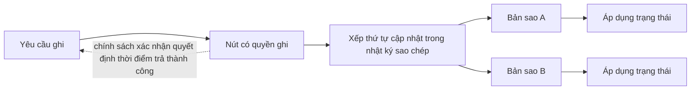
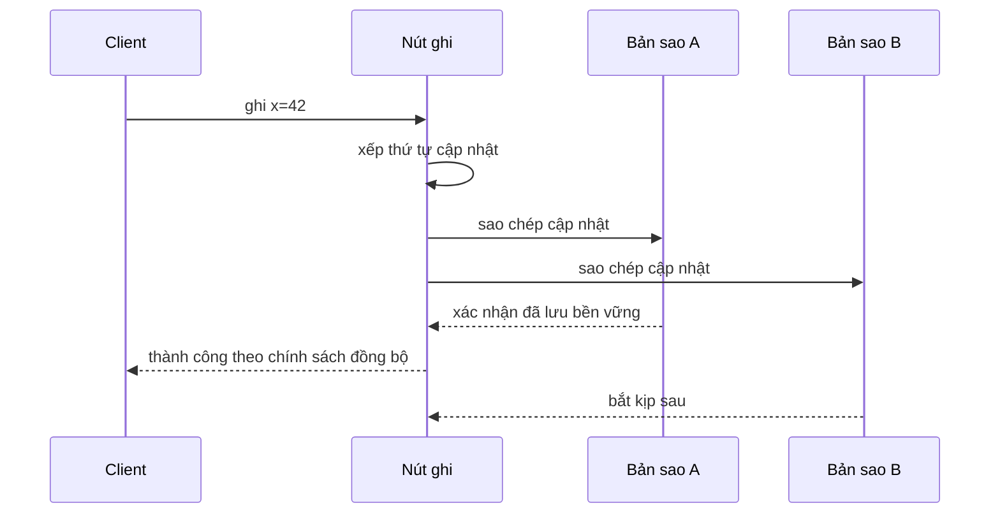
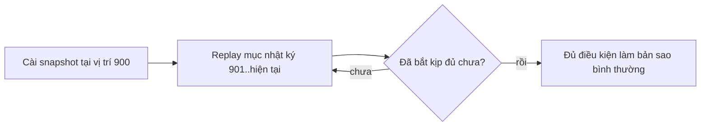
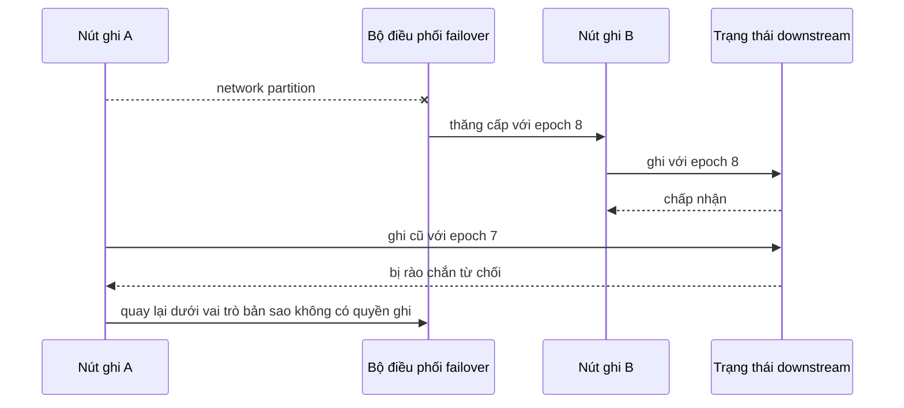

# Sao chép phân tán: Giữ các bản sao đúng qua sự cố và chuyển đổi dự phòng

**Tình huống minh họa (giả định):** Người dùng đổi mật khẩu, nhưng lần đăng nhập tiếp theo đọc dữ liệu từ một bản sao chưa bắt kịp nên vẫn thấy mật khẩu cũ. Trong một kiến trúc khác, máy chủ dự phòng được thăng cấp trong khi ứng dụng vẫn có thể ghi vào máy chủ chính cũ. Nếu hệ thống không thực thi việc thu hồi quyền ghi cũ, hai bên có thể tạo ra hai lịch sử xung đột. Đây là các tình huống minh họa, không phải sự cố thực tế có số liệu độ trễ.

Sao chép duy trì nhiều bản sao của trạng thái. Để đánh giá mức an toàn, cần biết **thời điểm xác nhận (ACK)**, bên nào có quyền ghi và cơ chế chuyển đổi dự phòng ngăn bên ghi cũ tiếp tục ghi như thế nào.

> 💡 **Quy tắc bỏ túi:** Hãy xem sao chép phân tán là giao thức về thẩm quyền và bản sao với ranh giới lỗi tường minh, không đơn thuần là đồng bộ dữ liệu nền. Đừng bao giờ đánh đồng $N$ bản sao với việc luôn có $N$ dữ liệu mới nhất, và tuyệt đối không bao giờ failover mà thiếu cơ chế rào chắn cô lập bên ghi cũ.

## Tóm tắt

- **Sao chép xác lập thẩm quyền và thứ tự cập nhật, không chỉ lưu trữ thô:** Giao thức sao chép phải định rõ nút nào có quyền quyết định từng cập nhật, xếp thứ tự các thao tác ghi vào một nhật ký sao chép duy nhất, và bảo đảm các bản sao áp dụng dữ liệu một cách tất định.
- **Ranh giới ACK xác định cam kết:** Replication bất đồng bộ có thể ACK trước khi follower lưu bền vững, tạo cửa sổ mất dữ liệu khi bản sao nguồn không thể phục hồi. Trong replication đồng bộ, hệ thống có thể chờ remote receipt, OS write, flush bền vững hoặc apply — tùy protocol/cấu hình. Nhãn `sync` **không tự bảo đảm remote fsync**.
- **Độ trễ sao chép phân hóa theo từng chặng:** Một bản sao có thể chậm trễ ở khâu nhận gói tin qua mạng (đã nhận), lưu trữ xuống đĩa bền vững (đã lưu bền vững), nạp vào state machine (đã áp dụng), hoặc khâu sẵn sàng cho câu lệnh đọc quan sát (đã nhìn thấy).
- **Failover cần bảo vệ quyền ghi:** Promotion phải ngăn primary cũ thay đổi trạng thái có thẩm quyền (epoch, fencing tại resource hoặc thu hồi quyền ghi). Không phải mọi topology đều phát fencing token; chỉ đổi DNS hoặc routing không tạo bất biến an toàn.
- **Cạm bẫy chết người:** Ảo tưởng rằng hệ số sao chép bằng 3 ($N=3$) đồng nghĩa với việc không bao giờ mất dữ liệu. Nếu ranh giới xác nhận chỉ nằm ở Leader cục bộ và Leader gặp sự cố phần cứng vĩnh viễn trước khi kịp đồng bộ sang các follower, toàn bộ các lần ghi đã báo thành công cho client sẽ bốc hơi hoàn toàn.



<TermBox term="Hệ số sao chép">
**Hệ số sao chép** là số lượng bản sao mà chính sách sao chép dự định duy trì cho một đơn vị dữ liệu.

Hệ số bằng ba chỉ nói nên có bao nhiêu bản sao. Nó không tự nói các bản sao nằm ở đâu, mới đến mức nào, bản sao nào được ghi hoặc hệ thống chịu được bao nhiêu lỗi tương quan.
</TermBox>

## Sao chép phân tán rộng hơn sao chép cơ sở dữ liệu

Bài **Sao chép cơ sở dữ liệu (Database Replication)** trong Atlas giải thích chi tiết một nhóm cơ chế cụ thể: nhật ký cơ sở dữ liệu, phát lại trên máy chủ dự phòng, cam kết đồng bộ và bất đồng bộ, định tuyến truy vấn đọc và chuyển đổi dự phòng.

Sao chép phân tán là khái niệm rộng hơn ở cấp hệ thống. Trạng thái được sao chép có thể là:

- một shard database;
- một bản ghi metadata;
- một phân vùng của luồng thông điệp;
- một khóa cấu hình;
- nhật ký của state machine được sao chép;
- chỉ mục đối tượng hoặc service registry.

Ngay cả khi không dùng cơ sở dữ liệu SQL, các câu hỏi cốt lõi vẫn giống nhau: bên nào sắp thứ tự các lần ghi, loại xác nhận nào được tính, bản sao chậm được phục hồi ra sao và điều gì ngăn hai bên có quyền ghi tạo ra lịch sử khác nhau sau khi mạng bị phân vùng.

## Lịch sử cập nhật có thứ tự cần quy tắc xác định bên có quyền ghi

Một kiến trúc phổ biến có một nút đang giữ quyền ghi, thường gọi là **leader**, cùng nhiều nút theo sau (follower). Leader xác định thứ tự các cập nhật được chấp nhận; các follower tái tạo lịch sử theo đúng thứ tự đó.

<TermBox term="Nhật ký sao chép">
**Nhật ký sao chép** là bản ghi có thứ tự của các thay đổi trạng thái hoặc lệnh, cho phép những bản sao phát lại (replay) và tái tạo cùng một trạng thái logic.

Điều quan trọng là quan hệ thứ tự do giao thức xác lập. Dữ liệu có thể được lưu dưới dạng WAL của cơ sở dữ liệu, nhật ký lệnh được sao chép, luồng chỉ ghi nối tiếp (append-only) hoặc một định dạng riêng khác.
</TermBox>

Có thể suy luận luồng leader-based như sau:

```text
yêu cầu cập nhật
  -> nút có quyền ghi kiểm tra và xếp thứ tự
  -> cập nhật đi vào nhật ký sao chép
  -> các bản sao nhận cập nhật đã có thứ tự
  -> các bản sao lưu bền vững và/hoặc áp dụng cập nhật
  -> mỗi bản sao tiến vị trí sao chép của mình
```

Vì thế “follower đã nhận byte” và “follower đã có thể phục vụ trạng thái mới” không nhất thiết là cùng một mốc.

**Ví dụ PostgreSQL:** [Tài liệu về sao chép đồng bộ](https://www.postgresql.org/docs/current/warm-standby.html) phân biệt `remote_write` (máy chủ dự phòng đã ghi WAL vào hệ thống tệp, nhưng chưa chắc dữ liệu đã được xả xuống bộ nhớ lưu trữ bền vững), `on` (chờ WAL được flush tại máy chủ dự phòng đồng bộ đã cấu hình) và `remote_apply` (chờ phát lại để thay đổi có thể được truy vấn đọc nhìn thấy). Cần kiểm tra `synchronous_standby_names` và thiết lập của từng giao dịch, không suy diễn chỉ từ nhãn “đồng bộ”.

## Thời điểm xác nhận quyết định cam kết của thao tác ghi

Giao thức sao chép chọn một thời điểm mà từ góc nhìn của client, thao tác ghi được xem là thành công.

Với **sao chép bất đồng bộ**, nút có quyền ghi có thể trả xác nhận trước khi bản sao khác lưu bền vững hoặc áp dụng cập nhật. Cách này không buộc thao tác ghi phải chờ độ trễ của bản sao từ xa, nhưng nếu nút có quyền ghi bị mất đột ngột thì dữ liệu trong khoảng thời gian đó có thể bị mất.

Với **sao chép đồng bộ**, giao thức chờ một hình thức xác nhận từ xa trước khi trả kết quả thành công. Cách này thu hẹp một số khoảng thời gian có nguy cơ mất dữ liệu, nhưng khiến độ trễ và khả năng phục vụ của thao tác ghi phụ thuộc vào những thành viên bắt buộc phải phản hồi.



Hai nhãn “đồng bộ” và “bất đồng bộ” chưa đủ nếu không nêu rõ thời điểm xác nhận. Hệ thống có thể chờ nhận dữ liệu, lưu dữ liệu bền vững, áp dụng dữ liệu vào máy trạng thái hoặc đạt một điều kiện quorum cụ thể. Mỗi lựa chọn mang lại một mức bảo đảm khác nhau.

PostgreSQL là ví dụ cụ thể: cơ chế sao chép luồng (streaming replication) mặc định hoạt động bất đồng bộ, còn sao chép đồng bộ có thể buộc thao tác cam kết chờ máy chủ dự phòng đã cấu hình đạt đến một mốc nhất định. Đây là cơ chế riêng của cơ sở dữ liệu, dùng để minh họa khái niệm tổng quát về thời điểm xác nhận.

## Độ trễ sao chép là khoảng cách tới một mốc tiến độ cụ thể

**Độ trễ sao chép** không phải một con số duy nhất cho mọi hệ thống. Một bản sao có thể chậm ở những giai đoạn khác nhau:

| Mốc tiến độ | Câu hỏi |
| --- | --- |
| Đã nhận | Bản sao đã nhận cập nhật chưa? |
| Đã lưu bền vững | Cập nhật đã được ghi xuống thiết bị lưu trữ bền vững chưa? |
| Đã áp dụng | Máy trạng thái cục bộ đã áp dụng cập nhật chưa? |
| Đã nhìn thấy | Truy vấn đọc tại chỗ đã nhìn thấy cập nhật chưa? |

Một nút có vẻ “khỏe mạnh” vẫn có thể chứa dữ liệu quá cũ đối với yêu cầu đọc cần bảo đảm tính đúng đắn.

Điều này nối trực tiếp với bài **Tính nhất quán phân tán** trước đó: sao chép tạo ra nhiều trạng thái mà client có thể quan sát, còn hợp đồng nhất quán quyết định trạng thái nào được phép dùng cho từng luồng đọc.

## Bản sao phải khởi tạo trước khi có thể liên tục theo kịp

Một nút mới thường không thể phát lại toàn bộ lịch sử không giới hạn kể từ đầu. Vì vậy, các hệ thống sao chép thường cài một ảnh chụp trạng thái (snapshot) hoặc bản dữ liệu nền, rồi phát lại phần nhật ký phát sinh sau đó.



Một bản sao vừa hoạt động trở lại cũng gặp vấn đề tương tự. Nếu nhật ký vẫn còn phần lịch sử mà nó bị thiếu, bản sao có thể đồng bộ bù từng phần. Nếu phần lịch sử cần thiết đã bị gom gọn hoặc xóa, bản sao có thể phải cài lại một snapshot mới.

Bài báo Raft mô tả cách snapshot thay thế phần đầu nhật ký đã cam kết và được gửi tới follower tụt lại quá xa. PostgreSQL cũng giải thích quá trình bắt kịp của máy chủ dự phòng và trường hợp phải khởi tạo lại khi WAL cần thiết không còn được lưu giữ.

Về vận hành, quá trình khởi tạo bản sao không miễn phí. Một snapshot lớn có thể tiêu tốn băng thông mạng, hoạt động đọc/ghi lưu trữ, CPU và tài nguyên của leader đúng lúc cả cụm đang gặp sự cố.

## Chuyển đổi dự phòng thay đổi quyền ghi, vì vậy phải rào chắn bên ghi cũ

Chuyển đổi dự phòng không chỉ là “chuyển lưu lượng sang một bản sao khác”. Thao tác này thay đổi nút nào được phép tiếp nhận các lần ghi có thẩm quyền.

<TermBox term="Fencing token">
**Fencing token (mã rào chắn)** là một giá trị thẩm quyền tăng đơn điệu, chẳng hạn epoch, term hoặc thế hệ lease, cho phép thành phần nhận thao tác ở phía sau từ chối yêu cầu đến từ nguồn thẩm quyền cũ.

Rào chắn bảo vệ trước nút từng hợp lệ, sau đó bị cô lập, rồi quay lại làm việc sau khi một nguồn quyền mới đã tiếp quản.
</TermBox>

**Lưu ý về thực thi:** Epoch hoặc term tăng đơn điệu chưa tự tạo ra cơ chế rào chắn. Tầng lưu trữ hoặc tài nguyên trực tiếp thực hiện tác động phải từ chối các thế hệ quyền cũ. Một số kiến trúc còn cần biện pháp cô lập nằm ngoài giao thức, chẳng hạn ngắt nguồn điện hoặc khóa quyền truy cập lưu trữ. Hãy mô tả đúng cơ chế mà hệ thống thực sự áp dụng.


Nếu không có rào chắn, bên ghi cũ có thể hoạt động trở lại sau khi chuyển đổi dự phòng và gây ra tình trạng **split-brain**: hai nút cùng chấp nhận các lần ghi, tạo nên hai lịch sử không thể đồng thời là lịch sử có thẩm quyền duy nhất.



Cơ chế cụ thể thay đổi theo hệ thống. Một nhóm consensus có thể quyết định leadership và thứ tự log đã commit. Bộ điều phối failover bên ngoài có thể dùng lease hoặc metadata store được phối hợp chặt. Hạ tầng lưu trữ có thể áp rào chắn ở tầng thấp hơn. Invariant vẫn giống nhau: **nguồn quyền cũ không được tiếp tục ghi sau khi nguồn quyền mới đã tồn tại**.

Tài liệu failover của PostgreSQL cảnh báo rõ rằng primary cũ khi khởi động lại cần cơ chế ngăn nó tiếp tục hành xử như primary sau khi standby đã được thăng cấp.

## Kiến trúc nhiều bên ghi hoặc không có leader chuyển phần phức tạp sang khâu đối soát

Không phải topology sao chép nào cũng chọn một bên ghi đang hoạt động.

Thiết kế **nhiều leader (multi-leader)** có thể tiếp nhận thao tác ghi tại nhiều leader rồi đối soát xung đột sau. Thiết kế **không leader cố định (leaderless)** có thể gửi yêu cầu đọc và ghi trực tiếp tới nhiều bản sao mà không có một nguồn sắp thứ tự cố định.

Các thiết kế này giảm phụ thuộc vào một vị trí ghi duy nhất, nhưng cập nhật đồng thời có thể không có một thứ tự tự nhiên duy nhất. Giao thức phải định nghĩa cách so sánh và hòa giải các version.

Dynamo là ví dụ kinh điển về kiến trúc không có leader cố định. Thiết kế này dùng thông tin phiên bản của đối tượng và cơ chế giải quyết xung đột có sự tham gia của ứng dụng để duy trì khả năng phục vụ trong một số tình huống lỗi. Hệ thống cũng dùng các cơ chế sửa chữa để đưa các bản sao dần hội tụ trở lại.

Các cơ chế hòa giải hữu ích gồm:

- siêu dữ liệu phiên bản giúp phát hiện các nhánh cập nhật đồng thời thay vì âm thầm ghi đè lẫn nhau;
- cơ chế sửa khi đọc (read repair) cập nhật các bản sao cũ ngay trong quá trình trả kết quả đọc;
- cơ chế đối chiếu định kỳ (anti-entropy) so sánh các vùng dữ liệu giữa những bản sao trong nền;
- quy tắc merge theo nghiệp vụ khi hệ thống không thể tự suy ra ý định đúng.

Quorum có thể là một phần của giao thức sao chép không leader, nhưng **phép tính quorum không tự động trở thành đồng thuận** và cũng không chứng minh được rằng toàn hệ thống có một lịch sử duy nhất với tính tuyến tính hóa (linearizability).

## Hệ số sao chép không tự bảo đảm khả năng chịu lỗi

Ba bản sao chạy trên ba tiến trình khác nhau vẫn có thể cùng nằm trong một miền lỗi.

Ví dụ lỗi tương quan:

- mọi bản sao cùng trên một physical host;
- mọi bản sao cùng trong một availability zone;
- mọi copy cùng chạy bản deploy lỗi;
- mọi nút cùng mất một dependency dùng chung;
- automation của operator xóa hoặc làm hỏng mọi bản sao.

Hãy bố trí bản sao theo loại sự cố mà yêu cầu sẵn sàng thực sự cần chịu được. Có thể phải phân tán bản sao qua nhiều ổ đĩa, máy chủ, vùng sẵn sàng hoặc khu vực địa lý; tuy nhiên, phạm vi phân tán càng rộng thì độ trễ mạng và độ phức tạp vận hành càng tăng.

Sao chép làm tăng khả năng còn ít nhất một bản sao hợp lệ. Tuy nhiên, nó không thay thế bản sao lưu, khả năng phục hồi về một thời điểm cụ thể (point-in-time recovery) hay cơ chế bảo vệ khỏi lỗi logic bị sao chép nguyên vẹn sang mọi bản sao.

## Phân vùng dữ liệu và sao chép là hai chiều độc lập

**Phân vùng dữ liệu (partitioning)** xác định mỗi nút chịu trách nhiệm cho phần dữ liệu nào. **Sao chép (replication)** xác định phần dữ liệu đó có bao nhiêu bản sao và các bản sao phối hợp với nhau ra sao.

Một hệ thống sharded thường kết hợp cả hai:

```text
shard A -> A1, A2, A3
shard B -> B1, B2, B3
shard C -> C1, C2, C3
```

Đổi shard key làm thay đổi cách dữ liệu được đặt giữa các partition. Đổi replication factor làm thay đổi số bản sao trong từng partition. Tách hai chiều này giúp phân tích capacity và failure rõ hơn.

## Sao chép và đồng thuận giải quyết hai bài toán khác nhau

Sao chép trả lời: **nhiều nút nhận và duy trì các bản sao trạng thái bằng cách nào?**

Đồng thuận trả lời: **các nút thống nhất về một giá trị hoặc lịch sử có thứ tự như thế nào khi xảy ra lỗi và độ trễ?**

Nhiều replicated state machine kết hợp hai khái niệm: consensus protocol quyết định log entry nào đã commit, còn replication phân phối các entry đó sang thành viên khác.

Nhưng replication cũng tồn tại khi không có consensus protocol tạo ra một global committed history duy nhất. Hệ thống primary/standby bất đồng bộ và kho leaderless hội tụ cuối cùng là hai ví dụ.

Vì vậy đừng suy ra:

> trạng thái đã được sao chép -> consensus đã xảy ra

hoặc:

> replication theo quorum -> consensus linearizable

Bài Atlas kế tiếp sẽ tách riêng khái niệm consensus.

## Tình huống minh họa (giả định): hai bên cùng ghi sau khi chuyển đổi dự phòng

Một dịch vụ theo khu vực lưu trạng thái quyền sử dụng của khách hàng trên ba bản sao. Nút ghi A đang giữ epoch 41. Sự cố phân vùng mạng khiến A mất liên lạc với bộ điều phối chuyển đổi dự phòng; bộ điều phối thăng cấp nút ghi B với epoch 42.

Lưu lượng được chuyển sang B, nhưng một nhóm ứng dụng cũ vẫn có thể truy cập A. A tiếp tục nhận các cập nhật quyền sử dụng trong vài phút. Khi kết nối được khôi phục, các bản sao chứa hai lịch sử đều có vẻ hợp lệ.

**Hậu quả:** Quyền của khách hàng lúc xuất hiện, lúc biến mất tùy thuộc bản sao nào trả lời yêu cầu đọc. Khâu đối soát không thể tự xác định một cách an toàn cập nhật nghiệp vụ nào trong hai lịch sử xung đột mới là dữ liệu đúng.

**Nguyên nhân cốt lõi:** đội ngũ kỹ thuật xem việc thăng cấp (promotion) chỉ như một thao tác đổi hướng routing mạng đơn thuần. Nút ghi cũ không hề có rào chắn cô lập, khiến việc đứt kết nối với control plane không thể tước bỏ khả năng tiếp tục ghi đè dữ liệu có thẩm quyền của nó.

**Cách khắc phục:** Gắn mọi thao tác ghi có thẩm quyền với epoch hoặc term hiện tại; buộc thành phần nhận thao tác ở phía sau từ chối mã quyền cũ; và chỉ thăng cấp nút mới sau khi cơ chế chuyển đổi dự phòng xác lập được một nguồn thẩm quyền duy nhất. Khi nút ghi cũ hoạt động trở lại, hãy đưa nó về vai trò bản sao chỉ đọc, cài snapshot an toàn hoặc đối soát phần nhật ký còn lưu giữ, rồi xác minh nó đã bắt kịp hoàn toàn trước khi cho phép nó đủ điều kiện nhận quyền ghi trở lại.

## Tự kiểm tra

Một dịch vụ có ba bản sao trả kết quả thành công ngay sau khi nút ghi hiện tại lưu bền vững cập nhật. Hai follower chỉ nhận cập nhật sau đó. Nút ghi gặp sự cố dừng ngay sau khi trả kết quả thành công, trước khi bất kỳ follower nào nhận được cập nhật.

Replication factor bằng ba có đảm bảo lần ghi đã xác nhận vẫn tồn tại không?

<details>
<summary>Xem giải thích chi tiết</summary>

Không. Hệ số sao chép chỉ mô tả số bản sao dự kiến duy trì, chứ không xác định thời điểm xác nhận. Với chính sách bất đồng bộ này, hệ thống trả kết quả thành công trước khi bất kỳ follower nào nhận được cập nhật. Vì vậy, nếu nút ghi gặp sự cố trong khoảng thời gian đó, lần ghi đã xác nhận vẫn có thể bị mất. Muốn thu hẹp khoảng thời gian rủi ro này, cam kết của thao tác ghi phải chờ bản sao từ xa đạt đến mốc cần thiết, đồng thời chấp nhận đánh đổi về độ trễ và khả năng phục vụ.

</details>

## Checklist review

- [ ] **Quyền ghi:** Đã nói rõ nút hoặc quy tắc nào được phép xếp thứ tự write cho từng đơn vị dữ liệu được sao chép chưa?
- [ ] **Xác nhận:** Client chỉ thấy success sau mốc tiến độ nào của replica?
- [ ] **Độ trễ:** Operator có phân biệt được receive, durable, apply và visibility lag khi các stage này khác nhau không?
- [ ] **Khởi tạo:** Replica mới hoặc quá cũ có thể cài snapshot rồi replay phần lịch sử còn lại an toàn không?
- [ ] **Failover:** Bằng chứng nào khiến một candidate đủ điều kiện được thăng cấp?
- [ ] **Rào chắn:** Write từ epoch, term hoặc lease cũ bị từ chối bằng cách nào sau khi quyền thay đổi?
- [ ] **Hòa giải:** Nếu cho phép nhiều writer, concurrent version được phát hiện và merge bằng quy tắc nào?
- [ ] **Vị trí:** Replica có trải qua đúng fault domain mà yêu cầu availability thực sự quan tâm không?
- [ ] **Phục hồi:** Hệ thống có phục hồi được logical corruption mà không dùng chính bản sao đã sao chép corruption làm recovery source không?

## Quy tắc cho agent

- [ ] **Khôi phục authority model trước:** Xác định writer, leader, quorum rule hoặc conflict-resolution rule trước khi thay đổi code replication.
- [ ] **Gọi tên acknowledgment point:** Không gọi replication là “đồng bộ” nếu chưa nói rõ đang chờ tiến độ từ xa nào.
- [ ] **Xem lag là input của correctness:** Route read chấp nhận stale và read nhạy cảm về correctness theo freshness requirement tường minh.
- [ ] **Rào chắn authority cũ:** Promotion chưa hoàn tất nếu writer cũ vẫn có thể sửa authoritative state.
- [ ] **Tách các chiều:** Giữ partitioning, replication, consistency, durability và consensus tách biệt trong giải thích và test.
- [ ] **Test recovery path:** Kiểm tra bootstrap, catch-up, failover, stale-writer rejoin và conflict reconciliation ở topology cho phép các hành vi đó.

## Nguồn

Các nguồn chính được kiểm tra lại ngày **2026-11-27**:

- [Ongaro & Ousterhout — In Search of an Understandable Consensus Algorithm](https://raft.github.io/raft.pdf)
- [Amazon Science — Dynamo: Amazon's highly available key-value store](https://www.amazon.science/publications/dynamo-amazons-highly-available-key-value-store)
- [PostgreSQL — Log-Shipping Standby Servers](https://www.postgresql.org/docs/current/warm-standby.html)
- [PostgreSQL — Failover](https://www.postgresql.org/docs/current/warm-standby-failover.html)
