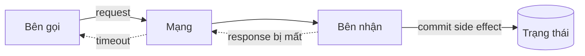
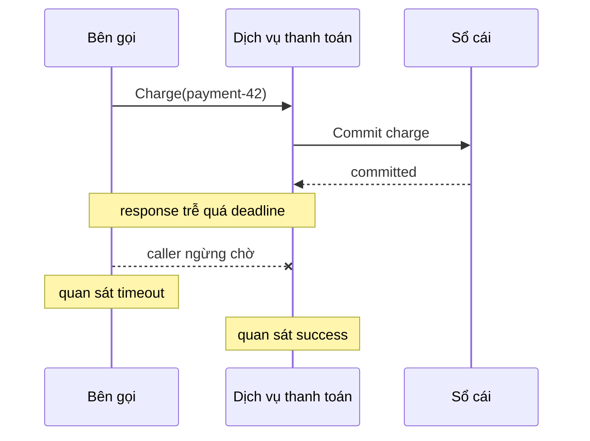
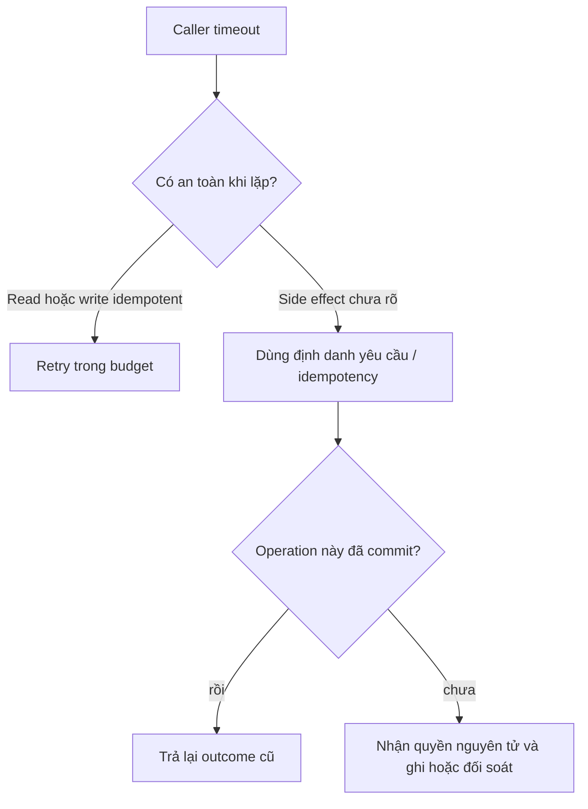
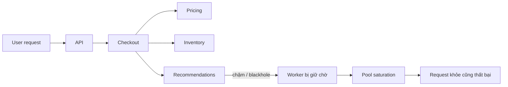

# Partial Failure: Suy luận khi kết quả không chắc chắn

## Tóm tắt nhanh

**Tình huống minh họa (giả định):** Máy POS báo timeout khi thu tiền cà phê nhưng người mua đã nhận thông báo ghi nợ. Hai bên chỉ có quan sát cục bộ; timeout không chứng minh giao dịch chưa thực hiện và thông báo ghi nợ chưa đủ để khẳng định mọi bước đã hoàn tất. Trước khi gửi yêu cầu mới, ứng dụng phải đối soát với hệ thống có thẩm quyền.

**Lỗi một phần (partial failure)** là tình huống một thành phần hoàn tất thao tác nhưng thành phần khác không quan sát được kết quả. Lỗi truyền thông không chứng minh giao dịch chưa được ghi bền vững.

> 💡 **Quy tắc bỏ túi:** Trong hệ thống phân tán, timeout chỉ là một quan sát cục bộ, không phải phán quyết cuối cùng. Đừng đồng nhất “chưa nhận được phản hồi” với “thao tác chưa xảy ra” khi yêu cầu có thể làm thay đổi dữ liệu. Trước khi thử lại, cần đối soát hoặc có cơ chế chống lặp được phía nhận thực thi.

- **Lỗi cục bộ và kết quả qua mạng:** Ngoại lệ trong cùng tiến trình được lan truyền theo ngôn ngữ và môi trường chạy; nó **không tự động dừng luồng thực thi**. Qua mạng, bên gọi có thể mất phản hồi sau khi bên nhận đã ghi dữ liệu. Phải phân biệt lỗi RPC với kết quả nghiệp vụ.
- **Quan sát độc lập:** Bên gọi và bên nhận có thể đưa ra **những kết luận cục bộ khác nhau** về cùng một RPC: bên gọi thấy `DEADLINE_EXCEEDED` trong khi bên nhận đã ghi thành công vào cơ sở dữ liệu.
- **Thử lại cần hợp đồng chống lặp:** Với thao tác ghi chưa rõ kết quả, cần định danh nghiệp vụ ổn định, cơ chế chống lặp được máy chủ thực thi, đối soát hoặc ràng buộc duy nhất/cập nhật có điều kiện. **Chỉ gửi header chứa khóa chống lặp không bảo đảm an toàn** nếu bên nhận không thực thi đúng.
- **Giới hạn phạm vi ảnh hưởng:** Chờ một hệ thống phụ thuộc chậm quá lâu có thể làm cạn luồng xử lý, kết nối và bộ nhớ. Hãy đặt **hạn chót (deadline)**, truyền tín hiệu **hủy (cancellation)** và cân nhắc thất bại sớm, phương án dự phòng có giới hạn hoặc suy giảm chức năng.
- **Sai lầm rủi ro cao:** **Coi timeout là bằng chứng thao tác chưa diễn ra.** Thử lại ngay một yêu cầu ghi mà không có cơ chế chống lặp có thể tạo khoản thu hoặc đơn đặt hàng trùng, tùy hành vi của hệ thống nhận.

Khó khăn cốt lõi không chỉ là sự cố kỹ thuật. Đó là **sự không chắc chắn về những gì đã thực sự diễn ra ở đầu bên kia**.

<TermBox term="Partial Failure">
**Lỗi một phần** xảy ra khi một số thành phần hoặc đường truyền không hoạt động, trong khi những phần khác của thao tác phân tán vẫn tiếp tục hoặc đã hoàn tất.
</TermBox>

## Timeout là một quan sát, không phải phán quyết

Giả sử bên gọi chờ hai giây mà không nhận phản hồi. Một trong nhiều khả năng sau có thể đã xảy ra:

- yêu cầu chưa tới máy chủ;
- máy chủ đã nhận nhưng chưa xử lý xong;
- máy chủ đã ghi thay đổi thành công nhưng phản hồi bị mất;
- phản hồi tới sau hạn chót của bên gọi;
- máy chủ dừng đột ngột trước hoặc sau khi thay đổi dữ liệu bền vững.

Vì vậy, **hết thời gian chờ không chứng minh thao tác đã thất bại**; kết quả vẫn chưa được xác định.

Với thao tác thay đổi state, coi `DEADLINE_EXCEEDED` là “không có gì xảy ra” là một giả định nguy hiểm.

## Bên gọi và bên nhận có thể kết luận khác nhau

gRPC nêu rõ một thuộc tính quan trọng: client và server đưa ra kết luận cục bộ độc lập về cùng một RPC. Máy chủ có thể hoàn tất thành công dù bên gọi báo quá hạn vì phản hồi đến quá muộn.

Hai phía không mâu thuẫn về tính trung thực; họ chỉ có bằng chứng khác nhau.

<TermBox term="Kết quả mơ hồ">
**Kết quả chưa xác định** nghĩa là bên gọi không thể dựa vào quan sát cục bộ để biết thao tác phía bên kia đã gây tác động hay chưa.
</TermBox>

## Sự cố không chỉ là “máy chủ ngừng hoạt động”

Thiết kế nên tính ít nhất các nhóm sau:

- **tiến trình dừng đột ngột:** một tiến trình ngừng hoạt động trong khi các thành phần khác vẫn khỏe;
- **hệ thống phụ thuộc chậm:** dịch vụ vẫn chạy nhưng không đáp ứng giới hạn độ trễ;
- **phân vùng mạng:** một số nút hoặc đường truyền không giao tiếp được, phần khác vẫn hoạt động;
- **yêu cầu bị mất:** bên gọi đã gửi nhưng bên nhận không nhận được;
- **phản hồi bị mất:** bên nhận hoàn tất nhưng bên gọi không biết;
- **suy giảm một chiều:** lưu lượng lỗi chỉ theo một hướng hoặc ở một nhóm nút.

Một kết quả kiểm tra sức khỏe báo “đang chạy” không phân biệt hết những trạng thái này.

## Thử lại có thể khắc phục sự cố hoặc tạo tác động trùng

Mỗi lần thử lại là một lượt thực thi mới, không phải cách quay ngược thời gian.

Nếu `Charge(payment-42)` đã commit trước khi response bị mất, thử lại bằng một lệnh `Charge()` mới có thể tạo giao dịch trùng và tác dụng phụ lặp.

Với thao tác cần thử lại sau khi chưa rõ kết quả, hãy dùng **định danh yêu cầu** hoặc khóa chống lặp ổn định. Máy chủ phải gắn khóa với đúng ý định nghiệp vụ và dữ liệu đầu vào, bảo đảm các lượt thực thi đồng thời không cùng tạo tác động trùng, đồng thời công bố phạm vi và thời gian lưu khóa. Chỉ kiểm tra bản ghi chống lặp rồi ghi dữ liệu ở hai bước không được phối hợp nguyên tử vẫn có thể gây tranh chấp.

<TermBox term="Định danh yêu cầu">
**Định danh yêu cầu** là mã ổn định được giữ qua các lần thử lại để bên nhận nhận ra nhiều lượt truyền đều thuộc một thao tác nghiệp vụ.
</TermBox>

Cơ chế chống lặp không làm mạng đáng tin cậy hơn; nó chỉ làm việc thử lại an toàn hơn trong **phạm vi và thời hạn lưu khóa mà phía nhận cam kết**. Nếu một khóa được tái sử dụng với dữ liệu khác, phía nhận phải xử lý theo hợp đồng rõ ràng, thay vì âm thầm coi đó là yêu cầu cũ.

**Cancellation không phải rollback.** [gRPC Core Concepts](https://grpc.io/docs/what-is-grpc/core-concepts/) nêu rõ thay đổi đã xảy ra trước khi cancel không được hoàn tác. [Hướng dẫn gRPC Cancellation](https://grpc.io/docs/guides/cancellation/) yêu cầu handler hợp tác kiểm tra tín hiệu hủy: thư viện không thể ngắt mọi đoạn code ứng dụng. Vì thế một lệnh ghi timeout vẫn cần đối soát với bên nhận.

## Hạn chót giới hạn chờ; tín hiệu hủy giới hạn công việc lãng phí

Mỗi hệ thống phụ thuộc từ xa đều tiêu tốn thời gian và tài nguyên. Bên gọi nên truyền một **hạn chót (deadline)** xuyên suốt các bước, thay vì cấp lại toàn bộ thời gian chờ ở mỗi chặng. Một số thư viện gRPC tự truyền deadline, còn số khác cần cấu hình; phải kiểm tra môi trường chạy thực tế.

Khi bên gọi không còn cần kết quả, hãy truyền **tín hiệu hủy (cancellation)** để các hệ thống phía sau có thể dừng phần việc không cần thiết. Nhưng cancellation không phải rollback: thay đổi đã commit trước lúc hủy có thể vẫn còn nguyên.

Điều này quan trọng khi request phía trên hết deadline, user bỏ thao tác, hoặc fan-out bỏ các nhánh quá chậm.

## Lỗi một phần có thể lan rộng qua chuỗi hệ thống phụ thuộc

Một lỗi nhỏ có thể lan thành sự cố toàn hệ thống nếu các lời gọi đồng bộ cứ chờ lẫn nhau.

Với mỗi dependency, hãy hỏi:

- Nó bắt buộc cho correctness hay chỉ hữu ích?
- Nên **fail-fast**, **suy giảm chức năng**, dùng **fallback** có giới hạn hay **cô lập**?
- Nó nhận deadline và retry budget bao nhiêu?
- Một dependency chậm có thể làm cạn thread, connection hoặc queue capacity của caller không?

Một dịch vụ phụ trợ cũng có thể trở thành điểm nghẽn nghiêm trọng nếu bên gọi chờ nó vô hạn.

## Thu thập bằng chứng để xác định kết quả chưa rõ

Chỉ mã trạng thái HTTP không đủ để tái dựng lỗi một phần. Hãy truyền **mã tương quan (correlation ID)** hoặc định danh yêu cầu qua các ranh giới và lưu trong log hay dấu vết truy vết.

Các signal hữu ích gồm dependency latency, timeout rate, số retry attempt, duplicate-suppression hit, cancellation count, saturation và success/error rate theo dependency.

Với thao tác ghi chưa rõ kết quả, cần gắn mã thao tác nghiệp vụ ổn định với dữ liệu có thẩm quyền tại ranh giới ghi an toàn, để người vận hành trả lời: **thao tác này đã commit chưa?** Chỉ có mã tương quan trong log không chứng minh khoản thanh toán bên ngoài đã thành công.

## Tình huống minh họa (giả định)

Dịch vụ thanh toán gọi nhà cung cấp qua `POST /charges`. Nhà cung cấp đã ghi khoản thu nhưng gói phản hồi bị mất. Dịch vụ hết thời gian chờ rồi tự thử lại bằng một mã yêu cầu mới.

**Hậu quả:** khách hàng bị thu tiền hai lần dù chỉ thanh toán một lần. Người vận hành thấy một lượt quá hạn và một lượt thành công nên ban đầu khó phân biệt đây là hai lần thực thi hay một thao tác có phản hồi bị mất.

**Nguyên nhân cốt lõi:** bên gọi coi hết thời gian chờ là bằng chứng thao tác chưa xảy ra rồi thử lại một yêu cầu có tác động phụ mà không giữ định danh nghiệp vụ ổn định. Bên gọi và bên nhận có bằng chứng khác nhau về lượt thực thi đầu tiên.

**Cách khắc phục chuẩn:** tạo mã thao tác thanh toán ổn định trước lần gửi đầu; tái sử dụng khóa chống lặp cho những lần thử lại khi nhà cung cấp thực thi và công bố phạm vi/thời hạn lưu khóa; không dùng cùng khóa cho nội dung yêu cầu khác; đặt hạn chót và giới hạn thử lại; truyền tín hiệu hủy khi có ích; đối soát dữ liệu thanh toán có thẩm quyền và dùng mã tương quan riêng để nối các lượt truyền của cùng thao tác nghiệp vụ.

Tự kiểm tra: cuộc gọi thanh toán hết thời gian chờ có chứng minh chưa thu tiền không?

Không. Yêu cầu có thể đã ghi thay đổi thành công và chỉ phản hồi bị mất. Hãy coi kết quả chưa rõ cho tới khi có thể đối soát dữ liệu có thẩm quyền hoặc thử lại an toàn với định danh ổn định và cơ chế chống lặp thực sự được phía nhận bảo đảm.

## Danh sách kiểm tra vận hành

- [ ] Remote timeout được mô hình hóa như một outcome có thể mơ hồ.
- [ ] Thử lại thao tác ghi sử dụng cùng định danh hoặc khóa chống lặp trong phạm vi, thời hạn lưu và quy tắc đối chiếu nội dung đã công bố.
- [ ] Retry budget có giới hạn và được đặt có chủ đích trong dependency chain.
- [ ] Deadline end-to-end được truyền xuống thay vì reset ở mỗi hop.
- [ ] Cancellation dừng downstream work không còn cần thiết khi protocol hỗ trợ.
- [ ] Code không giả định cancellation rollback thay đổi đã commit.
- [ ] Dependency critical và noncritical đều có hành vi fail-fast/degrade/fallback/isolation rõ.
- [ ] Blast radius tính cả saturation của connection, worker, thread và queue.
- [ ] Correlation ID nối caller, callee, retry và bằng chứng business state.
- [ ] Metric theo dependency thể hiện latency, timeout, retry, cancellation và error.
- [ ] Thao tác ghi chưa rõ kết quả có cách đối soát với nguồn có thẩm quyền.
- [ ] Failure test gồm case chậm, blackhole, partition và lost response, không chỉ clean HTTP 500.

## Quy tắc cho agent

Khi lời gọi từ xa thất bại, đừng đánh đồng “không nhận được phản hồi thành công” với “thao tác chưa xảy ra”. Hãy liệt kê các trạng thái có thể có ở bên nhận, giữ định danh nghiệp vụ qua các lần thử lại, giới hạn thời gian chờ và số lần thử, đồng thời thiết kế cách thu thập bằng chứng để đối soát kết quả chưa rõ.

## Nguồn

- gRPC — [Core concepts: RPC termination, deadlines, and cancellation](https://grpc.io/docs/what-is-grpc/core-concepts/)
- gRPC — [Deadlines](https://grpc.io/docs/guides/deadlines/)
- Amazon Builders' Library — [Timeouts, retries, and backoff with jitter](https://aws.amazon.com/builders-library/timeouts-retries-and-backoff-with-jitter/)
- Amazon Builders' Library — [Making retries safe with idempotent APIs](https://aws.amazon.com/builders-library/making-retries-safe-with-idempotent-APIs/)
- Stripe — [Idempotent requests](https://docs.stripe.com/api/idempotent_requests)
- Google SRE — [Addressing Cascading Failures](https://sre.google/sre-book/addressing-cascading-failures/)
