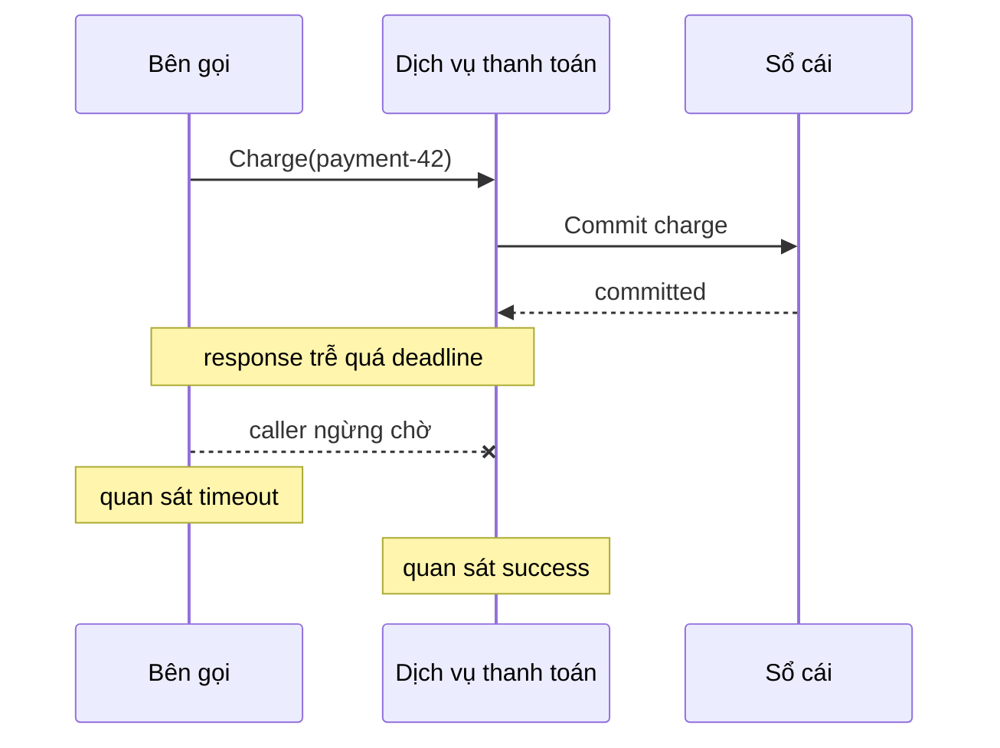
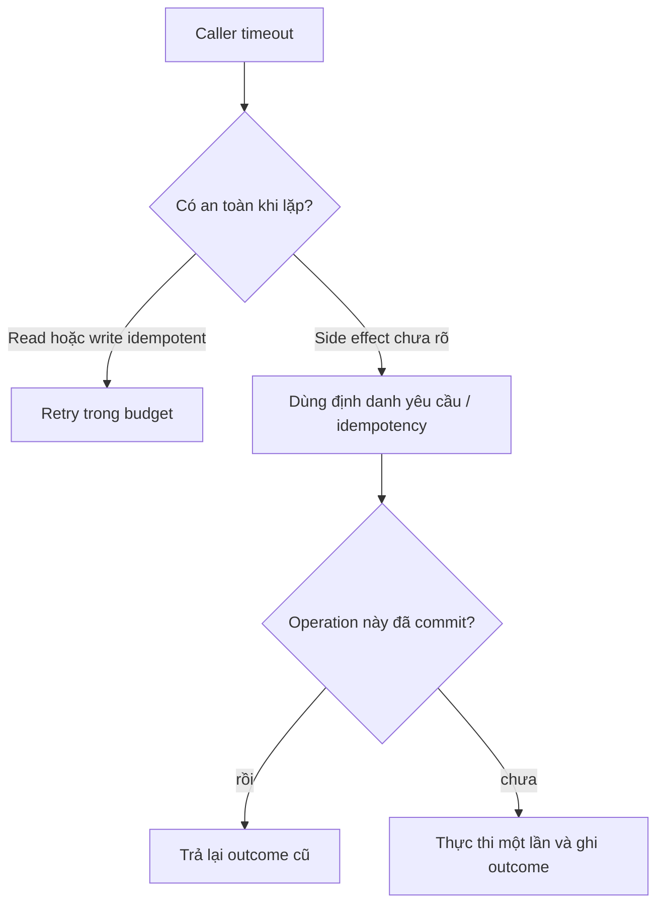
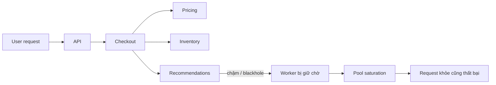

# Partial Failure: Suy luận khi kết quả không chắc chắn

## Tóm tắt nhanh

**Tình huống minh họa (giả định):** Máy POS báo timeout khi thu tiền cà phê nhưng người mua đã nhận thông báo ghi nợ. Hai bên chỉ có quan sát cục bộ; timeout không chứng minh giao dịch chưa thực hiện và thông báo ghi nợ chưa đủ để khẳng định mọi bước đã hoàn tất. Trước khi gửi yêu cầu mới, ứng dụng phải đối soát với hệ thống có thẩm quyền.

**Lỗi một phần (partial failure)** xảy ra khi một thành phần có thể hoàn tất thao tác nhưng thành phần khác không quan sát được kết quả. Mất liên lạc không chứng minh dữ liệu đã hoặc chưa được ghi thành công.

> 💡 **Quy tắc bỏ túi:** Trong hệ thống phân tán, timeout chỉ là một quan sát cục bộ, không phải phán quyết cuối cùng. Tuyệt đối không bao giờ đồng nhất "chưa nhận được phản hồi" với "thao tác chưa xảy ra" đối với các tác vụ ghi dữ liệu.

- **Lỗi cục bộ và kết quả qua mạng:** Ngoại lệ trong cùng tiến trình có thể truyền đến handler theo runtime; nó **không tự động làm dừng thread**. Qua mạng, caller có thể mất phản hồi sau khi callee đã commit. Phải phân biệt RPC failure với trạng thái nghiệp vụ.
- **Quan sát độc lập giữa bên gọi và bên nhận:** Client và server có thể đưa ra **kết luận cục bộ khác nhau** về cùng một RPC. Lỗi `DEADLINE_EXCEEDED` **có thể** xuất hiện dù bên nhận đã commit, nhưng riêng lỗi này không chứng minh việc commit đã xảy ra.
- **Retry cần hợp đồng chống lặp:** Với write chưa rõ kết quả, dùng định danh thao tác nghiệp vụ ổn định, idempotency được server thực thi, đối soát hoặc unique constraint/conditional update phù hợp. **Header idempotency key không tự đảm bảo an toàn** nếu bên nhận không tôn trọng nó.
- **Giới hạn phạm vi ảnh hưởng:** Chờ quá lâu các dịch vụ phụ thuộc có thể làm cạn tiến trình xử lý, kết nối hoặc bộ nhớ khi tải cao. Hãy đặt **deadline**, truyền tín hiệu **hủy (cancellation)** khi có hỗ trợ và dùng chính sách từ chối sớm, dự phòng hoặc giảm chức năng phù hợp với tính quan trọng của từng dịch vụ.
- **Sai lầm rủi ro cao:** **Coi timeout là bằng chứng thao tác chưa thực hiện.** Thử lại thao tác ghi không có cơ chế chống lặp sau khi mất phản hồi **có thể** tạo giao dịch thanh toán, đơn hàng hoặc thay đổi tồn kho trùng. Kết quả phụ thuộc lần đầu đã commit chưa và cách hệ thống phía sau xử lý yêu cầu trùng.

Khó khăn cốt lõi không chỉ là sự cố kỹ thuật. Đó là **sự không chắc chắn về những gì đã thực sự diễn ra ở đầu bên kia**.

<TermBox term="Partial Failure">
**Lỗi một phần** xảy ra khi một số thành phần hoặc đường truyền gặp sự cố trong khi các phần khác của thao tác phân tán vẫn đang chạy hoặc đã hoàn tất.
</TermBox>

## Timeout là một quan sát, không phải phán quyết

Giả sử bên gọi chờ hai giây nhưng không nhận response. Nhiều thực tế đều có thể đúng:

- request chưa bao giờ tới server;
- server đã nhận nhưng chưa xử lý xong;
- server đã xử lý và commit nhưng response bị mất;
- response chỉ tới trễ sau deadline của caller;
- server crash trước hoặc sau khi đổi durable state.

Vì vậy **timeout không chứng minh operation thất bại**; kết quả vẫn có thể không rõ.

Với thao tác thay đổi state, coi `DEADLINE_EXCEEDED` là “không có gì xảy ra” là một giả định nguy hiểm.

## Bên gọi và bên nhận có thể kết luận khác nhau

gRPC nêu rõ một thuộc tính quan trọng: client và server đưa ra kết luận cục bộ độc lập về cùng một RPC. Server có thể hoàn tất thành công trong khi client báo deadline exceeded vì response tới quá trễ.

Hai phía không mâu thuẫn về tính trung thực; họ chỉ có bằng chứng khác nhau.

<TermBox term="Kết quả mơ hồ">
**Kết quả mơ hồ** là khi bên gọi không thể từ quan sát cục bộ xác định side effect phía xa đã xảy ra hay chưa.
</TermBox>

## Sự cố không chỉ có nghĩa máy chủ ngừng hoạt động

Thiết kế nên tính ít nhất các nhóm sau:

- **process crash:** một process biến mất trong khi peer vẫn khỏe;
- **dependency chậm:** service còn sống nhưng vượt latency budget;
- **phân vùng mạng:** một số node hoặc path không giao tiếp được, phần khác vẫn hoạt động;
- **request bị mất:** caller gửi nhưng callee không nhận;
- **mất phản hồi:** callee hoàn tất nhưng caller không biết;
- **degradation một chiều:** traffic chỉ lỗi theo một hướng hoặc một nhóm node.

Một kết quả kiểm tra sức khỏe báo “đang hoạt động” không thể phân biệt hết các tình huống này.

## Thử lại có thể khắc phục sự cố hoặc tạo tác động trùng

Mỗi lần thử lại là một lượt thực hiện mới, không thể hoàn tác lượt trước. Hết thời gian chờ không cho biết lần ghi đầu đã commit, vẫn đang xử lý hay chưa tới máy chủ.

Nếu `Charge(payment-42)` đã commit trước khi mất phản hồi, thử lại bằng một lệnh `Charge()` **mới không được bảo vệ** có thể tạo giao dịch trùng nếu API thanh toán coi đó là thao tác độc lập.

Với operation có thể retry sau failure mơ hồ, hãy dùng **định danh yêu cầu** ổn định hoặc idempotency key. Server phải nhận ra nhiều transport attempt thuộc cùng một logical operation, thay vì coi mỗi retry là command mới.

<TermBox term="Định danh yêu cầu">
**Định danh yêu cầu** là identifier ổn định được giữ qua các retry để receiver nhận ra nhiều attempt chỉ đại diện cho một logical operation.
</TermBox>

Idempotency không làm network đáng tin cậy hơn; nó làm việc thử lại an toàn hơn.

**Cancellation không phải rollback.** [gRPC Core Concepts](https://grpc.io/docs/what-is-grpc/core-concepts/) nêu rõ thay đổi đã xảy ra trước khi cancel không được hoàn tác. [Hướng dẫn gRPC Cancellation](https://grpc.io/docs/guides/cancellation/) yêu cầu handler hợp tác kiểm tra tín hiệu hủy: thư viện không thể ngắt mọi đoạn code ứng dụng. Vì thế một lệnh ghi timeout vẫn cần đối soát với bên nhận.

## Deadline giới hạn thời gian chờ; hủy giúp giảm công việc dư thừa

Mỗi remote dependency tiêu tốn thời gian và tài nguyên. Bên gọi nên truyền một **hạn chót (deadline)** end-to-end hợp lý thay vì để mỗi hop bắt đầu lại một timeout đầy đủ.

Khi caller không còn cần kết quả, hãy truyền **cancellation** để downstream dừng công việc nếu có thể. Nhưng cancellation không phải rollback: thay đổi đã commit trước lúc hủy có thể vẫn còn nguyên.

Điều này quan trọng khi request phía trên hết deadline, user bỏ thao tác, hoặc fan-out bỏ các nhánh quá chậm.

## Sự cố một phần có thể lan rộng qua chuỗi dịch vụ phụ thuộc

Một lỗi cục bộ có thể lan rộng nếu các dịch vụ phụ thuộc chờ nhau quá lâu.

Với mỗi dependency, hãy hỏi:

- Nó bắt buộc cho correctness hay chỉ hữu ích?
- Nên **fail-fast**, **suy giảm chức năng**, dùng **fallback** có giới hạn hay **cô lập**?
- Nó nhận deadline và retry budget bao nhiêu?
- Một dependency chậm có thể làm cạn thread, connection hoặc queue capacity của caller không?

Backend “không quan trọng” vẫn có thể trở thành critical nếu caller chờ nó vô hạn.

## Thu thập bằng chứng khi kết quả chưa rõ

HTTP status một mình không đủ tái dựng partial failure. Hãy truyền **mã tương quan (correlation ID)** hoặc request ID qua boundary và giữ nó trong log/trace.

Các signal hữu ích gồm dependency latency, timeout rate, số retry attempt, duplicate-suppression hit, cancellation count, saturation và success/error rate theo dependency.

Với thao tác ghi chưa rõ kết quả, hãy lưu mã thao tác nghiệp vụ bên cạnh trạng thái có thẩm quyền để người vận hành trả lời: **thao tác này đã commit chưa?**

## Tình huống minh họa (giả định)

Checkout gọi payment provider bằng `POST /charges`. Provider đã commit charge nhưng response packet bị mất. Checkout timeout rồi tự retry bằng một request ID mới.

**Hậu quả:** nếu phía thanh toán không chống lặp hoặc không có bước đối soát, khách hàng **có thể** bị trừ tiền hai lần dù chỉ đặt hàng một lần. Một timeout và một phản hồi thành công sau đó có thể là hai quan sát phù hợp của các lần gửi khác nhau. Đây là ví dụ tự xây dựng, không phải sự cố thanh toán đã được ghi nhận.

**Nguyên nhân cốt lõi:** caller coi timeout là bằng chứng operation thất bại rồi retry side effect không idempotent mà không có logical request identity ổn định. Bên gọi và bên nhận có hai quan sát cục bộ khác nhau về attempt đầu tiên.

**Cách khắc phục chuẩn:** tạo mã thao tác thanh toán ổn định trước lần gửi đầu. Chỉ dùng lại cùng khóa khi nhà cung cấp **thực thi hợp đồng chống lặp đã công bố**, hoặc đối soát trạng thái thanh toán có thẩm quyền trước khi gửi lệnh mới. Đặt deadline và giới hạn số lần thử, truyền tín hiệu hủy khi hữu ích, lưu bằng chứng cho kết quả chưa rõ và gắn mã tương quan để phân biệt một thao tác nghiệp vụ với nhiều lần gửi qua mạng.

Tự kiểm tra: payment call timeout thì có thể kết luận chắc chắn chưa charge không?

Không. Request có thể đã commit và chỉ response bị mất. Hãy coi outcome là chưa rõ cho tới khi query/reconcile authoritative state hoặc retry an toàn bằng request identity ổn định và idempotent semantics.

## Danh sách kiểm tra khi vận hành

- [ ] Remote timeout được mô hình hóa như một outcome có thể mơ hồ.
- [ ] Retry cho state-changing operation dùng lại request identity hoặc idempotency key ổn định.
- [ ] Retry budget có giới hạn và được đặt có chủ đích trong dependency chain.
- [ ] Deadline end-to-end được truyền xuống thay vì reset ở mỗi hop.
- [ ] Cancellation dừng downstream work không còn cần thiết khi protocol hỗ trợ.
- [ ] Code không giả định cancellation rollback thay đổi đã commit.
- [ ] Dependency critical và noncritical đều có hành vi fail-fast/degrade/fallback/isolation rõ.
- [ ] Blast radius tính cả saturation của connection, worker, thread và queue.
- [ ] Correlation ID nối caller, callee, retry và bằng chứng business state.
- [ ] Metric theo dependency thể hiện latency, timeout, retry, cancellation và error.
- [ ] Write có outcome mơ hồ có đường reconciliation.
- [ ] Failure test gồm case chậm, blackhole, partition và lost response, không chỉ clean HTTP 500.

## Quy tắc dành cho agent

Khi remote call thất bại, đừng biến “tôi không nhận được success response” thành “operation không xảy ra”. Hãy liệt kê các remote state có thể có, giữ logical request identity qua retry, giới hạn waiting/retry amplification và thiết kế đường bằng chứng để reconcile outcome mơ hồ.

## Nguồn

Các tài liệu chính thức được rà soát ngày **2026-11-18**:

- gRPC — [Core concepts: RPC termination, deadlines, and cancellation](https://grpc.io/docs/what-is-grpc/core-concepts/)
- gRPC — [Deadlines](https://grpc.io/docs/guides/deadlines/)
- gRPC — [Mã trạng thái DEADLINE_EXCEEDED](https://grpc.io/docs/guides/status-codes/) — thao tác thay đổi trạng thái có thể đã hoàn tất trước khi bên gọi gặp lỗi deadline
- Amazon Builders' Library — [Timeouts, retries, and backoff with jitter](https://aws.amazon.com/builders-library/timeouts-retries-and-backoff-with-jitter/)
- Amazon Builders' Library — [Making retries safe with idempotent APIs](https://aws.amazon.com/builders-library/making-retries-safe-with-idempotent-APIs/)
- Stripe — [Idempotent requests](https://docs.stripe.com/api/idempotent_requests)
- Google SRE — [Addressing Cascading Failures](https://sre.google/sre-book/addressing-cascading-failures/)
