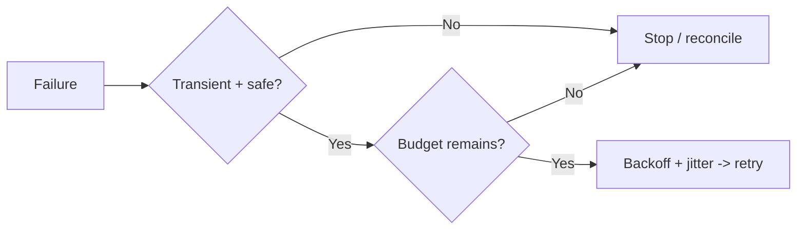
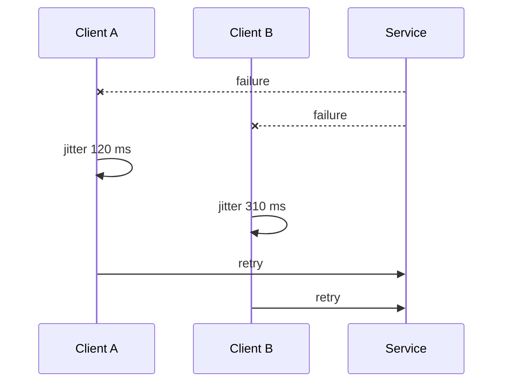

# Retries and Backoff: Recover Without Amplifying Failure

## TL;DR

**Illustrative scenario (hypothetical):** A struggling service returns temporary errors. When thousands of clients immediately retry or all wait the same fixed delay, their recovery traffic may create another burst before the service recovers. This is a **retry storm**; its severity depends on client count, retry limits, resource capacity and load-shedding policy.

A retry is useful only when failure may be transient, replay is safe, there is useful deadline remaining and the dependency can tolerate more work. HTTP status alone is not enough.

> 💡 **Rule of thumb:** Retry only when a failure is plausibly transient, replay is safe and the remaining deadline and retry budget justify more work. Bounded exponential backoff with jitter is often a good fleet-wide default, not an unconditional protocol rule. Coordinate one retry owner, including SDK attempts.

- **Classify before retrying:** `429` can reflect a quota that will not reset within this request's useful lifetime; `503` can persist. Neither status automatically means retrying will help. Do not repeat deterministic authentication, validation or business failures unchanged.
- **Idempotency is non-negotiable for state mutations:** A network retry is a brand new attempt, not an undo action. Retrying an ambiguous write without an **idempotency key** or reconciliation path will create duplicate charges, double-booked seats, and ghost inventory entries.
- **Backoff and jitter by policy:** Capped exponential backoff with jitter is a common strategy for spreading retries, not an immutable requirement for every protocol. Enforce attempt/time caps, and apply valid server delay hints only if they still fit the request's useful deadline.
- **Single retry owner:** Establish clear **retry ownership** at a single architectural boundary. If the client, API gateway, and intermediate microservice each independently configure 3 retries, a single failed query multiplies into `3 × 3 × 3 = 27` destructive attempts on the deepest database layer.
- **High-risk pattern:** Independent retries at several layers can multiply downstream attempts. If three layers each permit three total tries, a single request can cause up to `3 × 3 × 3 = 27` attempts at the last dependency when every branch gets that far.



<TermBox term="Retryability">
A failure is **retryable** when a later attempt can change the outcome. Temporary transport, throttling, or availability failures can qualify; invalid input, bad credentials, and stable business rejection are usually deterministic.
</TermBox>

## Classify before retrying

| Signal | Default decision |
| --- | --- |
| transient transport error | retry if safety and budget hold |
| `429` / `503` | check quota, overload, request safety and deadline; use valid `Retry-After` only when another attempt remains useful |
| auth / validation / business rejection | do not retry unchanged input |
| ambiguous write timeout | require idempotency or reconciliation |

<TermBox term="Retry Budget">
A **retry budget** bounds extra work by attempt count, elapsed time, remaining deadline, or shared quota.
</TermBox>

## Make writes safe first

If attempt one may have committed, a new logical request can duplicate a payment or reservation. Reuse the same idempotency identity or reconcile state first. Retry does not create idempotency.

## Back off, jitter, stay inside the deadline

```text
100 ms -> 200 ms -> 400 ms -> capped delay
```

**Exponential backoff** spaces attempts farther apart; **jitter** helps prevent a synchronized fleet. Bound the number of attempts, delay and total elapsed time. If a valid `Retry-After` delay exceeds the remaining deadline, **do not retry within the current request**; let the caller report a result or schedule a separate operation only if its semantics allow it.




### `Retry-After` is a hint, not a new deadline

Under [RFC 9110](https://www.rfc-editor.org/rfc/rfc9110.html#section-10.2.3), `Retry-After` can be a non-negative delay in seconds or an HTTP date. It suggests when to send a follow-up request; it **does not make an unsafe operation safe to repeat**, and is not mandatory on every `429` or `503`. A valid hint that exceeds the remaining deadline means the current request should stop retrying.

For example, when the caller has **250 ms** left and receives `Retry-After: 2`, waiting two seconds cannot fit inside that request's deadline. A later background operation needs its own explicit semantics and, for payment-like writes, a stable idempotency contract.

## Choose one retry owner

If Client, Service A, and Service B each allow three total attempts, one original request can drive `3 × 3 × 3 = 27` attempts at the deepest dependency. Pick the layer with context to judge value, safety, and remaining deadline. Existing SDK retries count too.

<TermBox term="Retry Storm">
A **retry storm** is overload amplified by retries: recovery traffic becomes part of the incident.
</TermBox>

## Protect the fleet

During broad failure, a shared **retry budget** or **token bucket** can suppress retries. AWS SDK standard mode uses a token-backed retry quota. Observe original requests separately from attempts, retry reason, exhausted budget, and saturation.

## Illustrative scenario (hypothetical)

A gateway calls Checkout → Inventory → database. During a latency spike every layer retries twice, uses deterministic backoff, and reservation writes lack stable idempotency identity.

**Impact:** one user request can drive up to 27 database attempts; synchronized retries create bursts, saturation worsens, and ambiguous writes can duplicate reservations.

**Root cause:** retry ownership was spread across layers, failures were not classified, writes were unsafe to repeat, and timing synchronized the fleet.

**Correct pattern:** choose one retry owner, retry only transient failures, preserve one logical request identity, bound attempts inside the remaining deadline, use exponential backoff with jitter, honor valid `Retry-After`, and stop when the shared retry budget is depleted. Measure original requests separately from attempts.

## Self-check

Your SDK and service wrapper already retry. A dependency starts returning `503`. Should the gateway add another retry loop?

<details>
<summary>Show the reasoning</summary>

No. Recover existing retry layers, choose one owner, and coordinate the total attempt/deadline budget before changing policy.

</details>

## Retry operating checklist

- [ ] Retry transient failures, not deterministic ones.
- [ ] Make ambiguous writes idempotent or reconcile first.
- [ ] Fit retries inside the remaining deadline.
- [ ] Assign one owner and include SDK retries.
- [ ] Cap backoff, add jitter, respect `Retry-After`.
- [ ] Bound fleet retries and observe request vs attempt volume.

## Agent rule

Before adding retries, recover failure class, operation safety, deadline, existing retries, ownership, bounds, backoff/jitter, server hints, fleet budget, and telemetry. Reject uncoordinated retry loops.


This lesson is the **operating guide for retry eligibility, backoff, jitter, ownership and fleet load**. For time-budget mechanics see [Timeouts](/docs/distributed-systems/timeouts); for the partial-failure synthesis see [Timeouts, Retries & Backoff](/docs/distributed-systems/timeouts-retries-and-backoff).

## Sources

Primary references verified on **2026-11-05**: [RFC 9110](https://www.rfc-editor.org/rfc/rfc9110.html), [AWS retry guidance](https://docs.aws.amazon.com/wellarchitected/latest/reliability-pillar/rel_mitigate_interaction_failure_limit_retries.html), and [AWS SDK retry behavior](https://docs.aws.amazon.com/sdkref/latest/guide/feature-retry-behavior.html).
