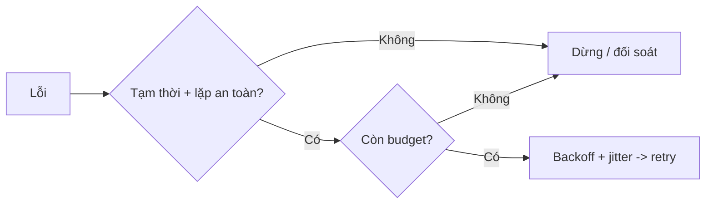
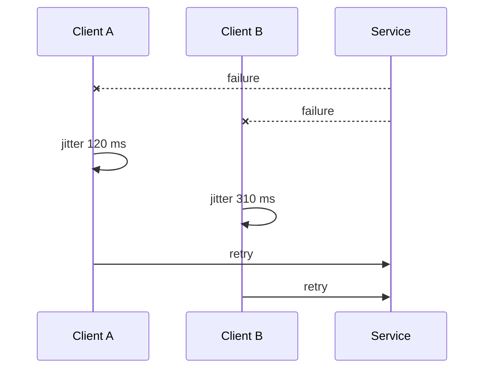

# Retries và Backoff: Phục hồi mà không làm sự cố lan rộng

## Tóm tắt

**Ví dụ minh họa (giả định):** Một dịch vụ đang quá tải trả lỗi tạm thời. Nếu hàng nghìn client thử lại ngay hoặc cùng chờ đúng một khoảng cố định, lượng request thử lại có thể tạo đợt tải mới trước khi downstream kịp phục hồi. Đây là **retry storm**; mức độ thực tế phụ thuộc vào số client, số lần thử, tài nguyên và chính sách điều áp.

Retry chỉ có ích khi lỗi có khả năng hết, thao tác được phép lặp lại và vẫn còn đủ deadline. Hãy phân biệt *trạng thái HTTP*, *tính an toàn khi lặp*, *ngân sách retry* và *khả năng chịu tải của downstream*.

> 💡 **Quy tắc bỏ túi:** Chỉ retry khi lỗi có khả năng tạm thời, thao tác có hợp đồng lặp an toàn và còn đủ deadline cùng retry budget. Backoff có giới hạn kèm jitter thường giúp phân tán tải; cần một điểm chịu trách nhiệm điều phối toàn bộ lần thử, bao gồm cả retry mặc định của SDK.

- **Đánh giá khả năng phục hồi trước khi retry:** `429` có thể biểu thị quota chưa được cấp lại, còn `503` có thể kéo dài; không tự kết luận cả hai đều hết lỗi nếu thử lại. Với lỗi xác thực, validation hoặc business rejection, không lặp cùng request nếu không có thay đổi có ý nghĩa.
- **Tính idempotent là bắt buộc đối với thao tác ghi:** Một lần retry qua mạng là một nỗ lực mới, không phải cỗ máy quay ngược thời gian. Với các thao tác ghi dữ liệu, bắt buộc phải có **định danh yêu cầu (idempotency key)** hoặc cơ chế **đối soát (reconciliation)** để ngăn chặn việc trừ tiền lặp hoặc đặt trùng chỗ khi request đầu tiên đã commit thành công.
- **Backoff và jitter theo tải:** Capped exponential backoff có jitter là lựa chọn phổ biến để giảm các đợt thử lại đồng bộ, nhưng không phải cam kết áp dụng cho mọi giao thức. Đặt giới hạn thời gian, số lần thử và tôn trọng thời điểm server đề nghị nếu hợp lệ và còn trong deadline.
- **Chỉ định duy nhất một chủ sở hữu retry (retry owner):** Xác lập rõ quyền sở hữu retry tại một tầng duy nhất trong kiến trúc. Nếu Client, API Gateway và Service trung gian đều độc lập retry 3 lần, một request lỗi từ người dùng sẽ bị khuếch đại thành `3 × 3 × 3 = 27` lượt gọi dồn dập vào tầng database sâu nhất.
- **Rủi ro lớn:** Các lớp retry độc lập có thể nhân tải lên nhiều lần. Nếu mỗi trong ba tầng thực hiện tối đa ba attempt, một request có thể tạo tới `3 × 3 × 3 = 27` attempt ở dependency cuối khi mọi lần thử đều đi tới đó.



<TermBox term="Retryability">
Failure **retryable** khi attempt sau có thể đổi outcome. Transport tạm thời, throttling hoặc unavailable có thể phù hợp; input/credential sai thường deterministic.
</TermBox>

## Phân loại trước khi retry

| Tín hiệu | Quyết định mặc định |
| --- | --- |
| transient transport error | retry nếu an toàn và còn budget |
| `429` / `503` | cân nhắc khả năng phục hồi, quota và tải; chỉ retry nếu thao tác an toàn, còn ngân sách; xử lý `Retry-After` hợp lệ |
| auth / validation / business rejection | không retry input không đổi |
| timeout sau write có outcome mơ hồ | cần idempotency hoặc reconciliation |

<TermBox term="Retry Budget">
**Ngân sách retry** giới hạn công việc thêm bằng số attempt, thời gian đã dùng, deadline còn lại hoặc shared quota.
</TermBox>

## Làm write an toàn trước

Nếu attempt đầu có thể đã commit, request mới có thể tạo effect trùng. Dùng lại idempotency identity hoặc đối soát state trước. Retry không tự tạo idempotency.

## Backoff, jitter và giữ trong deadline

```text
100 ms -> 200 ms -> 400 ms -> capped delay
```

**Exponential backoff** giãn các lần thử; **jitter** giúp các client không thử lại cùng nhịp. Đặt giới hạn số attempt, delay và tổng thời gian. Nếu `Retry-After` yêu cầu chờ lâu hơn deadline còn lại, **không thử lại trong request hiện tại**; để caller quyết định báo lỗi hoặc lên lịch một công việc mới nếu nghiệp vụ cho phép.




### Phân biệt `Retry-After` và retry budget

Theo [RFC 9110](https://www.rfc-editor.org/rfc/rfc9110.html#section-10.2.3), `Retry-After` có thể là số giây không âm hoặc một ngày giờ HTTP. Header này là gợi ý thời điểm gửi request sau, **không tự cho phép retry một thao tác không an toàn**; trên `429` và `503` nó cũng không phải header bắt buộc. Nếu thời điểm được gợi ý đã vượt deadline hiện tại hoặc quota vẫn chưa sẵn sàng, cần dừng và trả quyền quyết định cho caller.

Ví dụ: request chỉ còn **250 ms** nhưng server đưa `Retry-After: 2` (hai giây). Không thể đợi hai giây rồi coi đó là một attempt thuộc request 250 ms. Với thao tác thanh toán, chỉ tổ chức retry ở một job mới nếu giao thức nghiệp vụ có idempotency và cho phép xử lý về sau.

## Chọn một retry owner

Nếu Client, Service A và Service B đều cho ba total attempt, một request gốc có thể tạo `3 × 3 × 3 = 27` attempt. Chọn một **retry owner** có đủ context; tính cả SDK retry.

<TermBox term="Retry Storm">
**Bão retry** là overload bị retry khuếch đại: recovery traffic trở thành một phần của sự cố.
</TermBox>

## Bảo vệ cả fleet

Khi failure lan rộng, **retry budget** hoặc **token bucket** có thể giảm retry. Quan sát request gốc tách khỏi số attempt, cùng lý do retry, cạn budget và saturation.

## Kịch bản minh họa (giả định)

Gateway gọi Checkout → Inventory → database. Khi latency tăng, mọi layer retry hai lần, dùng deterministic backoff và write thiếu stable idempotency identity.

**Hậu quả:** một user request có thể tạo tới 27 database attempt; retry đồng bộ tạo burst, saturation nặng hơn và ambiguous write có thể tạo reservation trùng.

**Nguyên nhân cốt lõi:** retry ownership bị rải ở nhiều layer, failure không được phân loại, write không an toàn khi lặp và timing làm cả fleet đồng bộ.

**Cách khắc phục chuẩn:** chọn một retry owner, chỉ retry transient failure, giữ logical request identity, bound attempt trong deadline còn lại, dùng exponential backoff có jitter, tôn trọng `Retry-After` và dừng khi retry budget cạn. Tách original request khỏi attempt.

## Tự kiểm tra

SDK và service wrapper của bạn đều đã retry. Dependency bắt đầu trả `503`. Có nên thêm retry loop ở gateway không?

<details>
<summary>Xem giải thích chi tiết</summary>

Không. Trước tiên hãy tìm toàn bộ retry hiện có, chọn một owner và phối hợp total attempt/deadline budget rồi mới đổi policy.

</details>

## Checklist vận hành retry

- [ ] Chỉ retry failure tạm thời, không retry lỗi deterministic.
- [ ] Làm ambiguous write idempotent hoặc đối soát trước.
- [ ] Giữ mọi retry trong deadline còn lại.
- [ ] Chọn một retry owner và tính cả SDK retry.
- [ ] Cap backoff, thêm jitter, tôn trọng `Retry-After`.
- [ ] Giới hạn retry toàn fleet và tách request gốc khỏi attempt trong observability.

## Agent rule

Trước khi thêm retry, hãy tìm failure class, safety, deadline, retry hiện có, ownership, bounds, backoff/jitter, server hint, fleet budget và telemetry.


Bài này dành cho **chính sách retry, backoff, jitter, retry ownership và tải**. Để đặt ranh giới thời gian đúng, xem [Timeouts](/vi/docs/distributed-systems/timeouts). Để hiểu vì sao response bị mất không chứng minh một write thất bại, xem [bài tổng hợp Partial Failure và Retry](/vi/docs/distributed-systems/timeouts-retries-and-backoff).

## Nguồn

Nguồn chính kiểm tra ngày **2026-11-05**: [RFC 9110](https://www.rfc-editor.org/rfc/rfc9110.html), [AWS retry guidance](https://docs.aws.amazon.com/wellarchitected/latest/reliability-pillar/rel_mitigate_interaction_failure_limit_retries.html), [AWS SDK retry behavior](https://docs.aws.amazon.com/sdkref/latest/guide/feature-retry-behavior.html).
