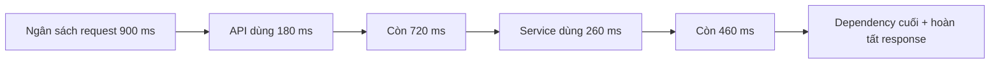
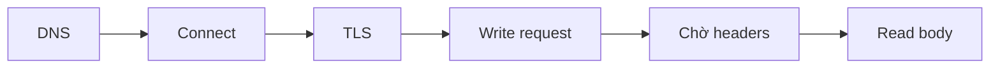
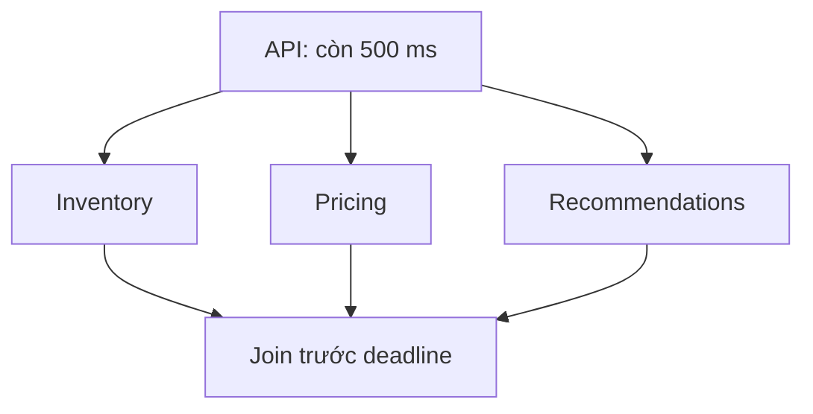

# Timeout: Vận hành với ngân sách thời gian rõ ràng

## Tóm tắt

**Tình huống minh họa (giả định):** Một dịch vụ gợi ý sản phẩm phản hồi chậm, trong khi gateway sử dụng timeout chung 30 giây cho từng lần gọi. Dù request của người dùng chỉ còn ít thời gian hữu ích, gateway vẫn chờ dependency và giữ tài nguyên lâu hơn cần thiết. Không thể suy ra số worker bị chặn hoặc thời gian sập hệ thống từ một giá trị timeout: cần đo loại timeout, số request đồng thời và độ trễ thực tế.

**Timeout** giới hạn thời gian chờ của một thao tác hoặc giai đoạn; **deadline** là thời điểm muộn nhất mà toàn bộ yêu cầu còn giá trị đối với bên gọi. Hết thời gian chờ không chứng minh máy chủ chưa thực hiện thao tác.

> 💡 **Quy tắc bỏ túi:** Trước khi đặt timeout, xác định nó đo phần nào của request (connect, response, đọc body hay toàn bộ call). Với thao tác có deadline toàn trình, truyền thời gian còn lại tới từng dependency, giữ phần dự phòng cho xử lý cục bộ và dừng công việc khi không còn hữu ích. Deadline là quyết định về mục tiêu/request, không phải giá trị mặc định của từng socket.

- **Phạm vi timeout khác với deadline:** Timeout giới hạn thời gian đợi một phase hoặc thao tác; deadline là hạn chót của request end-to-end. SLO độ trễ dùng để thiết kế chính sách nhưng không nhất thiết bằng deadline cứng cho từng request.
- **Bóc tách từng giai đoạn kết nối:** Cần biết chính xác giới hạn nào áp dụng cho phân giải **DNS**, kết nối TCP (**connect**), bắt tay **TLS**, **ghi** yêu cầu, chờ **header** phản hồi và **đọc** nội dung. Không phải thư viện nào cũng cung cấp giới hạn riêng cho từng giai đoạn. Connect timeout không chặn được việc đọc nội dung bị treo; một số read timeout bắt đầu lại khi có thêm dữ liệu.
- **Truyền ngân sách còn lại:** Khi đã thiết lập deadline end-to-end, mỗi lần gọi tiếp theo phải dùng thời gian còn lại sau khi trừ thời gian đã tiêu thụ và phần dự phòng cục bộ. Không tự cấp một timeout mới dài hơn toàn bộ khoảng còn giá trị.
- **Hủy bỏ (cancellation) không phải hoàn tác (rollback):** Khi hết hạn chót, phát tín hiệu **hủy** ngay lập tức để downstream ngừng lãng phí tài nguyên tính toán, nhưng luôn ghi nhớ rằng việc hủy không tự động hoàn tác các thay đổi đã ghi bền vững vào cơ sở dữ liệu.
- **Lỗi cần tránh:** Cấp lại timeout đầy đủ ở từng hop làm tổng thời gian chờ vượt deadline của request; mức ảnh hưởng lên pool và người dùng phụ thuộc mức tải và cách runtime giữ tài nguyên.



<TermBox term="Timeout">
**Timeout** là thời gian chờ tối đa cho một thao tác hoặc giai đoạn cụ thể. Nó bảo vệ tài nguyên có hạn; không chứng minh thao tác trên máy chủ bên kia chưa xảy ra.
</TermBox>

<TermBox term="Deadline">
**Deadline** là thời điểm muộn nhất mà thao tác từ đầu đến cuối còn có giá trị. Mỗi lần gọi dịch vụ tiếp theo chỉ được dùng phần ngân sách còn lại.
</TermBox>

## Biết chính xác timeout đang bao phủ gì

Một tùy chọn tên `timeout` chưa đủ rõ nếu không biết phạm vi. Thư viện phía client có thể giới hạn riêng cho phân giải DNS, kết nối TCP (**connect**), bắt tay TLS, **ghi** yêu cầu, chờ header phản hồi, **đọc** nội dung, thời gian nhàn rỗi hoặc toàn bộ lượt gọi.



Connect timeout không chặn được body read bị treo. Socket read timeout có thể được reset mỗi khi có byte mới nên không nhất thiết giới hạn tổng thời gian request. Hãy kiểm tra hành vi thực tế trong tài liệu của thư viện, thay vì chỉ dựa vào tên tùy chọn.

## Truyền ngân sách còn lại, không cấp lại timeout ban đầu

Nếu incoming request chỉ còn 600 ms, downstream call không được nhận lại 2 giây mới. Hãy **truyền deadline** hoặc thời gian còn lại và giữ đủ thời gian để local work cùng response cuối hoàn tất.

gRPC hỗ trợ **truyền deadline** theo mô hình này: khi tính năng được bật trong bản triển khai, thời gian đã trôi qua sẽ được trừ trước khi truyền thời gian chờ còn lại cho RPC tiếp theo. Go và Java thường tự truyền deadline; với C++ cần bật tính năng này rõ ràng. gRPC không tự đặt deadline mặc định cho client, nên bên gọi phải chủ động đặt trước.

Một cách reasoning đơn giản:

```text
remaining = request_deadline - now
child_budget = remaining - local_finish_reserve
```

Nếu `child_budget <= 0`, fail sớm thay vì khởi động call không còn cơ hội tạo kết quả hữu ích.

## Chọn giá trị từ objective và phân phối độ trễ

Timeout là production policy, không phải hằng số copy từ blog. Bắt đầu từ caller SLO và **phân phối độ trễ** của downstream, bao gồm network overhead. Chọn tỷ lệ **timeout giả** chấp nhận được, rồi xem percentile tương ứng và thêm padding có lý do.

AWS mô tả trực tiếp cách này: với service-to-service call, chọn xác suất false timeout chấp nhận được rồi quan sát latency percentile tương ứng. Cần cẩn thận khi p50 gần tail latency hoặc khi độ biến thiên Internet chi phối.

Timeout quá cao:

- thread, socket, memory và request slot bị giữ lâu;
- dependency chậm mở rộng blast radius;
- user latency vượt khỏi khoảng còn giá trị.

Timeout quá thấp:

- tail latency khỏe mạnh bị biến thành lỗi giả;
- caller tạo thêm work không cần thiết;
- dao động latency nhỏ có thể thành timeout spike toàn hệ thống.

## Fan-out vẫn chỉ có một deadline

Chạy song song không tạo thêm thời gian. Trong một **fan-out**, nhiều dependency song song vẫn cạnh tranh trong cùng deadline end-to-end.



Phân loại branch theo mức cần thiết. Dependency bắt buộc có thể làm request fail khi hết budget; dependency tùy chọn có thể bị cancel và bỏ khỏi response. Đừng để một branch không quan trọng giữ sống cả request sau khi thời gian hữu ích đã hết.

## Cancellation dừng lãng phí; cancellation không rollback

Khi hết deadline, hãy **phát tín hiệu hủy (cancellation)** để các dịch vụ tiếp theo dừng việc không còn hữu ích, nếu chúng hỗ trợ. Đây là cơ chế phối hợp: gRPC không tự ngắt mọi xử lý đang chạy; mã xử lý phía máy chủ phải quan sát tín hiệu hủy. Việc hủy RPC con cũng có thể khác nhau giữa các ngôn ngữ. **Hủy không phải rollback**: thay đổi đã xảy ra trước đó không tự được hoàn tác.

Vì vậy một timed-out write vẫn có thể cần idempotency hoặc reconciliation. Việc xử lý timeout kiểm soát việc chờ và tiêu thụ tài nguyên; Partial Failure giải thích sự không chắc chắn về side effect.

## Quan sát theo giai đoạn timeout và dependency

Một metric `timeout_count` chung là quá yếu. Ít nhất cần ghi:

- dependency/route và **giai đoạn timeout**: DNS, connect, TLS, write, headers, read, overall;
- configured budget và thời gian còn lại lúc dispatch;
- **độ trễ dependency** theo percentile và caller SLO;
- deadline-exceeded cùng cancellation count;
- saturation như active requests, connection pool, queue hoặc worker.

Trace cần giúp operator phân biệt “không connect được” với “server mất 480 ms nhưng caller chỉ còn 120 ms”.

<TermBox term="Timeout giả">
**Timeout giả** xảy ra khi call có thể hoàn tất thành công nhưng threshold của caller hết trước. Một lượng false timeout có thể là chủ ý; tỷ lệ chấp nhận được phải được đo và công khai.
</TermBox>

## Tình huống minh họa (giả định)

**Ví dụ thời gian tự xây dựng, không phải số đo sự cố thực tế:** Một API có mục tiêu độ trễ 1 giây và chọn riêng deadline hữu ích 1 giây cho yêu cầu này. Nó lần lượt gọi dịch vụ A rồi dịch vụ B. Tuy vậy, mỗi lượt gọi lại khởi tạo timeout toàn trình 1 giây, còn dịch vụ B có thêm timeout kết nối/đọc 1 giây. Khi latency tăng, upstream request tiếp tục chờ lâu hơn budget có ích trong khi worker và socket vẫn bị giữ.

**Hậu quả:** tail latency vượt SLO, worker và connection pool bão hòa, rồi traffic khỏe mạnh cũng timeout phía sau các request chậm.

**Nguyên nhân cốt lõi:** mỗi hop tự cấp lại full timeout thay vì chia sẻ deadline còn lại, còn telemetry chỉ báo lỗi `timeout` chung chung mà không chỉ rõ stage hay dependency.

**Cách khắc phục chuẩn:** định nghĩa một deadline end-to-end, trừ elapsed time và local reserve trước mỗi call, cấu hình connect với request/read scope có chủ ý, cancel work đã hết giá trị, và tune threshold từ latency percentile cùng target timeout giả rõ ràng. Emit timeout stage, configured budget, remaining budget, dependency latency và saturation metrics.

## Tự kiểm tra

Một request còn 300 ms. Service của bạn cần khoảng 60 ms sau khi dependency trả về để serialize và gửi response. Có nên gọi downstream với timeout mới 500 ms không?

<details>
<summary>Xem giải thích chi tiết</summary>

Không. Downstream budget tối đa chỉ khoảng 240 ms, thường còn thấp hơn sau safety margin. Timeout 500 ms mới sẽ phá parent deadline và giữ tài nguyên cho work mà kết quả đã hết giá trị. Hãy truyền thời gian còn lại và giữ reserve cho local completion.

</details>

## Checklist vận hành timeout

- [ ] **Scope:** Mỗi timeout đang bao phủ DNS, connect, TLS, write, headers, read, idle hay overall duration?
- [ ] **Deadline:** Có một deadline end-to-end gắn với usefulness/SLO của caller không?
- [ ] **Propagation:** Mỗi downstream hop chỉ nhận thời gian còn lại không?
- [ ] **Reserve:** Có giữ thời gian cho local completion và response delivery không?
- [ ] **Tuning:** Giá trị có dựa trên phân phối độ trễ đo được và target timeout giả rõ ràng không?
- [ ] **Fan-out:** Các branch song song có chia sẻ cùng deadline và phân loại required/optional work không?
- [ ] **Cancellation:** Work hết hạn có được cancel mà không giả định rollback không?
- [ ] **Observability:** Operator có xác định được stage, dependency, budget, latency và saturation không?

## Quy tắc cho agent

Khi được yêu cầu “set timeout”, trước tiên phải khôi phục SLO/deadline end-to-end, exact timeout scope của client, phân phối độ trễ downstream, tỷ lệ timeout giả chấp nhận được, cách truyền remaining budget, local reserve, cancellation behavior và telemetry. Đừng chọn con số trước khi biết nó đang giới hạn điều gì.


Bài này tập trung vào **phạm vi timeout, ngân sách thời gian và cancellation**. Sau khi biết request còn bao nhiêu thời gian, đọc [Retries and Backoff](/vi/docs/distributed-systems/retries-and-backoff) để quyết định có nên dùng ngân sách đó cho lần thử mới hay không. Bài [Timeouts, Retries & Backoff](/vi/docs/distributed-systems/timeouts-retries-and-backoff) là phần tổng hợp lý luận về partial failure, không thay thế checklist vận hành riêng.

## Khái niệm liên quan

- **Partial Failure** — giải thích vì sao timeout không chứng minh write thất bại.
- **Retries and Backoff** — quyết định một attempt khác có nên dùng phần budget còn lại hay không.
- **SLIs and SLOs** — cung cấp latency objective mà timeout policy phải phục vụ.
- **Logs, Metrics & Traces** — cho thấy stage timeout và resource pressure.

## Nguồn

Tài liệu chính thức được kiểm tra ngày **2026-11-18**:

- [gRPC — Deadlines](https://grpc.io/docs/guides/deadlines/)
- [gRPC — Core concepts: deadlines, termination, cancellation](https://grpc.io/docs/what-is-grpc/core-concepts/)
- [gRPC — Cancellation](https://grpc.io/docs/guides/cancellation/) — xử lý hủy có phối hợp và khác biệt giữa các ngôn ngữ
- [Amazon Builders' Library — Timeouts, retries, and backoff with jitter](https://aws.amazon.com/builders-library/timeouts-retries-and-backoff-with-jitter/)
- [AWS Well-Architected — Set client timeouts](https://docs.aws.amazon.com/wellarchitected/latest/framework/rel_mitigate_interaction_failure_client_timeouts.html)
