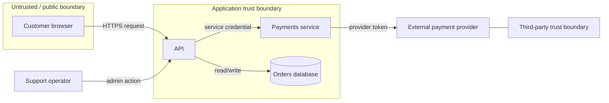
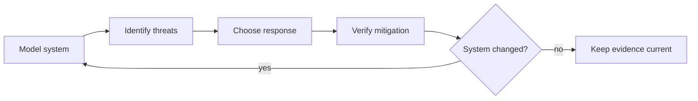
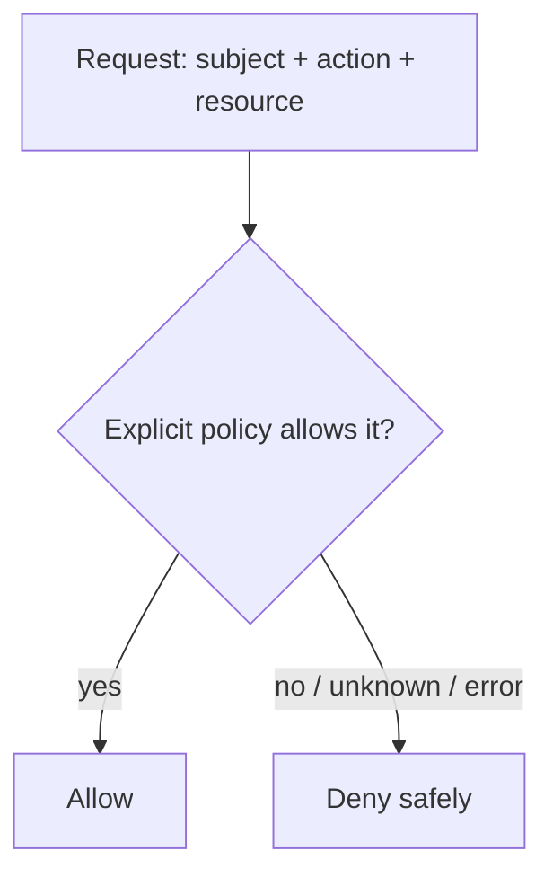
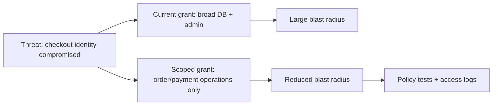

# Threat Modeling & Least Privilege: Thiết kế bảo mật trước khi sự cố xảy ra

## Tóm tắt

**Tình huống giả định (không phải sự cố đã được xác minh):** Kẻ tấn công đánh cắp phiên đăng nhập của một nhân viên hỗ trợ rồi truy vấn hồ sơ khách hàng thuộc tổ chức khác. API chỉ kiểm tra người gọi đã đăng nhập, không kiểm tra họ có quyền đọc hồ sơ cụ thể đó hay không. Ở một ranh giới khác, dịch vụ backend được cấp quyền quá rộng đối với S3 và các API quản trị RDS. Nếu danh tính của **chính dịch vụ đó** bị xâm phạm, phạm vi thiệt hại sẽ lớn hơn. Việc mất phiên đăng nhập của nhân viên không tự động làm lộ thông tin xác thực IAM của dịch vụ. Các chi tiết trong ví dụ chỉ để minh họa, không phải số liệu sự cố thực tế.

Cần phân biệt: `rds:*` cho phép các thao tác quản trị RDS trong phạm vi chính sách IAM, **không tự động cấp quyền đọc bảng bằng SQL**. Khi dùng xác thực IAM để kết nối cơ sở dữ liệu, hành động liên quan là `rds-db:connect`; người dùng và quyền trong cơ sở dữ liệu vẫn là một lớp kiểm soát riêng. Bài học chính là kiểm tra quyền trên từng đối tượng và thu hẹp quyền của từng dịch vụ.

> 💡 **Quy tắc bỏ túi:** **Authentication chứng thực bạn là ai; Authorization và Least Privilege quyết định bạn được phép chạm vào cái gì.** Bảo mật sẽ sụp đổ khi sự tin tưởng được trao quyền mù quáng. Luôn áp dụng deny-by-default (chặn theo mặc định), thẩm định quyền hạn trên mỗi request đối với từng tài nguyên cụ thể, và giới hạn phạm vi thiệt hại (blast radius) để một token bị lộ không mặc nhiên có quyền truy cập các hệ thống không liên quan.

- **Vòng lặp mô hình hóa hiểm họa:** Trả lời có hệ thống bốn câu hỏi: Chúng ta đang xây gì, điều gì có thể sai, chúng ta sẽ phòng ngừa thế nào, và đã làm đủ tốt chưa?
- **Ranh giới tin cậy rõ ràng:** Vẽ rõ luồng dữ liệu xuyên qua các ranh giới mạng, ranh giới tiến trình và ranh giới tổ chức nơi mức độ tin cậy thay đổi; không bao giờ coi lưu lượng nội bộ là mặc định an toàn.
- **Chặn theo mặc định (Deny-by-default) & kiểm tra liên tục:** Không cấp quyền trừ khi có quy tắc cho phép rõ ràng, và kiểm tra authorization trên **mỗi request** thay vì chỉ kiểm tra một lần lúc đăng nhập.
- **Thu hẹp bán kính thiệt hại (Blast Radius):** Áp dụng quyền tối thiểu cho cả con người lẫn dịch vụ tự động (microservice, hàm serverless, CI runner) bằng cách giới hạn phạm vi IAM role và quyền database vào đúng công việc cần làm.
- **Sai lầm nguy hiểm:** Coi VPN hoặc tường lửa là đủ để thay thế kiểm tra quyền trên từng tài nguyên, hoặc cấp quyền IAM ký tự đại diện quá rộng chỉ để thuận tiện. Mức độ rủi ro phụ thuộc vào **quyền thực tế có hiệu lực**, bao gồm tài nguyên, điều kiện và các chính sách liên quan.

## Mô hình hóa hệ thống trước khi liệt kê mối đe dọa

Bắt đầu từ kiến trúc thực tế thay vì một danh sách lỗ hổng chung chung.



Ít nhất hãy ghi lại:

- các tác nhân bên ngoài và những tác vụ chạy trong hệ thống;
- các tiến trình và dịch vụ;
- những kho lưu trữ dữ liệu nhạy cảm;
- các luồng dữ liệu và giao thức;
- danh tính và thông tin xác thực đi qua từng ranh giới;
- những giả định về sự tin cậy có thể gây nguy hiểm nếu không đúng.

<TermBox term="Trust boundary">
**Ranh giới tin cậy (trust boundary)** là điểm mà dữ liệu hoặc quyền điều khiển đi từ môi trường có mức độ tin cậy hoặc thẩm quyền này sang môi trường khác.

**Vì sao quan trọng:** mỗi lần vượt ranh giới cần xác định ai đã được xác thực, quyền nào được cấp, dữ liệu đầu vào nào được chấp nhận, thông tin xác thực nào có thể bị lộ và hậu quả nếu phía bên kia bị xâm phạm.
</TermBox>

## Mô hình hóa mối đe dọa theo bốn câu hỏi

Mô hình đe dọa không nhất thiết phức tạp, nhưng cần trả lời rõ bốn câu hỏi:

1. **Chúng ta đang xây dựng gì?** Mô tả hệ thống, luồng dữ liệu, tài sản, danh tính và ranh giới tin cậy.
2. **Điều gì có thể xảy ra sai?** Tìm các cách lạm dụng và mối đe dọa đối với từng luồng. STRIDE là công cụ gợi ý, không phải mục tiêu cuối.
3. **Chúng ta sẽ xử lý thế nào?** Với từng mối đe dọa đáng kể, chọn loại bỏ, giảm thiểu bằng biện pháp có người phụ trách và cách kiểm chứng, chuyển giao một phần tác động, hoặc chấp nhận rủi ro còn lại một cách có ghi nhận. Chuyển giao không đồng nghĩa rủi ro kỹ thuật biến mất.
4. **Các biện pháp đã đủ tốt chưa?** Rà soát mô hình, kiểm chứng biện pháp và cập nhật khi hệ thống thay đổi.



Mô hình cần được cập nhật khi thêm kho dữ liệu, nhà cung cấp danh tính, hàng đợi, chức năng quản trị, tích hợp bên thứ ba, quyền truy cập hoặc ranh giới mạng. Rà soát một lần trước khi phát hành không phải là cơ chế bảo vệ lâu dài.

## Biến mối đe dọa thành biện pháp có thể kiểm chứng

Xét flow `GET /accounts/:accountId`.

Một biện pháp quá yếu là:

> User phải được authenticated.

Quy tắc đó chưa trả lời được Alice có được phép đọc tài khoản của Bob hay không.

Biện pháp tốt hơn cần:

- authenticate caller;
- authorize action `read` trên **đúng account cụ thể**;
- deny nếu không có policy grant action đó;
- thực hiện check server-side trên mỗi request;
- log authorization failures mà không leak sensitive data;
- test cả allowed và denied object relationships.

Mô hình đe dọa chỉ thực sự hữu ích khi các biện pháp của nó có thể triển khai và kiểm chứng.

## Xác thực danh tính không đồng nghĩa với cấp quyền

<TermBox term="Authorization">
**Authentication** xác lập một entity là ai hoặc là gì. **Authorization** kiểm tra entity đó có được thực hiện action yêu cầu trên resource cụ thể hay không.

**Tại sao quan trọng:** session, JWT, mTLS identity hay API key hợp lệ không đồng nghĩa với quyền đọc mọi record hoặc gọi mọi administrative operation.
</TermBox>

Một secure request path có dạng:

```text
identity = authenticate(request.credentials)
policy_attributes = load_minimal_policy_attributes(request.resource_id)
if policy_attributes == missing or !authorize(identity, action, policy_attributes):
    return deny
return perform_authorized_action(action, request.resource_id)
```

Quyết định cấp quyền phải được thực thi ở phía máy chủ, không thể vượt qua bằng cách sửa mã phía client. Trước khi kiểm tra quyền, chỉ tải những thuộc tính đáng tin cậy tối thiểu cần thiết để đánh giá chính sách; không trả dữ liệu được bảo vệ về cho người gọi. Với thao tác ghi hoặc tác vụ bất đồng bộ, cần kiểm soát quyền tại ranh giới thực thi tương ứng. `perform_authorized_action` chỉ là hàm minh họa: khi triển khai thật, thao tác phải giới hạn dữ liệu theo tenant tại thời điểm thực thi và xử lý trường hợp quyền thay đổi. Ẩn nút trên giao diện không phải là biện pháp kiểm soát truy cập.

### Kiểm tra permission trên mỗi request

Đừng giả định page load trước đó, gateway check hay authenticated session sẽ cấp quyền mãi mãi. Authorization-relevant attributes có thể đổi và alternate route có thể chạm cùng resource.

Kiểm tra cả hai chiều:

- **horizontal authorization**: một user thường có truy cập resource của user khác được không?
- **vertical authorization**: identity ít quyền hơn có gọi admin/elevated action được không?

Với API, authorize cả operation lẫn object. UUID khó đoán không thay thế ownership hoặc policy check.

## Từ chối theo mặc định để tránh lỗ hổng chính sách

Với **deny-by-default**, request không match explicit allow rule sẽ bị deny.



Điều này quan trọng vì policy set thay đổi theo thời gian. Nếu route/resource mới xuất hiện nhưng chưa có matching policy, failure mode an toàn hơn là deny thay vì vô tình expose.

Đừng ngầm fallback thành allow khi:

- authorization dependency timeout;
- thiếu attribute;
- policy không parse được;
- action mới chưa có rule.

Availability có thể có đánh đổi riêng, nhưng authorization error không được vô tình trở thành privilege grant.

## Quyền tối thiểu: giới hạn phạm vi và thời hạn

NIST mô tả least privilege là giới hạn user hoặc process ở đúng minimum authorizations và resources cần để hoàn thành chức năng.

Áp dụng nguyên tắc đó không chỉ cho human role:

| Identity | Grant quá rộng | Scope tốt hơn |
| --- | --- | --- |
| checkout service | admin trên mọi database | chỉ read/write order/payment table hoặc API cần thiết |
| image worker | toàn quyền cloud storage | read input prefix, write output prefix |
| CI job | production owner token vĩnh viễn | short-lived deployment identity cho một environment |
| support user | global customer export | explicit support actions cho assigned cases |

Ba dimension hữu ích:

- **resource scope** — object, tenant, project, table, bucket hay namespace nào?
- **action scope** — read, write, delete, deploy, impersonate, rotate hay administer?
- **time scope** — permanent, session-bound, task-bound hay just-in-time?

<TermBox term="Blast radius">
**Blast radius** là lượng capability hoặc data của hệ thống có thể bị ảnh hưởng khi một identity, credential, component hoặc boundary bị compromise.

**Tại sao quan trọng:** least privilege không đảm bảo compromise sẽ không xảy ra. Nó giới hạn compromise có thể đi xa đến đâu sau đó.
</TermBox>

## Mô hình đe dọa và quyền tối thiểu bổ trợ cho nhau

Threat model có thể chỉ ra: “Nếu checkout service bị compromise, database credential của nó có thể sửa customer profiles và IAM records.”

Mitigation không chỉ là “bảo vệ credential tốt hơn”. Hãy hỏi checkout có thực sự cần các privilege đó không.



Security control mạnh hơn khi threat model giải thích **vì sao** privilege tồn tại và automated checks chứng minh scope đó chưa rộng ra ngoài ý muốn.

## Tình huống vận hành giả định: nhân viên hỗ trợ đọc dữ liệu tenant khác

**Đây là ví dụ được dựng để giảng giải, không phải một vụ xâm nhập đã được công bố.** Cổng hỗ trợ khách hàng bổ sung endpoint `GET /customers/:customerId`. Giao diện chỉ hiển thị khách hàng được phân công cho nhân viên đã đăng nhập; endpoint cũng yêu cầu phiên đăng nhập hợp lệ.

**Hậu quả:** một agent đã authenticated đổi `customerId` trong URL và lấy được customer record của tenant khác. Service credential phía sau cũng có thể query billing tables không liên quan, khiến impact lớn hơn nếu service bị compromise.

**Nguyên nhân cốt lõi:** thiết kế coi authentication là đủ cho authorization. API không kiểm tra relationship của caller với customer cụ thể trên mỗi request. Threat model có ghi “employee access” nhưng không model customer-object boundary hay horizontal privilege escalation. Service identity cũng có database privileges rộng hơn feature cần.

**Cách khắc phục chuẩn:** model support-agent → API → customer-record data flow và trust boundaries; authorize mỗi request cho đúng customer/action; deny-by-default nếu không có relationship hay policy grant access; test cross-tenant denial; và giới hạn service identity ở đúng data/operation portal cần. Các control này vừa sửa access-control bug tức thời vừa giảm blast radius của compromise sau này.

## Tự kiểm tra

Một background export job dùng long-lived cloud credential có read access tới mọi production bucket vì “sau này có thể cần thêm dataset”. Hiện tại job chỉ đọc một reports prefix. Threat model có threat “credential bị đánh cắp” nhưng mitigation chỉ ghi “rotate secrets thường xuyên”.

Thiếu điều gì?

<details>
<summary>Xem giải thích chi tiết</summary>

Mitigation chưa xử lý blast radius. Áp dụng least privilege ngay: cấp task-appropriate identity chỉ đọc required reports scope, ưu tiên short-lived credentials. Sau đó biến boundary đó thành testable bằng IAM policy checks hoặc integration tests. Rotation có thể giảm credential lifetime, nhưng không biện minh cho resource/action permissions không cần thiết.

Threat model cũng phải được cập nhật khi job thực sự cần dataset khác thay vì pre-grant quyền cho nhu cầu giả định trong tương lai.

</details>

## Checklist trước khi vận hành

- [ ] Model actors, services, data stores, data flows, identities và mọi trust boundary quan trọng.
- [ ] Xác định threats trên kiến trúc thật, không chỉ dựa vào generic vulnerability categories.
- [ ] Biến threat quan trọng thành actionable mitigation có owner và verification evidence.
- [ ] Giữ authentication và authorization là hai decision riêng.
- [ ] Enforce authorization server-side cho đúng action/resource trên mỗi request.
- [ ] Dùng deny-by-default khi không có explicit allow rule hoặc không thể đưa ra authorization decision an toàn.
- [ ] Test horizontal và vertical privilege boundaries, gồm cross-tenant/object access.
- [ ] Scope privilege của human, service, CI và automation theo resource, action và lifetime.
- [ ] Xóa unused privileges thay vì tích lũy chúng cho nhu cầu tương lai chưa chắc có.
- [ ] Review lại threat model khi trust boundaries, integrations, data flows hoặc privileges thay đổi.

## Quy tắc cho agent

Khi thay đổi identity, route, data flow, integration hoặc privileged action, hãy xác định trust boundary và authorization decision bị ảnh hưởng trước khi code. Ưu tiên **deny-by-default**, verify permissions trên mỗi request cho đúng action/resource, giảm privilege scope và lifetime, và thêm machine-checkable evidence cho mitigation. Đừng coi authentication thành bằng chứng authorization.

## Tài liệu tham khảo

- OWASP Cheat Sheet Series, **Threat Modeling**: https://cheatsheetseries.owasp.org/cheatsheets/Threat_Modeling_Cheat_Sheet.html
- OWASP Cheat Sheet Series, **Authorization**: https://cheatsheetseries.owasp.org/cheatsheets/Authorization_Cheat_Sheet.html
- NIST CSRC Glossary, **Least Privilege**: https://csrc.nist.gov/glossary/term/least_privilege
- AWS RDS, **IAM policy for database access** (phân biệt `rds-db:connect` và `rds:`): https://docs.aws.amazon.com/AmazonRDS/latest/UserGuide/UsingWithRDS.IAMDBAuth.IAMPolicy.html
- AWS RDS, **RDS IAM management actions**: https://docs.aws.amazon.com/AmazonRDS/latest/UserGuide/security_iam_service-with-iam.html
- OWASP Top 10:2025, **A01 Broken Access Control**: https://owasp.org/Top10/2025/A01_2025-Broken_Access_Control/
