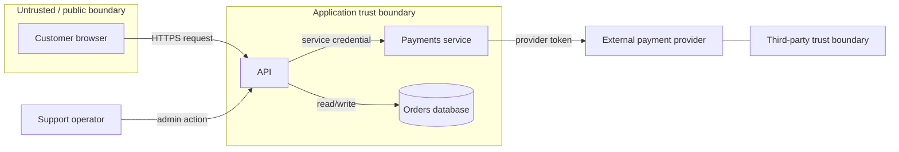
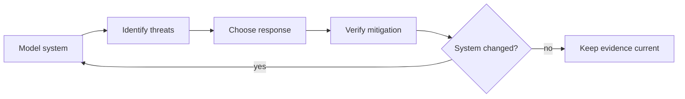
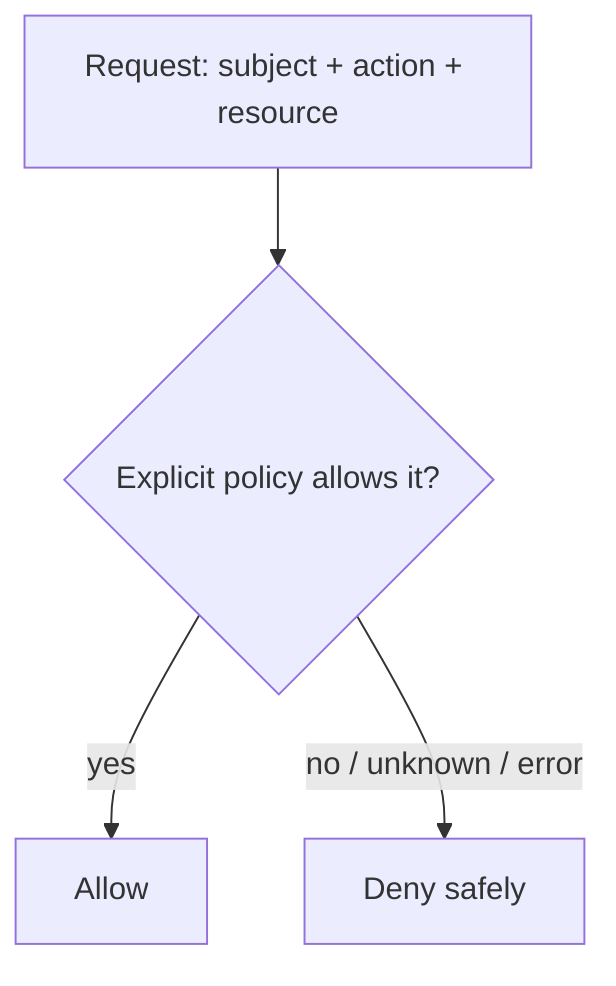
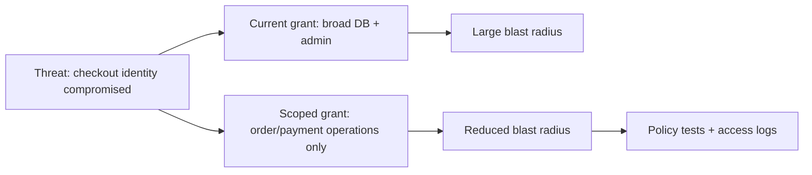

# Mô hình đe dọa và quyền tối thiểu: Thiết kế bảo mật từ sớm

## Tóm tắt

**Tình huống giả định (không phải sự cố đã được xác minh):** Kẻ tấn công đánh cắp phiên đăng nhập của một nhân viên hỗ trợ rồi truy vấn hồ sơ khách hàng thuộc tổ chức khác. API chỉ kiểm tra người gọi đã đăng nhập, không kiểm tra họ có quyền đọc hồ sơ cụ thể đó hay không. Ở một ranh giới khác, dịch vụ backend được cấp quyền quá rộng đối với S3 và các API quản trị RDS. Nếu danh tính của **chính dịch vụ đó** bị xâm phạm, phạm vi thiệt hại sẽ lớn hơn. Việc mất phiên đăng nhập của nhân viên không tự động làm lộ thông tin xác thực IAM của dịch vụ. Ví dụ này không viện dẫn số liệu tấn công, thời gian hay thiệt hại của một sự cố thực tế.

Cần phân biệt: `rds:*` cho phép các thao tác quản trị RDS trong phạm vi chính sách IAM, **không tự động cấp quyền đọc bảng bằng SQL**. Khi tính năng xác thực IAM được hỗ trợ và bật trên phiên bản, khu vực và loại cơ sở dữ liệu tương ứng, hành động kết nối là `rds-db:connect`. Tài khoản cơ sở dữ liệu và các quyền đã cấp cho tài khoản đó vẫn là lớp kiểm soát riêng. Bài học chính là kiểm tra quyền trên từng đối tượng và thu hẹp quyền của từng dịch vụ.

> 💡 **Quy tắc bỏ túi:** **Xác thực (authentication) xác định danh tính; phân quyền (authorization) và quyền tối thiểu (least privilege) quyết định hành động nào được phép trên tài nguyên nào.** Không coi việc đã đăng nhập hoặc nằm trong mạng nội bộ là quyền truy cập mặc định. Hãy áp dụng deny-by-default (từ chối theo mặc định), kiểm tra quyền trên **mỗi request** đối với tài nguyên cụ thể và giới hạn phạm vi ảnh hưởng (blast radius) nếu danh tính bị xâm phạm.

- **Vòng lặp mô hình hóa đe dọa:** Trả lời bốn câu hỏi: Hệ thống đang làm gì, có thể gặp rủi ro gì, chọn cách xử lý nào và đã kiểm chứng biện pháp đủ tốt chưa?
- **Ranh giới tin cậy rõ ràng:** Vẽ rõ luồng dữ liệu xuyên qua các ranh giới mạng, ranh giới tiến trình và ranh giới tổ chức nơi mức độ tin cậy thay đổi; không bao giờ coi lưu lượng nội bộ là mặc định an toàn.
- **Từ chối theo mặc định (deny-by-default):** Chỉ cho phép khi chính sách quy định rõ, và đánh giá quyền truy cập trên **mỗi request** thay vì suy ra quyền từ lần đăng nhập trước.
- **Giảm phạm vi ảnh hưởng (blast radius):** Cấp quyền tối thiểu cho cả người dùng và danh tính máy (dịch vụ, tác vụ không máy chủ, CI), giới hạn đúng tài nguyên, hành động và thời gian cần thiết.
- **Sai lầm nguy hiểm:** Coi VPN hoặc tường lửa là đủ để thay thế kiểm tra quyền trên từng tài nguyên, hoặc cấp quyền IAM ký tự đại diện quá rộng chỉ để thuận tiện. Mức độ rủi ro phụ thuộc vào **quyền thực tế có hiệu lực**, bao gồm tài nguyên, điều kiện và các chính sách liên quan.

## Mô tả hệ thống trước khi liệt kê mối đe dọa

Bắt đầu từ kiến trúc thực tế thay vì một danh sách lỗ hổng chung chung.



Ít nhất hãy ghi lại:

- các tác nhân bên ngoài và những tác vụ chạy trong hệ thống;
- các tiến trình và dịch vụ;
- những kho lưu trữ dữ liệu nhạy cảm;
- các luồng dữ liệu và giao thức;
- danh tính và thông tin xác thực đi qua từng ranh giới;
- những giả định về sự tin cậy có thể gây nguy hiểm nếu không đúng.

<TermBox term="Trust boundary">
**Ranh giới tin cậy (trust boundary)** là điểm mà dữ liệu hoặc quyền điều khiển đi từ môi trường có mức độ tin cậy hoặc thẩm quyền này sang môi trường khác.

**Vì sao quan trọng:** mỗi lần vượt ranh giới cần xác định ai đã được xác thực, quyền nào được cấp, dữ liệu đầu vào nào được chấp nhận, thông tin xác thực nào có thể bị lộ và hậu quả nếu phía bên kia bị xâm phạm.
</TermBox>

## Mô hình hóa mối đe dọa theo bốn câu hỏi

Mô hình đe dọa không nhất thiết phức tạp, nhưng cần trả lời rõ bốn câu hỏi:

1. **Chúng ta đang xây dựng gì?** Mô tả hệ thống, luồng dữ liệu, tài sản, danh tính và ranh giới tin cậy.
2. **Điều gì có thể xảy ra sai?** Tìm các cách lạm dụng và mối đe dọa đối với từng luồng. STRIDE là công cụ gợi ý, không phải mục tiêu cuối.
3. **Chúng ta sẽ xử lý thế nào?** Với từng mối đe dọa đáng kể, chọn loại bỏ, giảm thiểu bằng biện pháp có người phụ trách và cách kiểm chứng, chuyển giao một phần tác động, hoặc chấp nhận rủi ro còn lại một cách có ghi nhận. Chuyển giao không đồng nghĩa rủi ro kỹ thuật biến mất.
4. **Các biện pháp đã đủ tốt chưa?** Rà soát mô hình, kiểm chứng biện pháp và cập nhật khi hệ thống thay đổi.



Mô hình cần được cập nhật khi thêm kho dữ liệu, nhà cung cấp danh tính, hàng đợi, chức năng quản trị, tích hợp bên thứ ba, quyền truy cập hoặc ranh giới mạng. Rà soát một lần trước khi phát hành không phải là cơ chế bảo vệ lâu dài.

## Chuyển từng mối đe dọa thành biện pháp có thể kiểm chứng

Xét luồng truy cập `GET /accounts/:accountId`.

Một biện pháp quá yếu là:

> Người dùng phải được xác thực.

Quy tắc đó chưa trả lời được Alice có được phép đọc tài khoản của Bob hay không.

Biện pháp tốt hơn cần:

- xác thực danh tính bên gọi;
- kiểm tra quyền `read` trên **đúng tài khoản được yêu cầu**;
- từ chối nếu không có quy tắc cho phép;
- thực hiện kiểm tra ở máy chủ trên mỗi yêu cầu;
- ghi nhận lỗi phân quyền mà không tiết lộ dữ liệu nhạy cảm;
- kiểm thử cả đối tượng được phép và không được phép truy cập.

Mô hình đe dọa chỉ thực sự hữu ích khi các biện pháp của nó có thể triển khai và kiểm chứng.

## Xác thực danh tính không đồng nghĩa với cấp quyền

<TermBox term="Authorization">
**Xác thực (authentication)** xác định danh tính một người hoặc hệ thống. **Phân quyền (authorization)** quyết định danh tính đó có được làm một hành động trên tài nguyên cụ thể hay không.

**Vì sao quan trọng:** phiên đăng nhập, JWT, danh tính mTLS hay API key hợp lệ không tự cấp quyền đọc mọi bản ghi hoặc thực hiện mọi thao tác quản trị.
</TermBox>

Một secure request path có dạng:

```text
identity = authenticate(request.credentials)
policy_attributes = load_minimal_policy_attributes(request.resource_id)
if policy_attributes == missing or !authorize(identity, action, policy_attributes):
    return deny
return perform_authorized_action(action, request.resource_id)
```

Quyết định cấp quyền phải được thực thi tại máy chủ, không thể vượt qua chỉ bằng cách sửa mã ứng dụng phía người dùng. Trước khi kiểm tra quyền, chỉ tải những thuộc tính đáng tin cậy tối thiểu cần thiết để đánh giá chính sách; không trả dữ liệu được bảo vệ về cho người gọi. Với thao tác ghi và tác vụ bất đồng bộ, phải kiểm tra quyền ở chính ranh giới thực thi. Hàm minh họa `perform_authorized_action` cần được triển khai sao cho truy vấn hoặc giao dịch chỉ tác động đến dữ liệu thuộc khách hàng được phép; một lần kiểm tra trước không đủ nếu quyền sở hữu hoặc chính sách có thể thay đổi trước khi đọc/ghi. Ẩn nút trên giao diện không phải là biện pháp kiểm soát truy cập.

### Kiểm tra quyền trên mỗi request

Đừng mặc định lần tải trang, kiểm tra ở cổng API hoặc phiên đăng nhập trước đó cấp quyền vĩnh viễn. Thuộc tính dùng để phân quyền có thể thay đổi, và các đường truy cập khác vẫn có thể chạm tới cùng tài nguyên.

Kiểm tra cả hai chiều:

- **phân quyền ngang:** một người dùng có truy cập được tài nguyên của người dùng khác không?
- **phân quyền dọc:** danh tính ít quyền có thực hiện được thao tác quản trị hoặc nâng quyền không?

Với API, kiểm tra cả hành động lẫn đối tượng. Mã UUID khó đoán không thay thế kiểm tra quyền sở hữu hoặc chính sách. Nếu quyền sở hữu có thể thay đổi, điều kiện lọc dữ liệu và cập nhật phải nhất quán với quyết định phân quyền.

## Từ chối theo mặc định để tránh lỗ hổng chính sách

Theo nguyên tắc **deny-by-default**, yêu cầu không khớp với một quy tắc cho phép rõ ràng sẽ bị từ chối.



Điều này quan trọng vì chính sách thay đổi theo thời gian. Nếu xuất hiện đường dẫn hay tài nguyên mới nhưng chưa có quy tắc tương ứng, việc từ chối mặc định an toàn hơn vô tình cho phép truy cập.

Đừng tự chuyển sang cho phép khi:

- hệ thống kiểm tra quyền hết thời gian chờ;
- thiếu thuộc tính cần cho quyết định;
- không đọc được chính sách;
- thao tác mới chưa có quy tắc.

Có thể cần đánh đổi về độ sẵn sàng, nhưng lỗi kiểm tra quyền không được vô tình tạo quyền truy cập mới.

## Quyền tối thiểu: giới hạn phạm vi và thời hạn

NIST định nghĩa quyền tối thiểu là chỉ cấp cho người dùng hoặc tiến trình những quyền và tài nguyên tối thiểu để hoàn thành nhiệm vụ.

Áp dụng nguyên tắc này cho cả người dùng và danh tính dịch vụ:

| Identity | Grant quá rộng | Scope tốt hơn |
| --- | --- | --- |
| checkout service | admin trên mọi database | chỉ read/write order/payment table hoặc API cần thiết |
| image worker | toàn quyền cloud storage | read input prefix, write output prefix |
| CI job | production owner token vĩnh viễn | short-lived deployment identity cho một environment |
| support user | global customer export | explicit support actions cho assigned cases |

Ba chiều cần xem xét:

- **resource scope** — object, tenant, project, table, bucket hay namespace nào?
- **action scope** — read, write, delete, deploy, impersonate, rotate hay administer?
- **time scope** — permanent, session-bound, task-bound hay just-in-time?

<TermBox term="Blast radius">
**Phạm vi ảnh hưởng (blast radius)** là số lượng tài nguyên, dữ liệu và khả năng của hệ thống có thể bị tác động khi một danh tính, thông tin xác thực hoặc thành phần bị xâm phạm.

**Vì sao quan trọng:** quyền tối thiểu không ngăn được mọi sự cố xâm phạm, nhưng giới hạn những gì kẻ tấn công có thể tiếp cận tiếp theo.
</TermBox>

## Mô hình đe dọa và quyền tối thiểu bổ trợ cho nhau

Threat model có thể chỉ ra: “Nếu checkout service bị compromise, database credential của nó có thể sửa customer profiles và IAM records.”

Không chỉ tìm cách bảo vệ thông tin xác thực tốt hơn; hãy hỏi dịch vụ thanh toán có thực sự cần những quyền đó không.



Biện pháp bảo vệ đáng tin cậy hơn khi mô hình đe dọa giải thích **vì sao** quyền được cấp, còn kiểm thử tự động xác nhận phạm vi quyền không bị mở rộng ngoài ý muốn.

## Tình huống vận hành giả định: nhân viên hỗ trợ đọc dữ liệu tenant khác

**Đây là ví dụ được dựng để giảng giải, không phải một vụ xâm nhập đã được công bố.** Cổng hỗ trợ khách hàng bổ sung endpoint `GET /customers/:customerId`. Giao diện chỉ hiển thị khách hàng được phân công cho nhân viên đã đăng nhập; endpoint cũng yêu cầu phiên đăng nhập hợp lệ.

**Hậu quả (giả định):** nhân viên đã đăng nhập có thể đổi `customerId` trong URL và đọc hồ sơ thuộc khách hàng khác nếu API chỉ kiểm tra đăng nhập. Một danh tính dịch vụ **bị xâm phạm riêng biệt** còn có thể truy vấn bảng thanh toán không liên quan nếu quyền cơ sở dữ liệu cho phép; việc mất phiên nhân viên không tự làm lộ thông tin xác thực của dịch vụ.

**Nguyên nhân cốt lõi:** thiết kế coi authentication là đủ cho authorization. API không kiểm tra relationship của caller với customer cụ thể trên mỗi request. Threat model có ghi “employee access” nhưng không model customer-object boundary hay horizontal privilege escalation. Service identity cũng có database privileges rộng hơn feature cần.

**Cách khắc phục chuẩn:** mô hình hóa ranh giới tin cậy từ nhân viên hỗ trợ qua API tới hồ sơ khách hàng; kiểm tra quyền theo từng khách hàng và hành động, đồng thời thực thi phạm vi đó khi truy vấn hoặc ghi dữ liệu. Từ chối theo mặc định nếu thiếu quan hệ hoặc quy tắc cấp quyền; kiểm thử cả truy cập khác khách hàng và trường hợp quyền thay đổi; chỉ cấp danh tính dịch vụ những quyền thực sự cần cho cổng hỗ trợ.

## Tự kiểm tra

Một background export job dùng long-lived cloud credential có read access tới mọi production bucket vì “sau này có thể cần thêm dataset”. Hiện tại job chỉ đọc một reports prefix. Threat model có threat “credential bị đánh cắp” nhưng mitigation chỉ ghi “rotate secrets thường xuyên”.

Thiếu điều gì?

<details>
<summary>Xem giải thích chi tiết</summary>

Mitigation chưa xử lý blast radius. Áp dụng least privilege ngay: cấp task-appropriate identity chỉ đọc required reports scope, ưu tiên short-lived credentials. Sau đó biến boundary đó thành testable bằng IAM policy checks hoặc integration tests. Rotation có thể giảm credential lifetime, nhưng không biện minh cho resource/action permissions không cần thiết.

Threat model cũng phải được cập nhật khi job thực sự cần dataset khác thay vì pre-grant quyền cho nhu cầu giả định trong tương lai.

</details>

## Danh sách kiểm tra trước khi vận hành

- [ ] Mô tả tác nhân, dịch vụ, kho dữ liệu, luồng dữ liệu, danh tính và mọi ranh giới tin cậy quan trọng.
- [ ] Xác định mối đe dọa trên kiến trúc thực tế, không chỉ dựa vào danh mục lỗ hổng chung.
- [ ] Chuyển mối đe dọa quan trọng thành biện pháp có người phụ trách và bằng chứng kiểm chứng.
- [ ] Tách quyết định xác thực danh tính khỏi quyết định cấp quyền.
- [ ] Thực thi phân quyền tại máy chủ đối với đúng hành động và tài nguyên trên mỗi request.
- [ ] Áp dụng deny-by-default khi không có quy tắc cho phép hoặc chưa thể đưa ra quyết định phân quyền an toàn.
- [ ] Kiểm thử quyền ngang và dọc, kể cả truy cập đối tượng thuộc khách hàng khác.
- [ ] Giới hạn quyền của người dùng, dịch vụ, CI và công cụ tự động theo tài nguyên, hành động và thời hạn.
- [ ] Thu hồi quyền không dùng thay vì giữ lại cho nhu cầu tương lai chưa chắc xảy ra.
- [ ] Rà soát lại mô hình đe dọa khi ranh giới tin cậy, tích hợp, luồng dữ liệu hoặc quyền truy cập thay đổi.

## Quy tắc cho agent

Khi thay đổi danh tính, đường truy cập, luồng dữ liệu, tích hợp hoặc thao tác có quyền cao, hãy xác định ranh giới tin cậy và quyết định phân quyền bị ảnh hưởng trước khi viết mã. Ưu tiên **deny-by-default**, kiểm tra quyền trên mỗi request đối với hành động/tài nguyên cụ thể, giảm phạm vi/thời hạn quyền và bổ sung bằng chứng có thể kiểm thử tự động. Đừng coi đăng nhập thành công là đã được cấp mọi quyền.

## Tài liệu tham khảo

Đối chiếu các nguồn chính thức và giới hạn của nhà cung cấp vào **2026-11-18**:

- OWASP Cheat Sheet Series, **Threat Modeling**: https://cheatsheetseries.owasp.org/cheatsheets/Threat_Modeling_Cheat_Sheet.html
- OWASP Cheat Sheet Series, **Authorization**: https://cheatsheetseries.owasp.org/cheatsheets/Authorization_Cheat_Sheet.html
- NIST CSRC Glossary, **Least Privilege**: https://csrc.nist.gov/glossary/term/least_privilege
- AWS RDS, **Chính sách IAM để đăng nhập cơ sở dữ liệu** (phân biệt `rds-db:connect` và `rds:`): https://docs.aws.amazon.com/AmazonRDS/latest/UserGuide/UsingWithRDS.IAMDBAuth.IAMPolicy.html
- AWS RDS, **Các loại và phiên bản cơ sở dữ liệu hỗ trợ IAM DB auth**: https://docs.aws.amazon.com/AmazonRDS/latest/UserGuide/UsingWithRDS.IAMDBAuth.html
- AWS RDS, **RDS IAM management actions**: https://docs.aws.amazon.com/AmazonRDS/latest/UserGuide/security_iam_service-with-iam.html
- OWASP Top 10:2025, **A01 Broken Access Control**: https://owasp.org/Top10/2025/A01_2025-Broken_Access_Control/
